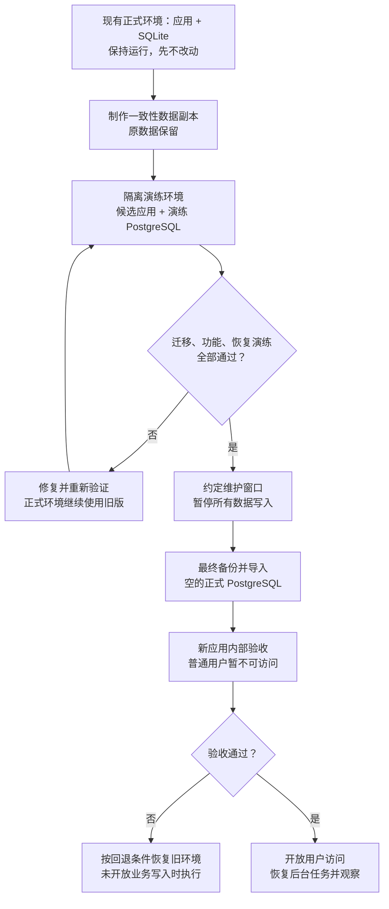

# GeoAgent 正式环境上线计划：SQLite 迁移 PostgreSQL

版本：历史上线计划，2026-10-27。

**本计划已执行并完成发布。实际配置、修复和验收结果见 [PostgreSQL 发布记录](SEALOS-POSTGRES-RELEASE-20261027.md)。下面保留执行前的计划与当时现状，不代表当前仍有未完成的 SQLite 改造。**

本轮只编写计划，不创建线上资源、不停止服务、不迁移正式数据、不发布镜像。下文步骤均为待执行事项，现状核查除外。

目标：保留现有线上数据，将 GeoAgent 的主业务库、采集账本、新问答和内部消息存储统一接入 PostgreSQL，再发布经过验证的版本。本次采用单应用实例、单数据库实例加独立备份；不引入多活、Patroni 或自动故障切换。首次切换安排维护窗口，不承诺无停机。

### 给客户讲解的流程图



图中“内部验收”通过限制网络入口或专用内部访问通道实现，只允许测试人员进入；不用假设 Nginx 能直接识别数据库中的用户身份。演练环境必须使用独立数据库和文件卷，不挂载正式数据卷读写，也不能把测试采集或 MCP 同步结果推送给真实客户。

## 1. 已核实的线上现状

2026-10-27 只读检查了广州 Sealos 的 `ns-d40dap45` 命名空间：

| 项目 | 检查结果 |
| --- | --- |
| 正式应用 | `deployment/geoagent`，1 个就绪副本 |
| 数据卷 | `geoagent-data`，挂载到 `/app/data` |
| PostgreSQL 配置 | 应用没有 `GEO_DATABASE_URL`，也没有通过 `envFrom` 注入；`geoagent-postgresql` Secret 不存在 |
| 研究库 | `research.sqlite3`，约 294 MiB；11 个快照、71,437 条 records、27,183 条翻译 |
| 采集账本 | `collection-runs/ledger.sqlite3`，约 6.7 MiB；17 次采集运行、10,492 条事件 |
| 全部数据文件 | 约 2.27 GiB，包括归档、输出和其他文件，不全是数据库 |
| 内部消息库 | 本次默认数据目录扫描未发现 `ht-macro/messages.sqlite3`；切换前还应检查自定义 `HT_MACRO_DB_PATH` |

这些是检查时的计数，正式迁移必须重新统计。集群里存在其他项目的 PostgreSQL 实例，不能据此认为 GeoAgent 已建库，也不能直接复用其他项目账号。

## 2. 为什么现在不能直接点正式发布

1. 新版本主业务数据库强制要求 PostgreSQL，线上尚未提供连接。
2. 内部消息模块仍依赖 SQLite。如果目标是全部统一 PostgreSQL，需要先补完该模块迁移。
3. 当前发布脚本在旧容器内执行 PostgreSQL 备份；旧线上使用 SQLite，这个步骤不能完成首次转换。
4. 常规发布只更新镜像和少量配置，不会创建 PostgreSQL、导入 SQLite，也不会自动注入 `GEO_DATABASE_URL`。
5. 本地数据库改动尚未提交成可追溯的候选版本，不能把远程现有标签当成包含这些修改的新镜像。
6. 发布验证尚未完成：此前构建和 193 项相关测试通过，只能证明部分路径。随后全量测试出现测试 PostgreSQL 连接失败及其他失败，原因尚未全部排查，不能宣称全量通过。迁移脚本新补入的 QA 三张表也须完成回归验证。

不能直接应用整份本地 `sealos.yaml` 来代替升级：线上已有 `proxy-tunnel` 等配置，应基于实际 Deployment 做最小补丁，保留代理、网关、认证、卷及资源设置。

## 3. 先准备数据库与候选版本

### 3.1 剩余代码工作

- 内部消息模块：把 `messages`、`message_tags`、`collection_runs` 和版本元数据接入 PostgreSQL，处理 SQL 方言、毫秒时间戳整数范围、去重并发和查询行为；新表与现有采集账本表要明确区分。
- 迁移工具：主库已经补入 QA 三张表的映射；还要加入旧内部消息库及自定义路径的导入，验证重复执行保护、失败回滚、内容校验和历史字段兼容。
- 检查 Web、独立 MCP、采集、翻译、内部消息定时任务的启动入口，确保全部得到相同的正式库配置。核对实际自动启动行为，提供演练/维护模式禁用任务的开关；只写“禁用任务”而代码没有入口控制不算完成。
- 检查备份和发布脚本；首次切换与后续常规发布分开。增加缺少数据库配置、迁移未验收时的发布阻断，避免新镜像误上旧 SQLite 环境。
- 排查全量测试失败，完成新版本完整测试和候选镜像构建，将改动提交为可追溯版本。

### 3.2 环境与发布产物

- 为 GeoAgent 新建独立 PostgreSQL 17 实例及持久化卷，或由管理员明确分配独立数据库和账号。仅开放内网访问，不开放公网 5432。
- 数据库空间应按迁移演练后的实际占用、WAL 和增长量确定；不要把 294 MiB SQLite 文件大小直接当作 PostgreSQL 所需空间。
- 连接串放到 Kubernetes Secret `geoagent-postgresql` 的 `GEO_DATABASE_URL` 字段，不写进 Git、发布日志或文档。
- 先打包候选镜像并固定 digest，完成全量自动化测试。准备只连接演练库的隔离验证环境，禁用自动采集、翻译及其他后台写入。
- 准备数据库备份位置，不能只把备份放在数据库自身的卷中。上线前做一次 `pg_dump` / `pg_restore` 恢复演练。

需要准备的资源如下，申请/创建前由环境管理员确认容量和权限：

| 资源 | 用途及隔离要求 |
| --- | --- |
| 正式 PostgreSQL + 数据卷 | GeoAgent 专用，内网访问，应用账号不使用集群管理员账号 |
| 演练 PostgreSQL | 独立库/实例和账号，绝不向正式库跑测试或清理 schema |
| 演练应用 + 文件卷 | 存放正式数据副本，入口仅测试人员可访问 |
| 卷外备份存储 | 保存数据库、附件/归档、配置及校验清单；有访问控制和明确保留期 |
| 维护/迁移任务 | 使用验证过的候选镜像运行，不同时启动 Web 和定时任务 |
| GitLab 发布记录 | 提交 SHA、镜像 digest、测试报告、旧版本信息、备份位置和验收结果 |

GitLab + Runner 顺序：代码提交 → 自动化测试 → 构建候选镜像 → 演练环境部署 → 数据迁移与验收 → 人工执行首次切换 → 上线观察。正式阶段应使用已验证的同一个镜像 digest，不重新构建。当前仓库没有现成的演练部署通道，需要先增加；不能把现有生产标签当作一键建库迁移工具。

### 3.3 数据对应关系

| 旧数据 | 新位置 | 迁移/保留方式 |
| --- | --- | --- |
| `research.sqlite3` | 正式 PostgreSQL 业务表 | 迁移脚本导入，逐表核对；包含历史快照、问答和 MCP Key 哈希 |
| `collection-runs/ledger.sqlite3` | PostgreSQL 采集账本表 | 保留运行 ID、事件、自增序列和复核记录 |
| `ht-macro/messages.sqlite3` 或自定义路径 | PostgreSQL 内部消息表 | 待补代码和脚本；不存在时不导入历史数据，但新功能仍需验证 |
| 采集输出、原始归档、附件、配置 JSON | 原应用数据卷/对应新卷 | 独立文件备份和保留，不自动写进 PostgreSQL |
| Kubernetes Secret、网关、代理配置 | 原集群配置及受控备份 | 保留并最小修改；备份不在文档中展示真实凭据 |

## 4. 用线上数据副本先演练

1. 对线上 SQLite 用 SQLite backup API 制作一致性副本；不要在运行中只复制 `.sqlite3` 文件而漏掉 WAL。各库独立制作的在线副本只用于演练，不代表跨库、跨文件的最终一致恢复点。
2. 备份现有数据目录、配置及部署信息，保存在原 PVC 之外的受控位置；记录文件清单、大小、校验和、镜像 digest。凭据备份单独加密保存。
3. 将研究库和账本副本放到演练目录，导入空的演练数据库或 schema：

   ```bash
   # 通过受控环境注入演练库 GEO_DATABASE_URL，不把真实密码写入命令历史。
   python -m scripts.migrate_sqlite_to_postgres --data-dir /migration/source-data --backup-dir /migration/pre-import-backup --source-stopped
   ```

4. 脚本会检查 SQLite 完整性、拒绝未知表和非空目标表，校验逐表行数与内容摘要，并修复自增序列。导入事务失败会回滚；初始化的空 schema/表可能保留。
5. 对照检查快照、当前工作快照、证据、翻译、历史简报/问答、MCP Key 状态、采集记录。运行页面和 MCP 验收，验证新问答记录可以写入和再次读取。
6. 内部消息库若存在，必须单独覆盖迁移和验收；现有脚本不能假装已经迁移它。配置 JSON、归档、采集输出也不会因导入 SQL 自动搬进 PostgreSQL，继续保留原数据卷。
7. 记录真实导入、校验、启动和回退耗时，再约定维护窗口。当前尚未进行真实线上数据迁移演练，不能承诺具体停机时长。

## 5. 正式切换：先停写，再迁移，再开放

1. 锁定本次发布，记录当前实际 Deployment 和旧镜像；暂停外部采集任务、翻译及所有会写入旧数据库的客户端/服务。
2. 进入维护窗口，关闭用户写入口，停止旧应用和所有后台写进程，确认没有 SQLite 写入者。停应用会中断访问，应提前通知使用者。
3. 由独立维护任务挂载原数据 PVC，制作最终离线备份并保存到卷外。处理 RWO 卷挂载约束，确认旧 Pod 已退出再启动维护任务。
4. 向新建的空正式库或空 schema 导入最终副本。不要在演练数据上重复导入，也不要为重跑脚本直接删除现有正式库。
5. 逐表校验通过后，注入 Secret 引用并更新到已验证的镜像 digest；保持外部入口维护状态，启动一个应用副本，后台任务暂不启动。
6. 通过内部入口执行登录、列表、历史数据、问答写入、MCP 增量接口检查。检查网关、代理和采集配置是否完整。验收写入须明确标为可丢弃测试数据，尚未放行真实用户或后台业务写入。
7. 验收通过才恢复用户入口及后台任务；观察错误率和数据库连接，并完成首次正式 PostgreSQL 备份。

## 6. 失败时怎样回退

- **尚未开放真实业务写入：** 停止新应用，恢复原 Deployment/镜像及保留的原 SQLite 数据卷，重新验收后开放旧版本。仅有已约定可丢弃的验收记录时可以这样回退；新 PostgreSQL 留作故障分析，不覆盖旧数据。
- **已经开放并产生新数据：** 不能只换回旧 SQLite 镜像，否则会丢失切换后的业务结果。优先修复 PostgreSQL 版本，或回退到兼容同一 PostgreSQL 数据结构的已验证镜像。
- **确需回到 SQLite：** 先停写，备份 PostgreSQL，制定并验证反向导出与补数据方案。当前没有可用的自动反向迁移脚本。

第一次数据库切换应单独执行上述流程。后续确认线上已使用 PostgreSQL 后，再采用 GitLab + Runner 的常规镜像发布和 PostgreSQL 备份流程。

## 7. 上线验收清单

以下各项都应记录执行人、时间和证据；有失败项就不开放普通用户入口。

- [ ] 所有业务存储已统一 PostgreSQL，运行时不再产生新的业务 SQLite 文件。
- [ ] 候选镜像构建与全量自动化测试通过，包含迁移、内部消息、新问答和 MCP 回归。
- [ ] 最终备份位于原数据卷之外，校验和一致；数据库与文件已完成实际恢复演练。
- [ ] 源、目标逐表数量及内容校验通过；工作快照、历史记录、MCP Key 状态一致。
- [ ] 新增、修改、读取和应用重启后的持久化正常，没有序列冲突、重复记录或历史数据缺失。
- [ ] 登录、列表、证据详情、问答、简报、采集监控、内部消息页面功能正常。
- [ ] MCP 全量初始读取、增量游标续读、重复读取、断点重试和鉴权通过；客户原有凭据仍能使用。不得因迁移擅自重置客户端游标。
- [ ] 以 10–15 名用户、5–10 并发做核心操作验证；提前约定各接口响应时间与错误率标准。长耗时模型调用单独衡量，避免混入普通列表接口指标。
- [ ] 容器重启能恢复服务，数据库连接无持续错误；数据库不可用时有明确故障表现，不能隐式落回 SQLite。
- [ ] 代理、境外数据访问、网关认证及独立服务连接配置完整；后台任务只启用一份，避免重复采集。
- [ ] 回退路径演练成功，维护窗口内预留足够的恢复和验收时间。

## 8. 执行节奏与责任

| 阶段 | 主责 | 完成条件 | 是否影响线上 |
| --- | --- | --- | --- |
| 代码补齐、测试修复 | 开发 | 全量测试与候选镜像通过 | 否 |
| 建库、存储、权限、演练通道 | 运维/环境管理员 | 连接验证、隔离验证、备份目标就绪 | 不切换现网；会新增资源 |
| 真实数据副本迁移与恢复演练 | 开发 + 运维 | 数据/功能/性能验收通过，有真实耗时记录 | 原服务继续运行；控制备份负载 |
| 维护窗口确认与通知 | 项目负责人 | 约定开始时间、最长不可用时间、回退截止点 | 尚不停止服务 |
| 最终备份、迁移、切换 | 运维执行，开发协助 | 第 7 节全部通过 | 有维护停机 |
| 开放与观察 | 运维 + 业务验收人员 | 稳定运行，完成首次备份和约定的后台任务周期 | 用户使用新版本 |

停机预算按演练实测计算：**最终停写及备份 + 导入 + 校验 + 应用启动及验收 + 回退预留**。超过约定的回退截止点仍未通过验收，就在业务写入开放前回退。首次真实演练前不填固定“几分钟完成”的承诺。

执行前需填写：维护窗口、执行人与验收人、数据库规格、备份位置和保留期、验收性能阈值、最大停机预算、回退截止点、业务开放时间及开放后的观察期限。均未确定前，本计划保持待执行状态。
