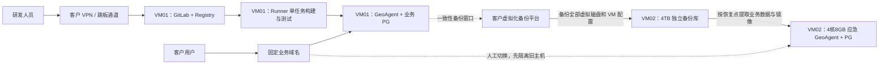

> 历史方案：现按测试和正式两台虚拟机、各装 GitLab/Runner 部署；请见 [客户双环境远程发布方案](客户测试与正式双环境远程发布方案.md)。

> 历史方案：当前已取消备份/应急机器，请使用 [单虚拟机部署与32GB内存分配方案](单虚拟机部署与32GB内存分配方案.md)。

# GeoAgent 双虚拟机集中部署与应急恢复方案

版本：2026-10-27，独立精简方案。适用：10–15 人使用、5–10 人正常并发。

原有[多节点生产部署方案](本地部署硬件与境外数据MCP同步方案.md)与[原讲解页](客户部署讲解页.html)保留。本文件提供另一种低成本选择，不替换原方案。

## 1. 客户确认的方向

- 一台主虚拟机集中运行 GitLab、内网镜像仓库、GitLab Runner、GeoAgent、业务 PostgreSQL 和入口代理。
- 第二台虚拟机 **4 核 / 8GB，配大容量硬盘**，平时保存独立备份，故障时人工恢复并启动精简业务。
- 不做应用多活、数据库主备复制，不部署 Patroni、etcd 或自动选主。
- 应急时只启动 GeoAgent、业务 PostgreSQL 和入口代理；GitLab、Registry、Runner、采集、翻译、定时同步及其他重任务保持停止。
- 正常环境故障时允许停机恢复；应急优先页面访问、登录和基础查询。4 核/8GB 不承诺原环境全部功能及原有并发能力，实际可用范围由交付演练确定。

本文件是待实施方案，不是当前项目已有能力。项目仍需完成 PostgreSQL 迁移、可恢复的数据目录整理、资源限制、应急启动配置和恢复脚本。本次只编写方案，未修改线上环境或部署应用。

## 2. 两台虚拟机配置

| 项目 | VM01：集中运行主机 | VM02：备份与应急主机 |
| --- | --- | --- |
| 数量 | 1 台 | 1 台 |
| CPU | **8 vCPU 起步建议** | **4 vCPU，按用户确认** |
| 内存 | **32GB 起步建议** | **8GB，按用户确认** |
| 系统盘 | 100GB SSD | 60GB SSD |
| 数据盘 | 300GB SSD 起，业务/仓库/构建目录分配独立配额，支持后续扩容 | 备份库 4TB 可用容量起；另留 300GB SSD 应急恢复工作盘 |
| 正常运行 | GitLab＋Registry、Runner、GeoAgent、业务 PG、入口代理 | 备份接收、校验、保留清理、轻量告警 |
| 故障时 | 停机或隔离，不再允许业务写入 | 只运行精简 GeoAgent＋业务 PG＋入口代理 |
| 发布能力 | 可构建、测试、受控发布 | 应急期间不提供构建发布 |

合计起步：**2 台虚拟机、12 vCPU、40GB 内存**；磁盘为系统盘合计 160GB、主机数据盘 300GB、备份容量 4TB、应急工作盘 300GB。虚拟磁盘扩容方便时可按实测增长调整，4TB 不是无限历史保留承诺。

为什么主机不是 4 核/8GB：此前 GitLab 与 Runner 各自 4 核/8GB 是分开部署的配额；现在还叠加业务应用和数据库，不能把所有组件的资源需求都压成一份 4 核/8GB。这里以单任务构建、低峰备份、构建与测试错峰控制峰值，最终规格由联机压测确认。

主机 300GB 数据盘共同存放业务 PG、GitLab、镜像、构建缓存与业务文件，不是全部划给 PostgreSQL。定期清理过期镜像、构建缓存和日志；保留至少 30% 空闲空间，不足时先清理或扩容。

两台 VM 应位于不同物理宿主机，备份不要落在与主机相同的唯一存储故障点。若同机、同一无冗余存储，只能防部分软件故障，不能承诺宿主或存储损坏时还能恢复。VPN、跳板机、DNS 和虚拟化管理平台复用客户已有能力，不计入两台 VM。

### 2.1 应急 8GB 怎么分

| 组件 | 内存控制起点 | 说明 |
| --- | --- | --- |
| GeoAgent 单实例 | 上限约 3GB | 单 Web 进程；限制请求并发、快照缓存和大文件导入 |
| 业务 PostgreSQL | 上限约 2GB | shared_buffers 可从 512MB 验证；降低连接数，限制查询工作内存 |
| 入口代理 | 约 256MB | TLS、认证入口与转发 |
| 系统、备份进程及余量 | 约 2.75GB | 应急期间暂停压缩、全盘校验和其他重任务 |

以上是资源限制起点，不是已经压测通过的参数。验收先做 1–3 人基本查询，再测试 5 人并发；不保证应急状态下 10 人同时做复杂分析。优先只读开放，确认数据一致性及写入功能后再由负责人开放必要写入。问答/简报等重功能按实测结果限流或暂停，本地模型不在预算内。

## 3. 拓扑：平时备份，故障时人工接管



这里两台都叫 VM，但 VM02 不是实时同步的数据库备库。整机备份是原环境的可恢复副本；必须恢复、验证并切入口，用户才可以访问。

“整台虚拟机备份”由客户虚拟化平台或兼容备份工具执行，备份文件写入 VM02 的独立存储库。虚拟机里装一个文件复制工具，不能自动取得宿主机上的完整虚拟磁盘与 VM 配置。交付前必须确认平台类型、导出能力、访问权限和恢复格式。

## 4. 单机内怎么部署与远程发布

### 4.1 组件与数据分开管理

| 组件 | 部署方式与要求 |
| --- | --- |
| GitLab + Registry | 固定已验收版本；仓库、配置、密钥、镜像存储持久化。GitLab 自带元数据库与 GeoAgent 业务 PG 分开管理 |
| Runner | 同 VM 注册构建测试与生产部署两个逻辑 Runner，串行执行；逻辑分开不等于机器级隔离 |
| 构建任务 | 单任务并发，建议限制到 2 vCPU/4GB；不向普通任务开放宿主 Docker socket、生产卷和生产密钥，采用经验证的非特权构建方式 |
| 发布任务 | 受保护发布流程调用固定部署脚本；生产权限仅授予受信代码和指定操作人。流水线定义修改也需审核 |
| GeoAgent | 单实例，容器镜像固定 digest；数据库、附件、快照及业务状态需可恢复；只保留可重建缓存于容器层 |
| 业务 PostgreSQL | 独立容器与持久卷，仅内部网络可访问；禁止与 GitLab 的内部数据库混用同一个业务库 |
| 入口代理 | 区分 GitLab 与业务域名，客户内网 DNS/TLS；DB 不对用户网段开放 |
| 备份与应急配置 | VM02 保存受保护的备份和已验收应急镜像、配置模板、启动/停止/检查脚本 |

示例目录（待部署脚本落地，不是现有可执行配置）：

```text
VM01
/srv/gitlab/             GitLab 配置、密钥和持久化数据
/srv/registry/           镜像存储（实际路径按安装方式确定）
/srv/geo/pgdata/         业务 PostgreSQL 数据
/srv/geo/files/          必需附件、快照、归档
/srv/geo/deploy/         镜像清单、Compose、配置和发布记录
/srv/runner-work/        可清理的构建与临时测试空间

VM02
/backup/vm01/           整机备份链，只用于保存历史
/backup/catalog/        恢复点、校验结果、镜像与版本清单
/recovery/geo/          独立 SSD 工作盘，解包/恢复/运行应急业务
/recovery/images/       应急镜像，不能只存在 VM01 的 Registry
```

备份库和应急运行目录必须分开，恢复不能直接覆盖唯一备份。生产凭据不能随普通源码提交；恢复所需密钥加密保存并验证可解密。

### 4.2 发布流程

1. 研发通过 VPN/跳板把代码推到 VM01 的 GitLab。
2. Runner 串行执行代码检查、构建与自动测试，生成唯一镜像指纹和报告。
3. 同 VM 启动临时测试容器与独立测试数据库/卷，只导入测试数据；不得连接生产库。测试结束回收资源。
4. 发布人查看测试结果，确认数据库变更向后兼容、上一稳定镜像可用，并检查最近备份成功。
5. 在低峰维护窗口停止后台写任务，按需要生成发布前一致性备份；停止旧应用，运行迁移并启动新版。
6. 自动验证登录、页面、基础查询和数据库读写；通过后开放访问。
7. 失败则回到兼容的上一应用镜像；数据库迁移优先向前修复。恢复旧数据库前须停写并核对期间新数据，不能随代码盲目回滚数据。

本版没有独立常驻测试环境，也没有双节点灰度或无停机发布。临时测试能验证功能，但与生产共用宿主、CPU 和磁盘；高峰时不运行构建、备份和大规模测试。遇到资源压力应排队延期，而不是抢占业务内存。

## 5. 备份：主线是整机备份，不是直接复制活跃目录

### 5.1 默认计划

| 备份内容 | 频率与保留建议 | 说明 |
| --- | --- | --- |
| 整台 VM01：VM 配置、系统盘和所有持久数据盘 | 每日一个可恢复点；工具支持时每周全量、每日增量；起步保留 14 天并保留覆盖最早恢复点的完整基础链 | 实际保留空间根据变化量计算，不能缺少增量依赖的基础备份 |
| 上线前恢复点 | 重大发布/数据库迁移前 | 成功完成并确认可读取后再开始变更 |
| 应急镜像与版本清单 | 每次批准上线时 | 同时保存应用镜像、PG 大版本/扩展、schema 版本、配置模板；无需等 GitLab 恢复才能启动业务 |
| 配置、证书、密钥、Runner 配置 | 变更时 | 备份加密，解密材料另行托管；应急时保持 Runner 停止 |
| 备份检查 | 每日，及每次任务结束 | 核对完成状态、时间、大小、依赖链、校验和与剩余容量，失败要告警 |
| 实际恢复演练 | 上线前一次，此后至少每季度与重大变更后 | 在 VM02 独立工作目录验证，记录停机、恢复和切换总时间 |

**默认每日整机恢复点的 RPO 最坏接近 24 小时；如果备份失败且没有处理，可能更长。**“全量”表示覆盖完整对象，不表示包含故障前一刻的新数据。

如果客户要求少丢数据，可另加业务 PG 物理基础备份＋连续 WAL 归档到 VM02，并同步版本化业务文件。该增强不需要主备数据库，但增加配置、监控和恢复链维护；未实施时不能承诺分钟级数据恢复点。GitLab 的仓库、元数据库和其他文件也不会因为业务 PG 有 WAL 就自动获得同样的恢复点。

### 5.2 如何保证备份能恢复

首选客户现有虚拟化备份工具的已验证一致性流程。若没有在线一致性能力，采用明确维护窗口：

1. 暂停 CI 发布、Runner、后台任务、外部同步和用户写入；停止 GitLab 等可能写数据的服务。
2. 干净停止业务数据库与虚拟机，取得全部相关虚拟磁盘的一致恢复点。
3. 平台支持冻结恢复点后异步导出时，可在恢复点形成后启动主机，再把独立备份导出到 VM02；若不支持，需等待冷备复制完成才能启动，停机可能较长。
4. 验证独立副本及完整备份链存在，成功后按规则清理平台临时快照。

虚拟化平台的“快照”通常仍依赖原存储，不等于 VM02 上已有独立备份。禁止对运行中的 PostgreSQL 目录简单 `cp/rsync` 后就认为备份一致。多磁盘还需跨卷一致性；在线方案必须经验证。[PostgreSQL 文件级备份说明](https://www.postgresql.org/docs/17/backup-file.html)

如另做 GitLab 应用级恢复包，需覆盖实际启用的 Registry 存储、仓库和数据库，并单独保护配置、TLS/SSH 密钥及 secrets。GitLab 恢复版本及 CE/EE 类型需要匹配；按锁定版本的官方说明演练。[GitLab 备份范围](https://docs.gitlab.com/administration/backup_restore/backup_gitlab/) / [恢复要求](https://docs.gitlab.com/administration/backup_restore/restore_gitlab/)

### 5.3 大硬盘如何计算

```text
备份库容量 >= 所有保留的完整基础链
             + 增量变化量 + 发布前恢复点 + 应急镜像/配置
             + 校验及整理临时空间 + 至少 30% 余量

应急工作盘 >= 恢复后的业务数据库 + 必需业务文件 + 镜像
               + 解包/WAL 回放临时空间 + 至少 30% 余量
```

4TB 与 300GB 是起步建议。应急 300GB 工作盘按业务数据库与必需文件合计约 100GB 以内估算；超过时必须扩盘再演练。备份工具若只支持整 VM 还原，还需能容纳原磁盘布局的目标空间；VM01 包含 100GB 系统盘和 300GB 数据盘，不能把 300GB 应急工作盘直接视为足以容纳整机磁盘布局。

## 6. VM01 故障后，VM02 如何应急启动

### 6.1 先准备好恢复方式

默认应急方式是 **从一致整机恢复点提取业务数据卷及必要文件，装入 VM02 预置的精简运行环境**。需要验证备份工具支持挂载/提取文件或虚拟磁盘，并保持文件权限、PG 版本、扩展和业务文件一致。

如果工具只能整机恢复：先恢复到隔离网络的临时 VM，或准备足够目标空间恢复原镜像；首次联网之前必须通过离线挂载/客体定制禁用 GitLab、Registry、Runner、采集和翻译的自动启动，再按应急配置启动 GeoAgent 与业务 PG。不能让原镜像的全部自动启动服务在 8GB 上一起运行。临时恢复所需宿主配额由客户平台预留，不偷偷计作已有第三台常驻服务器。

**交付前必须在客户实际平台上跑通其中一种方式。**如果既不能提取业务卷，也没有整机恢复空间/权限，只配一块大硬盘无法实现应急接管。

### 6.2 人工接管顺序

1. **确认故障并隔离 VM01。** 阻断旧业务入口与写入，防止主机突然恢复后两边同时运行任务和写库。
2. **选择最近成功恢复点。** 说明可能缺失的时间范围；确认业务镜像、PG 和 schema 对应。
3. **暂停 VM02 的重备份任务。** 保留原备份，只写入独立恢复工作目录；不得覆盖唯一历史副本。
4. **提取并恢复业务数据。** 从同一一致恢复点恢复 PG、必要附件/快照和配置；有经过验证的 WAL 增强时按完整链回放。
5. **启动应急模式。** 仅 GeoAgent、业务 PG 和入口；GitLab/Runner/采集/翻译/定时同步保持停止。后台自动恢复任务也必须禁用。
6. **内网小范围验证。** 核对登录、关键数据、文件与配置、已撤销账号/Key、镜像版本和页面。先只读；写入能力验证通过后按授权开放。
7. **人工切换固定业务入口。** DNS、客户网关或平台地址映射指向 VM02；处理 DNS 缓存、证书和旧连接。不在本方案中增加双网关或自动 VIP 切换。
8. **观察并告知功能限制。** 应急先保障少量用户访问，限流重请求。VM02 开放写入后立即建立新的恢复保护；不能再只保存旧 VM01 的备份。

应急备份仍落在 VM02 同一机器时，无法防 VM02 再次整体损坏；应尽快将新业务备份复制到修复后的 VM01、客户独立存储或批准的外置介质，或维持只读直到有可用保护路径。

### 6.3 恢复目标怎么承诺

| 指标 | 本版口径 |
| --- | --- |
| 自动切换 | 不提供，由负责人执行恢复与切入口 |
| 数据恢复点 RPO | 默认每日成功备份，最坏接近 24 小时；精确以实际最后可恢复点为准 |
| 应急访问 RTO | 在恢复工具、镜像、权限、工作盘就绪且业务数据约 100GB 内时，以 **1–4 小时**作为演练预算；未演练不能作为 SLA |
| 应急容量 | 4 核/8GB；先验收 1–3 人基础查询，再试 5 并发，重功能按实测限流 |
| 备份窗口 | 没有已验证在线一致性能力时需要维护停机；时间由实际备份工具与数据量确定 |

提前把某个恢复点解包到独立应急目录，并保持服务停止，通常可减少故障时的数据提取耗时，但仍然是旧恢复点，不是实时同步。不要承诺“有整机备份就能几分钟无损切换”。

### 6.4 原主机修好以后

如果 VM02 只读，核对数据和版本后可择期切回；如果 VM02 已经产生新写入，它就是当前业务数据来源，不能直接启动旧 VM01 的过期数据库接流量。

正确回切：安排维护窗口 → 停止 VM02 业务写入 → 对当前业务生成一致备份 → 恢复到隔离的 VM01 并核对 → 切回业务入口 → 只在 VM01 恢复后台任务 → 补做备份 → VM02 回到备份职责。GitLab/Runner 的恢复单独验证，不抢先自动执行遗留任务。

## 7. MCP 数据与离线部署

- 客户自行决定同步频率，主机正常时由单个持久任务执行；应急阶段默认停同步，浏览已恢复的数据。
- 当前 MCP 下载协议是“先比版本哈希，无变化不下载，有变化分块获取完整新快照”，不是逐条记录差异传输。
- 下载完成并校验后暂存入 PG，完整成功才切换可见版本和成功哈希；失败保留旧数据，不覆盖客户复核、问答、简报。
- 客户仍需批准 MCP HTTPS、代理或数据交换区路径。完全隔离没有交换通道就不能远程拉取。
- 安装包、基础镜像、Python/npm 依赖从内网仓库或批准摆渡取得；应急镜像提前存到 VM02，不能临时依赖故障主机的 Registry。
- 模型服务使用客户批准的可达服务；无模型连接时应急先恢复非 AI 页面，不在 8GB 上启动本地大模型。

## 8. 上线前验收清单

| 项目 | 通过标准 |
| --- | --- |
| 远程发布 | 推代码、自动测试、受控发布和回退可远程操作；明确同机资源限制 |
| PG 迁移 | SQLite 到 PG 的业务、权限、配置和历史记录核对通过 |
| 临时测试隔离 | 测试账号、数据库、文件目录和端口与生产分开；不能误连生产 |
| 正常容量 | 5/10 并发与一项后台任务组合测试；检查构建限额、OOM 和磁盘 I/O |
| 独立整机备份 | 能从 VM02 的备份链恢复，不依赖已损坏的 VM01 磁盘 |
| 4 核/8GB 应急启动 | 在 VM01 隔离情况下，只启动业务组件并验证页面、登录、基本查询；记录访问量、内存峰值和耗时 |
| 写入与回切 | 需要写入时验证事务与权限，演练从 VM02 回迁新增数据，避免双边写入 |
| 版本与密钥 | VM02 能找到匹配的镜像、PG 版本/扩展、配置、证书和解密材料 |
| 告警与交接 | 客户明确谁处理备份失败、谁启动恢复、谁批准入口切换；交付步骤、脚本及演练报告 |

## 9. 与保留的多节点方案如何选择

| 项目 | 本版：集中运行＋备份应急 | 原版：多节点方案 |
| --- | --- | --- |
| 常驻资源 | 2 VM，12 vCPU/40GB 起步；应急 4 核/8GB | 13 VM，54 vCPU/124GB 起步，可复用客户平台 |
| 应用与数据库 | 同机，单应用＋单业务 PG | 应用分散，业务 PG 一主一备 |
| 数据库故障接管 | 人工从备份恢复，无 Patroni | Patroni 管理，受同步策略和协调资格约束 |
| 测试 | 同机临时容器与独立测试数据 | 常驻独立测试环境 |
| 发布 | 维护窗口，可短暂停机 | 可做双节点灰度、受控放量 |
| 保护方式 | 接受停机及每日恢复点，保留人工应急访问 | 更强的故障隔离与服务连续性，资源和运维成本更高 |

选择本版意味着接受集中部署的共同故障、维护停机、较旧恢复点和应急功能收缩；并不意味着可以省略独立备份或恢复演练。
