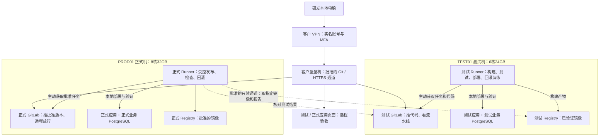
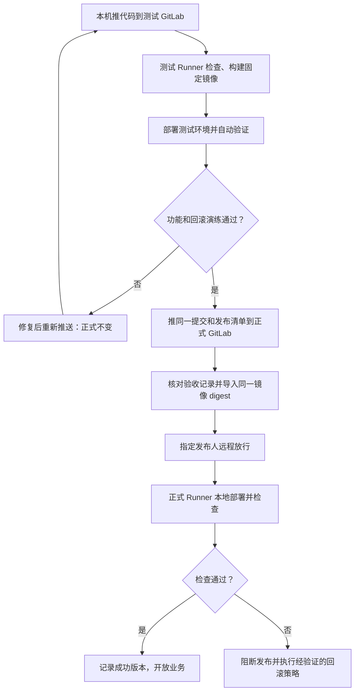
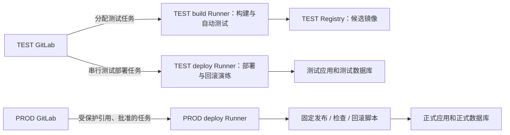
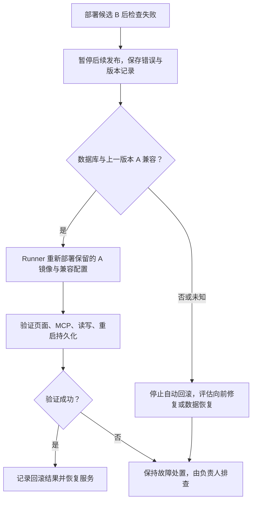

# GeoAgent 客户内网测试与正式部署方案

版本：2026-10-27，待实施与验收。适用：10–15 人使用、5–10 人正常并发。

## 1. 这次需要客户提供什么

**两台虚拟机、可用的远程接入通道、安装与发布权限。客户无需已有 GitLab：我们分别在测试机和正式机上安装 GitLab、镜像仓库和 Runner。**

研发人员在自己的电脑上操作，通过客户 VPN 和堡垒机批准的通道，把代码推送到客户内网 GitLab。测试侧自动构建、测试、部署；验收后，把相同提交推送到正式 GitLab，由正式流水线发布同一份已验证镜像。平时发布、验证和应用版本回滚无需人员到现场。

| 客户提供 | 我们完成 | 交付时怎样确认 |
| --- | --- | --- |
| 1 台正式 VM、1 台测试 VM | 安装 GitLab、Registry、Runner、GeoAgent、PostgreSQL、入口代理 | 两套 GitLab、应用地址均可访问，数据库和配置分别独立 |
| VPN 账号与接入说明 | 在研发电脑配置接入 | 外部网络上的研发电脑可登录 VPN |
| 堡垒机账号、目标资产授权、原生 Git/HTTPS 转发能力 | 配置本地代码推送、网页验证和受审计运维路径 | 不仅能打开终端，还能实际 git push、访问 GitLab 和测试页面 |
| 内网 IP、域名、证书及网络规则 | 配置域名入口、双环境流水线和镜像交付 | Runner 拉取任务、镜像、回传报告均成功 |
| 初装管理权限与长期受限发布权限 | 安装组件、配置部署/回滚脚本、完成验收 | VPN 断开后已触发任务仍在内网执行；再次接入能查看结果 |

**两套 GitLab 独立，不会因安装完成就自动同步代码和镜像。** 同一提交、测试报告和镜像指纹如何进入正式环境，必须按后文流程落地。堡垒机复用客户现有设备，不在上面安装 GitLab、业务数据库或构建工具。

## 2. 两台虚拟机与组件内存

| 配置 | PROD01 正式环境 | TEST01 测试环境 |
| --- | --- | --- |
| 数量 | 1 台 | 1 台 |
| CPU | **8 vCPU** | **6 vCPU** |
| 内存 | **32GB** | **24GB** |
| 系统盘 | **100GB SSD** | **70GB SSD** |
| 数据盘 | **300GB SSD** | **210GB SSD** |
| GitLab + Registry | 独立安装一套，保存正式代码和批准的镜像 | 独立安装一套，保存测试代码、构建镜像和报告 |
| Runner | 正式专用，只接受批准的发布、检查、回滚任务 | 构建/测试 Runner 与测试部署 Runner，逻辑隔离、资源串行控制 |
| 应用与数据库 | 正式 GeoAgent + 独立业务 PostgreSQL | 常驻测试 GeoAgent + 独立测试业务 PostgreSQL |
| GPU | **不需要配置** | **不需要配置** |

原方案没有 GPU。这里按 CPU、内存、存储约减少 30%：8×70%=5.6 核、32×70%=22.4GB，向上取整为 6 核/24GB，实际减少 25%；磁盘按 70% 配置。两台合计 14 vCPU、56GB 内存、170GB 系统盘和 510GB 数据盘。模型推理使用客户可达的外部或既有服务，本地 GPU 大模型不在预算内。

### 正式 32GB、测试 24GB 分给谁

| 组件 | 正式预算 | 测试预算 | 包含与使用方式 |
| --- | --- | --- | --- |
| GitLab 服务整体 | 8GB | 8GB | 包含自身 Web、后台作业、Gitaly、内部 PostgreSQL、Redis；这些内部组件不重复算。测试侧不机械缩小 GitLab 的基础预算 |
| Registry 镜像仓库 | 1GB | 1GB | 镜像接收、分发；镜像内容主要占磁盘。若与 GitLab 同一安装包，整组按 9GB 管理 |
| Runner 管理进程 | 0.5GB | 0.5GB | 正式发布 Runner；测试侧两个逻辑 Runner 的管理进程合计，不包含作业容器 |
| CI/CD 作业空间 | 4GB | 4GB | 测试侧构建、单元测试、一次性测试库分阶段共用；正式侧用于镜像导入、发布检查等，不重复构建候选版本。空闲可不占用 |
| GeoAgent 在线应用 | 4GB | 2GB | 含 Web/MCP 与缓存，按整组进程控制；测试侧只作功能验收，不能据此承诺正式吞吐量 |
| GeoAgent 业务 PostgreSQL | 4GB | 2GB | 独立于各自 GitLab 内部数据库；正式和测试账号、数据卷、连接串分开 |
| 采集/翻译/MCP 同步任务 | 2GB | 1GB | 限制并发，测试默认使用样例或脱敏副本，外部写入目标隔离 |
| Nginx/入口代理 | 0.5GB | 0.5GB | TLS、认证、转发，不包含客户现有 VPN/堡垒机 |
| 系统、Docker、基础日志 | 3GB | 2GB | 操作系统和运行时基础开销，日志轮转 |
| 未分配余量/缓存空间 | 5GB | 3GB | 保留给短时峰值与可回收缓存，不预先再启动一套环境 |
| **合计** | **32GB** | **24GB** | **预算，非固定占用；以锁定版本和真实数据压测确认** |

GitLab 的 8GB 属于受限环境的节省资源配置；官方当前单节点基线为 16GB。需按小团队调优并复测升级，不保证任意默认安装都满足 8GB。[GitLab 安装要求](https://docs.gitlab.com/install/requirements/)

数据库的 4GB/2GB 包含缓冲、连接、查询及维护开销，不应全部设置为 `shared_buffers`。查询工作内存会随查询节点、连接和并行进程放大。[PostgreSQL 内存说明](https://www.postgresql.org/docs/17/runtime-config-resource.html)

两台不承担主备关系。测试环境不是正式备机，不自动接管正式数据，也不配置额外备份机器。

## 3. 远程接入与双环境拓扑

两条路径要分别打通：

- **人的路径：** 研发电脑 → VPN → 堡垒机批准的 Git/HTTPS 通道 → 两套 GitLab、测试页面及授权的正式页面。代码推送和网页访问不依赖到现场。
- **机器的路径：** 各 Runner 主动连接对应 GitLab 获取任务，在所在环境执行部署并回传结果。任务触发后，不依赖研发电脑持续联网，也不要求 GitLab 通过堡垒机 SSH 到服务器。

GitLab/Runner 都部署在客户内网。生产数据库只允许所在业务网络的应用访问，不向研发电脑或测试机开放数据库端口。测试机不能直接 SSH 登录正式机；正式部署由正式 Runner 本地执行。

## 4. 客户网络与账号准备清单

### 必须先确认堡垒机能力

“VPN 能连上堡垒机”不等于“本地 Git 能推代码”。客户须提供可运行原生 Git 的审计接入方式，例如堡垒机客户端代理、经批准的 TCP 转发/SSH 隧道或 HTTPS 应用代理。仅有网页 SSH 终端、禁止文件传输和端口转发的模式，不满足本机直接推送与网页验收要求。

具体采用客户支持的方式，不私自绕过审计。若使用隧道，仍需正确处理内网域名、TLS 主机名和证书信任，不能靠关闭证书校验来连通。

### 请客户逐项提供

| 类别 | 需要提供的内容 | 可执行验收 |
| --- | --- | --- |
| VM | PROD01 8核32GB/100+300GB；TEST01 6核24GB/70+210GB，固定内网 IP，统一已验收 Linux 版本/架构 | 两机可经堡垒机受控登录，磁盘和内存核对一致 |
| VPN | 研发/运维实名账号、MFA、客户端、有效期、允许的源网段与路由 | 从公司或家中网络实际连接 |
| 堡垒机 | 两台资产授权、初装会话、Git/HTTPS 通道、文件传输策略、会话时长、审计要求 | 本地终端执行 git ls-remote / git push；本地浏览器打开测试站 |
| IP/DNS | 两机 IP；测试/正式 GitLab、Registry、GeoAgent 各自域名；内外接入解析方式 | VPN 和 Runner 内分别解析正确地址 |
| TLS | 与域名匹配的证书及内网 CA 分发方式 | 本机、Runner、容器运行时均正常验证 HTTPS |
| 初次安装 | 经堡垒机授予的限时 sudo/安装权限，允许安装 Docker/Compose、GitLab、Runner 与服务 | 完成安装、挂载数据卷、开机自启和重启验证 |
| 长期发布 | 专用服务账号，仅批准固定部署、状态检查、日志和回滚脚本所需权限 | Runner 能更新指定应用，普通构建任务没有生产权限 |
| 双 GitLab 身份 | 分别创建研发账号、部署管理账号、项目权限、受保护分支/标签、Runner 注册权限 | 测试可推送；正式只能由指定发布身份推进已批准版本 |
| 内网安装源 | OS/Python/npm/镜像源，或批准的离线包与版本校验流程 | 无公网时也能安装、构建、拉取固定镜像 |
| 跨环境镜像交付 | 下面两种方式中选定一种，并开通相关通道/账号 | 正式端能取得与测试通过版本完全一致的镜像 |
| 模型/MCP | 批准的服务地址、证书、访问凭据和代理/数据交换路径 | 测试访问只读源并隔离副作用，正式按业务授权调用 |
| 运维约定 | 维护窗口、发布与验收人、回滚负责人、告警接收人、账号续期负责人 | 演练发布及失败处置全流程 |

示例域名仅表示用途：`gitlab-test.<客户内网域>`、`registry-test.<客户内网域>`、`geo-test.<客户内网域>`，正式对应 `gitlab-prod`、`registry-prod`、`geo-prod`。由客户提供实际域名，不把示例当成现成地址。

### 防火墙/连通矩阵

| 来源 → 目标 | 协议/端口 | 目的与边界 |
| --- | --- | --- |
| 研发电脑 → 客户 VPN | 客户 VPN 指定端口 | 认证、接入批准网段 |
| VPN 用户 → 堡垒机 | 客户堡垒机指定入口端口 | 受审计访问；不是开放全部内网 |
| 堡垒机批准的通道 → 双 GitLab、双应用 | HTTPS 443 | Git over HTTPS、网页操作、查看流水线及验收 |
| 堡垒机 → 两台 VM 管理入口 | SSH 22 或客户指定端口 | 初装与授权排障；Git SSH 若另启用需单独列端口 |
| TEST Runner → TEST GitLab/Registry | HTTPS 443 | 拉代码/任务、推构建镜像、上传报告 |
| PROD Runner → PROD GitLab/Registry | HTTPS 443 | 拉正式任务、拉正式镜像、记录发布结果 |
| PROD 发布任务 → TEST GitLab/Registry | HTTPS 443，限定源/目标 | 方式 A：只读获取指定发布报告和镜像；测试机不需要登录正式机 |
| 各环境任务 → 批准的依赖源/MCP/模型 | 客户明确的 HTTPS 路径 | 安装依赖与业务访问，不开放任意出网 |
| GeoAgent → 本环境业务 PG | 容器内部网络 5432 | 不开放给研发电脑、另一环境或普通用户 |

同机服务也应以配置好的域名、证书和容器路由验证，不能只凭“在一台机器上”省略连通检查。Registry 如使用 5050 等其他端口，以最终安装配置替换矩阵中的 443。

## 5. 推代码后，CI/CD 怎样跑

| 步骤 | 谁执行、在哪里执行 | 结果 |
| --- | --- | --- |
| ① 推测试代码 | 研发电脑通过批准通道 git push 到 TEST GitLab 的测试分支 | TEST GitLab 按 rules 自动建立流水线 |
| ② 检查并构建 | TEST 构建 Runner，单个重作业 | 单元测试、迁移测试、构建候选镜像；失败停止，不触碰正式 |
| ③ 保存发布候选 | TEST Runner → TEST Registry/GitLab | 绑定代码 SHA、镜像 digest、测试报告和配置/数据库版本要求 |
| ④ 部署测试环境 | TEST 部署 Runner 调用测试部署脚本 | 用候选镜像更新常驻测试应用；测试数据/账号独立 |
| ⑤ 自动验证与人工验收 | TEST Runner + 研发/客户测试人员远程访问 geo-test | 登录、查询、问答、MCP、重启、数据库迁移及回滚演练通过 |
| ⑥ 推送正式候选 | 发布人在本机将已验收的同一 Git 提交及发布清单推至 PROD GitLab | 正式流水线自动启动检查；代码不是重新复制后生成另一个提交 |
| ⑦ 获取已验证镜像 | PROD 发布任务通过批准的交付通道取得镜像 | 核对 SHA/digest/报告后保存 PROD Registry；不能只相信可变 latest 标签 |
| ⑧ 放行正式部署 | 指定发布人在 PROD GitLab 执行批准的发布动作 | 前置检查通过、维护窗口就绪后进入部署；普通提交不自动替换正式服务 |
| ⑨ 更新正式应用 | PROD Runner 本地调用受限脚本 | 记录旧版本 → 检查恢复点和迁移兼容性 → 更新固定镜像 → 执行健康检查 |
| ⑩ 检查或回滚 | PROD Runner + 发布负责人 | 检查通过才完成发布；失败按兼容性条件回到上一稳定镜像并再次检查 |

正式部署“需要指定人放行”不等于“需要到现场”：所有放行、日志查看和验收都在远程浏览器完成。普通开发提交只部署测试，正式库和正式凭据不提供给普通测试作业。

### 两套 GitLab 之间交付什么

代码按原提交 SHA 推送；构建后生成的发布清单与验收报告作为制品传递，不为添加清单而修改已验收的代码提交。

每次正式发布至少携带：代码提交 SHA、测试通过的流水线/报告标识、不可变镜像 digest、版本清单、配置与数据库兼容要求，以及上一稳定版本。正式流水线要核对这些对应关系，不仅检查一个文本文件写着“通过”。

- **方式 A：客户允许受控跨环境读取。** 正式发布任务通过只读凭据访问测试 GitLab 的验收记录与测试 Registry 中的指定 digest；校验后把镜像复制到正式 Registry，保持 OCI manifest digest 一致，再发布。不开放测试机对正式机的 SSH/数据库访问。这是默认规划路径，需客户批准矩阵中的对应规则。
- **方式 B：禁止环境间直连。** 提供批准的制品交换区；或由本机发布工具经堡垒机下载验收报告与镜像包，上传到正式 GitLab/内网制品区，再触发正式流水线。使用适配大文件的限额、完整性校验与留痕；整个过程可由一条已验收的发布命令执行。需要本机在线直到转运结束，后续正式任务独立运行。

不能把整个镜像 tar 提交进 Git 仓库，也不能在正式环境重新构建另一份镜像后直接沿用测试镜像的验收结论。若客户禁止一切跨环境读取、文件转运和制品交换，则无法实现测试产物远程进入正式环境，必须先解决交付通道。

## 6. Runner 如何部署、测试和回滚

| Runner/任务 | 部署位置 | 允许执行 | 不应拥有 |
| --- | --- | --- | --- |
| TEST build | 测试机，注册到 TEST GitLab | 拉测试代码、构建、单元/迁移测试、写测试 Registry | 正式凭据、正式文件卷、正式 Docker socket |
| TEST deploy | 测试机，注册到 TEST GitLab | 固定脚本部署测试应用、自动验收、测试回滚 | 正式 SSH/数据库权限 |
| PROD deploy | 正式机，注册到 PROD GitLab | 已批准镜像导入、本地正式发布、健康检查、受控回滚 | 任意分支的构建任务、未经审核的临时脚本 |

三个是逻辑 Runner 身份，分别在两台 VM 上运行，不新增 Runner 虚拟机。TEST 的构建与部署串行协调，避免部署时另一个构建耗尽资源；PROD 同时只允许一项部署或回滚。

流水线用 tags 路由，生产 Runner 锁定项目、禁止无标签任务并只接受受保护引用。tags 本身不是权限控制；还需限制谁能推正式引用、修改 CI 定义、使用生产凭据，以及谁能修改 Runner 执行的部署脚本。生产只允许固定目标服务和受信发布代码，不将宿主 Docker socket 暴露给普通测试作业。[Runner 配置说明](https://docs.gitlab.com/ci/runners/configure_runners/)

发布与回滚共享同一部署锁（例如 `resource_group`），防止新旧流水线互相覆盖。更细的环境保护/部署审批能力要按客户选定 GitLab 版本与许可确认；基础方案不假设免费版包含全部高级审批功能。[GitLab 部署安全说明](https://docs.gitlab.com/ci/environments/deployment_safety/)

## 7. 回滚测试要验收哪些操作

### 测试环境：上线前先演练

1. 部署稳定版本 A 并记录数据基线、镜像指纹和配置版本。
2. 部署候选 B，验证功能与数据迁移；在可控测试场景制造健康检查失败。
3. 执行测试回滚任务，恢复 A 的已保留镜像及兼容配置。
4. 检查页面、MCP、数据库读写和重启后的数据；如果 B 的数据库变更不兼容 A，须调整迁移设计或验证恢复流程，不能伪造回滚成功。
5. 发布报告记录 B 的验收、回滚条件、实际耗时；恢复至要验收的候选版本后，才允许正式推进。

### 正式环境：应用回滚和数据恢复分开

正式任务在更新前记录上一镜像、配置和 schema 版本。若只改变兼容的应用代码，失败后可由受限回滚任务重新部署上一镜像并验证；是否自动执行由已验收的策略决定，不假定 GitLab 自带自动处理所有情况。[GitLab 回滚行为](https://docs.gitlab.com/ci/environments/deployments/)

如果数据库已做不兼容修改，或切换后已产生新业务数据，先停止进一步发布并由负责人处理，不能简单恢复旧库或旧 SQLite。数据库恢复涉及数据取舍，须有独立可用副本和明确恢复点。本轮只修改方案，部署/回滚脚本和保护条件仍须实施。

两台 VM 的角色是测试和正式，不是备份主备；测试库不能作为正式数据恢复副本。客户已有 NAS/对象存储/虚拟化备份可另接入，但本配置不新增备份机器，也不宣称现成存在备份能力。正式机整体故障时，其 GitLab 和 Registry 也会不可用，CI/CD 不能替代修复主机。

## 8. 初次交付与最终验收

| 阶段 | 客户配合 | 我们交付/验收标准 |
| --- | --- | --- |
| 接入联调 | VM、VPN、堡垒机账号、网络/域名/证书 | 在客户现场以外的研发电脑完成两套 GitLab 的 ls-remote 与一次可审计 push |
| 软件安装 | 初装权限、内网依赖/镜像来源 | 两套 GitLab/Registry、Runner 与应用/数据库启动并验证开机自启 |
| 测试自动化 | 测试账号、样例/脱敏数据、测试业务入口 | 本机推代码后自动构建、部署测试、生成报告；失败不影响正式 |
| 正式通道 | 指定发布身份、批准镜像转运方式 | 同一 SHA/digest 进入正式 GitLab/Registry；生产只处理批准版本 |
| 回滚演练 | 测试窗口、验收人员 | 测试 A→B→A 成功；明确数据库不兼容时的阻断条件 |
| 首次正式上线 | 确认维护窗口、正式数据和恢复点 | 数据迁移先演练；正式发布后验收。SQLite 首迁 PG 不使用普通镜像回滚处理 |
| 远程独立运行 | 账号有效期与后续支持联系人 | 已触发任务在断开研发 VPN 后继续执行，重新接入可查看结果并完成下一次发布 |
| 容量验收 | 接受测试资源较小的边界 | 正式按 5/10 并发测试；两机记录内存峰值、OOM、磁盘余量和任务耗时 |

交付物：两机安装清单、实际 IP/域名与网络矩阵、GitLab 项目/Runner 映射、受控流水线、部署与回滚脚本、版本清单、测试报告、操作手册及故障联系人。真实密码、密钥通过客户指定安全渠道交接，不写进本说明。

**完成定义：我们在自己的电脑上，经批准通道推一次代码，测试环境自动更新；验收后远程发布正式并执行受控回滚验证，全过程不需要人员到现场，也不需要每次让客户手工拷贝源码或敲部署命令。**

旧版多节点、单机和“主机＋备份机”配置说明已移除。客户配置统一以本版“测试＋正式、各自 GitLab/Runner、无额外备份机器”为准。资源、网络与流水线均为待实施方案，并不表示线上服务已经变更。
