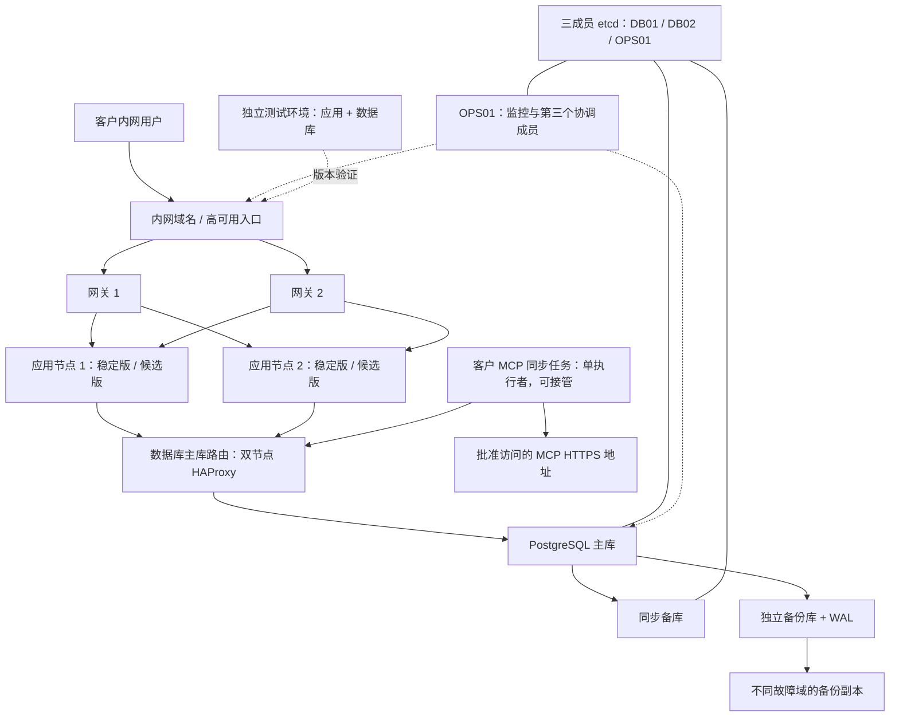

# GeoAgent 客户内网生产部署、灰度上线与数据恢复方案

版本：2026-10-27 修订版
适用规模：10–15 人使用、5–10 人并发。
范围：仅客户侧的生产环境、测试环境、发布、运维和 MCP 数据接收。
配套文件：[远程发布方式对比与客户环境准备清单](客户内网远程发布方式对比与环境准备清单.md)。

> 本文是生产建设及验收方案，不表示当前项目已经具备 PostgreSQL、多实例一致性或自动灰度能力。本文不再采用单机应用与数据库混合部署。硬件是起步预算，容量与恢复时限必须通过真实数据压测、故障演练和恢复演练验收。

## 1. 建设目标与上线前置条件

目标是：研发人员无需到现场，通过客户批准的远程通道提交版本，在客户内网完成构建、自动测试、测试环境部署、生产灰度、回滚和审计。应用节点和数据库节点分开，生产与测试隔离。

### 1.1 目标能力

| 项目 | 目标设计 | 验收结果 |
| --- | --- | --- |
| 应用多活 | 两台独立应用节点同时服务，任一台可承接全部业务负载 | 停掉任一应用节点，另一节点仍支持 10 人并发 |
| 入口高可用 | 客户已有高可用负载均衡，或双网关加虚拟 IP | 单网关故障后自动恢复入口 |
| 数据库高可用 | 独立 PostgreSQL 两节点，一主一备，Patroni 自动选主和旧主隔离 | 合格备库自动接管；严格同步缺少备库时阻塞写入，不出现双主 |
| 测试环境 | 独立应用、数据库、域名、账号与密钥 | 测试写入及故障演练不影响生产 |
| 灰度上线 | 测试通过后，在生产按固定用户组逐步放量 | 可观测、可暂停、可回退 |
| 备份恢复 | 物理备份、连续 WAL 归档、独立备份库、异地副本 | 能恢复到指定时间点，且有实测耗时 |
| MCP 接收 | 客户自行设置同步频率，断点续传、校验、原子发布 | 中断重试不重复导入，不展示半份数据 |
| 远程交付 | 代码或制品通过批准通道进入内网；任务在内网持续执行 | 研发电脑断线后任务继续，远程能查看结果 |

这里的“多活”指应用实例同时提供服务。PostgreSQL 使用单主写入，备库负责容灾；本方案不承诺数据库多主写入或跨城市双活。

### 1.2 当前代码与目标的差距

| 当前事实 | 对生产建设的影响 | 必须完成的改造 |
| --- | --- | --- |
| `backend/store.py` 直接使用 SQLite，其他模块也有专用 SQL | 不能只填 PostgreSQL 地址切换；不能把 SQLite 放 NFS 后启动双副本 | 存储层迁移、SQL 改写、版本化数据库迁移、数据转换与回归 |
| 问答、简报、人工复核、集成配置、MCP Key 等写入本地数据库 | 两台各用本机数据库会出现数据分叉 | 所有业务持久化统一进入 PostgreSQL |
| 采集任务有进程内字典、本机锁文件；启动时会恢复任务、尝试启动翻译进程 | 多副本可能重复执行、误判任务或重复计费 | Web 与后台任务分离，任务状态共享，增加租约及幂等控制 |
| 翻译标记、采集文件、部分配置、原始归档使用本地目录 | 请求切换节点后可能看不到相同状态 | 必需数据入库或进入高可用共享存储，本地只留可重建缓存 |
| `/healthz` 目前返回固定健康结果 | 不能判断数据库不可用或结构不兼容 | 新增业务就绪检查、构建版本信息和依赖状态指标 |
| 现有部署为单副本 `Recreate`，测试 tag 只生成制品 | 当前没有客户测试站点，也没有多实例灰度管线 | 新建客户环境部署入口与自动测试阶段 |
| MCP 下载工具已在本地代码中增加 | 不代表目标地址已发布，也不代表客户应用已接入 | 联调工具发现；实现客户下载、PG 入库和版本发布适配 |
| 现有应用为共享工作区 | 入口登录不等于每人独立数据权限 | 按客户要求接入统一认证；如需应用 RBAC，另行实现并验收 |

**上述前置条件未满足时，不能把本方案中的双节点拓扑直接套在当前镜像上，并作为高可用生产交付。** 本次文档修订没有实施这些代码改造或修改现有线上服务。

## 2. 客户侧目标架构



图中的主、备是角色，不绑定某一台固定机器。数据库故障切换后，应用仍访问同一个数据库路由地址。

- 网关可以主备，应用必须两台都接流量。应用多活不要求网关也双主。
- 数据库与应用部署在不同虚拟机，并按客户隔离要求分配到不同宿主机或资源池。
- 两台数据库分别位于不同故障域；etcd 成员分别放在 DB01、DB02、OPS01，三个成员跨三个故障域。两个应用节点、两个网关分别设置反亲和。
- 若要求数据库与应用物理服务器完全分离，至少需要应用侧两个、数据库侧两个独立宿主故障域；第三个协调成员另放在不与任一数据库同故障域的运维宿主上，不能把不同 VM 名称当作物理隔离。
- 不能把全部虚拟机放在一台物理机，或共同依赖一套没有冗余的存储、交换机、电源。
- 本方案覆盖同一站点内单节点故障。整个机房故障依靠异地备份恢复；如果要求机房级持续服务，需要另行建设第二站点及网络。

## 3. 硬件与容量预算

### 3.1 完整自建时的常驻资源

以下均为虚拟机或等效资源配额，不是要求采购同数量的物理服务器。已有客户平台可复用，不能重复计算采购。

| 角色 | 数量 | 单台 CPU | 单台内存 | 单台存储起步建议 | 说明 |
| --- | ---: | ---: | ---: | --- | --- |
| 生产应用 APP01/02 | 2 | 8 vCPU | 16GB | 系统 60GB + 工作盘 100GB SSD | 为单节点承载全部业务、稳定版与候选版并存、同步任务留余量 |
| 生产网关 GW01/02 | 2 | 2 vCPU | 4GB | 40GB SSD | HAProxy/反向代理、TLS、虚拟 IP；可复用企业 LB |
| 生产数据库 DB01/02 | 2 | 4 vCPU | 16GB | 系统 60GB + PG 数据/WAL 200GB + etcd 独立配额 20GB SSD | 一主一备；每台运行 Patroni 与一个 etcd 成员 |
| 监控 OPS01 | 1 | 4 vCPU | 8GB | 日志 200GB + etcd 独立配额 20GB SSD | 监控、日志、告警及第三个 etcd 成员；配额内预留约 1 vCPU/1GB 给协调服务，需实测 |
| 备份 BACKUP01 | 1 | 4 vCPU | 8GB | 系统 60GB + 备份库 1TB 起 | 独立存储，另需不同故障域副本 |
| 常驻测试应用 TEST-APP01 | 1 | 4 vCPU | 8GB | 100GB SSD | 功能、接口、浏览器回归 |
| 常驻测试数据库 TEST-DB01 | 1 | 4 vCPU | 8GB | 系统 60GB + 数据 150GB SSD | 独立实例，不能复用生产库 |
| **合计** | **10** | **44 vCPU 总量** | **104GB 总量** | 不含异地副本和发布平台 | CPU/内存为以上分配值相加 |

这套预算主要由高可用、环境隔离和灰度冗余决定，不是 15 人的日常查询本身需要 10 台机器。已有高可用入口、监控和备份平台时，业务侧常驻新增可缩减到 **2 台生产应用 + 2 台生产数据库 + 2 台测试机器，共 6 台**；这些公共服务仍必须真实可用。复用监控平台时也必须提供第三个协调成员的独立运行位置；不能只复用一个监控网址就删掉 OPS01。

应用规格在验收后可下调至每台 4 核/8GB，但必须证明：单台能够承载 10 人并发，并在灰度、同步和翻译并行时不发生内存不足。不能先减配，再把关闭灰度或关闭容灾作为常态。

发布平台已选定 GitLab + 构建测试 Runner + 独立生产发布 Runner，另加 3 台、10 vCPU、20GB；完整自建合计 **13 台、54 vCPU、124GB**。规格分别为 4 核/8GB、4 核/8GB、2 核/4GB；构建测试 Runner 并发任务数先设为 1，验收 GitLab 与镜像仓库共机、构建测试时的峰值内存，详见互动讲解页。GPU 不计入本方案：默认模型由客户可达的外部或已有内网服务提供；本地大模型需单独预算。

### 3.2 测试与灾备演练的临时配额

常驻两台测试机器只满足功能测试，不能证明生产高可用。

- 首次上线、数据库大版本升级、HA 策略变更前，测试环境临时扩成与生产相同的 2 网关、2 应用、2 数据库拓扑及单机规格；测试使用独立的三成员 etcd（第三成员可放测试网关，预留资源），绝不加入生产协调集群。
- 相对上述常驻测试配置，临时额外需要约 **20 vCPU / 56GB**，以及相应磁盘；测试结束回收。
- 恢复演练至少准备独立空白 PostgreSQL 实例，建议 4 vCPU/16GB，磁盘不小于待恢复数据库实际使用量并留 30% 余量。可以轮用测试资源，但演练期间不能与其他测试抢占数据目录。
- 必须至少一次按生产最大预期数据量压测与恢复；小数据样例上的结果不能作为生产承诺。

### 3.3 磁盘与网络测算

数据库两份副本不等于两倍可用业务容量，也不替代备份。每台数据库盘都需要容纳完整数据、索引、WAL、临时文件、迁移和重建空间。

```text
单台数据库磁盘 >= 当前数据库及索引
                  + 规划保留周期内增长
                  + 最长归档/复制故障期间的 WAL
                  + 导入及迁移临时空间
                  + 至少 30% 空闲余量

独立备份库 >= 保留的全备链 + 差异备份 + 连续 WAL + 配置备份 + 30% 余量
```

当前快照重复包含历史记录，增长量不能只按“每日新增新闻”估计。200GB 数据盘、1TB 备份盘只是初始配额，交付前以真实快照、每日 WAL 量和压缩比例重新计算。

- 内网应用到数据库建议千兆及以上；数据库复制、备份建议独立 VLAN，条件允许使用万兆。同步复制对延迟敏感，需实测。
- 起步验收条件：数据库节点间 RTT 通常小于 2ms，持续丢包为零；不能满足时重新评估同步写延迟和恢复目标。
- 磁盘优先企业 SSD，验收同步写延迟；vCPU 数量不能弥补慢磁盘。
- 应用内存按大快照 JSON 解码峰值估算，不直接用文件体积推算。单进程之外每增加一个 worker，可能重复持有缓存。
- 备份恢复耗时约等于数据读取/传输、解压写盘、WAL 回放、业务验证及切流的总和，必须实测。


### 3.4 整站备用环境（增强选配）

若需要预置整站备用环境，另建 2 网关、2 应用、2 数据库，共 **6 台、28 vCPU、72GB**，数据库同样一主一备。备用站点的 etcd 是独立集群：两个成员位于两台备用 DB，第三成员位于备用 GW01（现有配额内预留约 1 vCPU/1GB，另留 20GB SSD），三个成员必须跨故障域。不能把生产和备用站点拼成一个跨站 etcd 多数派。

完整自建加备用站点合计 **19 台、82 vCPU、196GB**；异地备份存储、恢复盘和跨站网络另计。跨站数据复制为异步，接管数据点需核对；目标 30–60 分钟受控接管仍须演练。两节点严格同步的写入限制同样适用于备用站点接管后。

## 4. 软件、中间件与网络分区

### 4.1 建议组件

| 组件 | 生产用途 | 选择说明 |
| --- | --- | --- |
| Linux + Docker Engine/Compose | 应用镜像托管 | 多台主机分别管理；Compose 本身不提供跨主机容灾 |
| 客户 LB，或 HAProxy + Keepalived | 应用流量、数据库主库路由、入口高可用 | Keepalived 需要客户网络支持 VIP/VRRP；不支持时用平台 LB |
| PostgreSQL 17 的已验收补丁版 | 统一业务数据库 | 锁定具体版本；安装不等于完成项目迁移 |
| Patroni + 三成员 etcd | PG 自动选主与集群协调 | etcd 盘与 PG I/O 做隔离；可复用合适的客户协调服务 |
| pgBackRest | 物理备份、WAL 归档、时间点恢复 | 备份存储独立于数据库节点 |
| Prometheus/Grafana/Alertmanager 或客户平台 | 指标与通知 | 必须接入值班渠道，不能只有仪表盘 |
| 集中日志平台 | 网关、应用、任务与数据库日志 | 允许复用客户现有日志系统 |
| 企业统一认证入口 | 登录和访问控制 | 应用用户角色另行验收，不能只依赖入口鉴权 |
| 内网镜像及依赖仓库 | 无公网依赖的构建和发布 | 发布工具选型见配套文件 |
| Redis / RabbitMQ / Elasticsearch | 本基线不要求新增 | 小规模任务可用 PG 持久任务表、租约与幂等实现；不能继续用进程内字典当共享状态 |

现有 Kubernetes 可复用；此时用 Deployment、健康探针、反亲和、资源配额和发布控制器承载应用。无需为本项目额外自建一套 Kubernetes。数据库依然按独立节点和备份要求部署，不能把改成 StatefulSet 当作完整数据库 HA。

### 4.2 网络与端口矩阵

| 来源 → 目标 | 端口/协议 | 用途与限制 |
| --- | --- | --- |
| 用户 → 应用入口 | TCP 443 | 内网 HTTPS，测试和生产使用不同域名 |
| 网关 → 应用 | TCP 18000/18001（示例） | 稳定/候选容器入口，只允许网关和监控访问 |
| 应用/同步任务 → DB 主库路由 | TCP 5432 | 仅应用网段，连接使用 TLS |
| DB 路由 → PG 节点 | TCP 5432 | 路由只选择当前主库 |
| DB 节点相互访问 | TCP 5432 | 复制连接，独立复制账号 |
| Patroni/管理探针 → etcd | TCP 2379 | mTLS 与客户端认证 |
| etcd 成员相互访问 | TCP 2380 | 仅三成员地址 |
| DB 路由/监控 → Patroni | TCP 8008（示例） | 角色检查；写管理接口单独授权 |
| DB/备份执行器 → 备份库 | TCP 22 或 443 | 按 SSH 仓库或对象存储方案二选一 |
| 同步任务 → MCP 或内网交换网关 | TCP 443 | 固定批准地址；禁止任意公网转发 |
| 应用 → 模型/PiChat | 客户批准的端口 | AI 功能需要；纯内网可接内网模型 |
| 发布控制机 → 指定应用/网关 | TCP 22 或平台 API | 执行限定发布操作，不开放任意数据库管理 |
| 运维接入 | 仅通过堡垒机/跳板机 | 不向研发电脑开放生产服务器直连 |

生产、测试、构建、发布管理、备份应划分网络边界。测试不能连接生产数据库；普通构建任务不能获取生产发布凭据。

现有代码只信任 loopback 网关的特定身份委托。独立网关架构不能直接扩大可信来源：应使用已支持的管理口令控制配置接口，或完成可信网关/统一认证适配后再启用委托。浏览器传来的用户、灰度分组及转发头必须由网关校验或覆盖。

## 5. 应用多活的实施要求

### 5.1 共享状态与后台任务

| 状态 | 目标位置及规则 |
| --- | --- |
| 快照、新闻、指标、工作快照指针 | PostgreSQL，发布指针在事务中切换 |
| 人工复核、问答、简报、模板 | PostgreSQL，保留原 ID 和关联关系 |
| 模型/集成配置、MCP Key 哈希、版本标记 | PostgreSQL；敏感字段加密策略与密钥托管单独落实 |
| 用户会话/身份 | 可由任意应用节点验证；不能只存在某一进程 |
| 同步/翻译任务 | PG 持久任务表、唯一键、租约、重试与完成凭据 |
| 下载临时文件 | 本机可重建缓存；节点丢失可从头下载 |
| 必需原始附件/导出文件 | 客户已有高可用对象存储；也可按评估入库，不能留单机作为唯一副本 |
| 非必需缓存、镜像层、临时日志 | 本机，丢失不影响数据正确性 |

后台 Worker 与 Web 分进程。两台可以均部署 Worker 候选，但同一数据源同一版本只有一个任务可以发布。租约过期后旧执行者不能再提交发布：最终事务必须检查租约持有者/代次，并由唯一约束兜底。

只使用 PG advisory lock 时必须考虑连接断开后锁已释放、旧进程却还在工作的问题；它不能替代发布时的持有者校验。任务采取“至少一次执行 + 幂等结果”，不宣称网络异常下天然只执行一次。

### 5.2 健康检查与故障行为

下列是**待实现的接口契约**，当前镜像尚不能直接使用：

| 接口 | 检查内容 | 故障处理 |
| --- | --- | --- |
| `/livez` | 进程和事件循环是否存活 | 连续失败重启容器；不因模型或数据库短时故障重启所有应用 |
| `/readyz` | PG 可连接、结构版本兼容、必要配置已加载 | 返回 503，网关摘除该实例 |
| `/version` | Git commit、镜像版本、兼容 schema 区间 | 内网可见，便于灰度与回滚核对 |

- 网关建议每 3 秒检查一次，连续 3 次失败摘除，连续 2 次成功恢复；实际以演练确认。
- 发布先停止分配新请求，再等待在途请求完成。长问答设置可观测的超时和排空上限，例如 180 秒；超时任务应能查询或安全重试。
- 数据库主库切换会断开既有连接；连接池必须丢弃坏连接并重新建立。查询可以有限重试，未知提交结果的写操作必须用幂等键查询，禁止盲目重放。
- 不把 MCP 外部地址和模型可用性作为核心页面 `/readyz` 的强依赖。数据源暂不可达时仍能浏览已落库数据，并展示同步时间。
- 任一节点故障都可能打断该节点正在处理的请求；多活保证后续可服务，不代表每条在途连接零中断。

### 5.3 部署槽位和资源

每台生产应用主机预留两个槽位：稳定版端口 `18000`、候选版端口 `18001`，容器内部仍可使用 8000。日常两台稳定版同时接流量；发布时两台候选版先启动且不接普通用户流量。

8 核/16GB 单台的起步资源预算：稳定版最多约 3 核/6GB，候选版约 3 核/6GB，Worker 约 1 核/2GB，剩余供系统和代理使用。CPU 上限、内存峰值和最大同步包均需压测，不能把这些值照抄成最终参数。

前后端同一镜像发布。静态资源按版本或内容哈希长期缓存，网关必须能返回灰度新旧版本引用的资源；保留旧资源至少覆盖回滚窗口。否则首页来自新版、资源请求落到旧版会出现白屏。接口与浏览器缓存也要覆盖新旧混用测试。

## 6. PostgreSQL 迁移与高可用

### 6.1 迁移范围和步骤

1. 建立独立 PG 数据访问层，明确 schema 版本管理，禁止每个 Web 请求建表。
2. 改写 SQLite 占位符、`INSERT OR IGNORE/REPLACE`、JSON 函数、事务和返回结果处理；覆盖所有业务模块，不只改 `store.py`。
3. 迁移快照、记录、统计、复核、问答、简报、模板、翻译、工作区状态、模型/集成配置、MCP Key 哈希及撤销记录。
4. 保留记录 ID、版本、引用、时区、有效零值及空值；Key 撤销状态不得因迁移或恢复复活。
5. 在测试环境导入一致性备份，核对表行数、关键字段哈希、外键、快照数量、业务页面和工具输出。
6. 首次正式迁移进入维护窗口：停止全部写入、后台 Worker 与同步；生成一致性 SQLite 备份；执行已演练的最终迁移；验证后切到 PG。
7. 保存旧库只读副本。PG 开始产生新写入后，禁止直接切回旧 SQLite；否则会丢失切换后的记录。后续程序回滚仍应使用兼容的新 PG，或走已设计的数据回迁流程。

当前没有有效的 PG 连接环境变量入口；后续连接串、连接池和凭据文件的变量名称必须随代码实现交付，本文不虚构可直接使用的 `DATABASE_URL` 配置。

### 6.2 数据库拓扑与故障策略

采用 **两台 PostgreSQL，一主一备，由 Patroni 管理自动切换**。每台 PG 主机运行一个 Patroni；三成员 etcd 用于共同保存主库资格，不保存业务数据，也不是三台数据库。[etcd 官方说明](https://etcd.io/docs/v3.6/faq/)

| 协调成员 | 部署位置 | 资源与隔离 |
| --- | --- | --- |
| etcd 1 | DB01 | 在该机配额内预留约 1 vCPU/1GB，独立 20GB SSD 配额 |
| etcd 2 | DB02 | 同上，与 DB01 不同故障域 |
| etcd 3 | OPS01 运维机器 | 在现有 4 核/8GB 配额内预留约 1 vCPU/1GB，独立 20GB SSD 配额；与两台 DB 不同故障域 |

这三个成员需要至少两个正常协作，才能更新主库资格。数据库少一台，协调成员仍保留三个；不额外增加三台数据库。轻量是起步资源估计，不代表对磁盘延迟、网络稳定性或可用性没有要求。复用客户协调集群时需验证权限、配额与故障域；无法提供第三成员位置时另申请节点并调整预算。

**沿用数据优先的严格同步基线，不能把双节点改动解释成已经批准降低持久性要求：**

- `synchronous_mode: true`、`synchronous_mode_strict: true`、`synchronous_node_count: 1`，写事务 `synchronous_commit=on`。
- 主库与唯一同步备库持久写入后才确认提交；备库符合条件且取得主库锁时可自动晋升。
- 只剩一台可用数据库时，没有合格同步备库，严格模式会阻塞新的写事务提交。**自动升主不等于立即恢复写入**；需补齐备库，或按事先批准的降级预案调整策略。
- 若客户要求故障后单节点继续写，可评估非严格同步（`synchronous_mode_strict: false`）。无同步备库时允许单节点写入，但该阶段新提交没有第二份在线副本；此后主库再坏，不能保证这些提交保留，也可能无法安全自动升主。
- 不能同时承诺“两台中坏一台仍持续写入”和“每笔新写入始终有两份同步副本”。上线前在验收记录中明确选择，不静默降级。

上述是目标配置策略，不是可独立运行的完整配置文件。同步模式的可用性与持久性取舍参见 [Patroni 复制模式](https://patroni.readthedocs.io/en/latest/replication_modes.html)。

自动切换顺序：本机检查与恢复尝试 → 主库锁释放/过期 → 校验备库健康、复制资格及协调多数派 → 取得唯一主库锁并升主 → 路由更新、应用重连。必须另行验证旧主隔离；主库锁的 TTL 不是端到端恢复时间。应用需要连接池失效重连、事务边界与幂等处理，不能盲目重试提交结果未知的写入。

采用经客户环境验证的 watchdog/fencing 机制隔离旧主，模拟网络分区和宿主机暂停。旧主失去领导权后不能继续接收写入；只做网关摘流不足以阻止仍存活的旧数据库连接。[Patroni watchdog 说明](https://patroni.readthedocs.io/en/latest/watchdog.html)

数据库路由必须检查 Patroni `/primary`（持有 leader lock 的主库），不能仅检查 5432 端口或普通 `/health`。HAProxy 双实例可以放在双网关上，故障后保持主库入口稳定。所有业务读写初期均走主库，避免读备库导致刚写完就查不到。[Patroni REST API](https://patroni.readthedocs.io/en/latest/rest_api.html)

### 6.3 配置与连接预算

| 项目 | 起步值/要求 | 验证点 |
| --- | --- | --- |
| 数据库版本 | PG 17 已验收补丁版 | 两节点同版本，镜像/软件包锁定 |
| `max_connections` | 100 起 | 包含新旧应用、任务、管理、备份和复制预留 |
| 应用连接池 | 每 Web 进程上限 10，起步 1 进程/容器 | 灰度 4 容器约 40；任务 10；至少预留 20，不把用户数等同连接数 |
| `shared_buffers` | 16GB 节点可从 4GB 验证 | 给 etcd、内核页缓存和连接内存留空间 |
| `work_mem` | 从 4–8MB 验证 | 按执行算子/连接叠加，不能按机器总内存随意放大 |
| `fsync`、`full_page_writes` | 保持开启 | 禁止以关闭持久性参数换性能 |
| 复制及归档 | 流复制、WAL 归档、复制槽容量限制 | 备库失联不能无限撑满主库磁盘 |
| 访问控制 | TLS、SCRAM、按来源网段限制 | 应用账号无超级用户、无结构变更权限 |
| 迁移账号 | 独立账号，仅发布时短时使用 | 不能长期注入全部应用容器 |

上述数值是本项目的起步建议。资源参数语义参见 [PG 资源配置](https://www.postgresql.org/docs/17/runtime-config-resource.html)，复制参数参见 [PG 复制配置](https://www.postgresql.org/docs/17/runtime-config-replication.html)。

## 7. 客户内网部署实施顺序

### 7.1 环境准备

客户先提供：远程接入/堡垒机账号、内网 Git 或制品落点、选定发布平台、镜像仓库、依赖镜像、主机清单、域名及证书、测试与生产网络权限、备份库和值班渠道。详细申请表见配套文件。

在目标环境提前导入基础镜像、Python/npm/系统依赖、浏览器测试运行镜像、发布工具及数据库软件。断网构建必须成功，不能依赖开发者电脑已缓存的包。

### 7.2 按层部署和验收

| 阶段 | 操作 | 放行条件 |
| --- | --- | --- |
| 1. 基础设施 | 配置 DNS/NTP/TLS、主机防火墙、内网仓库、磁盘和远程通道 | 时间同步、域名解析、镜像及包拉取正常 |
| 2. 数据层 | 建 PG/Patroni/etcd、主库路由、账号、备份及监控 | 单节点切换、备份、隔离恢复通过 |
| 3. 测试环境 | 部署 PG 适配版，初始化 schema，导入测试数据 | 自动回归、浏览器和 MCP 导入通过 |
| 4. 高可用演练 | 扩容测试环境到生产拓扑 | N+1 负载、网络分区、旧主隔离、入口故障通过 |
| 5. 生产基础版本 | 通过迁移流程导入正式数据，两应用稳定槽运行 | 对账和端到端业务验收通过 |
| 6. 发布管线 | 打通推送、构建、测试、候选部署、审批、放量、回退 | 人员远程操作，电脑断线后任务持续执行 |
| 7. 交付 | 保留配置、制品、报告、恢复手册及责任人 | 下文验收表全部签收 |

生产文件布局建议：配置与凭据在 `/etc/geoagent/`，部署版本清单在 `/srv/geoagent/releases/`，可重建缓存在 `/var/lib/geoagent/cache/`，任务状态在 PG。证书和凭据不进镜像、不进 Git；应用主机不得再保留作为事实源的 `research.sqlite3`。

Compose 或 Ansible 模板必须随 PG/无状态改造一起生成，按镜像 digest 部署。现有 `deploy/sealos.yaml` 和发布脚本固定了原集群与 SQLite 方式，不能直接改一个主机名用于客户生产。

## 8. 测试、灰度和版本回退

### 8.1 发布路径

```text
提交代码 → 自动校验 → 构建唯一镜像 digest → 自动部署测试环境
       → 接口/浏览器/MCP 自动测试 → 保存测试报告
       → 同一 digest 部署生产候选槽（普通流量为 0）
       → 指定人员验证 → 审批 → 分组灰度 → 全量 → 观察 → 回收旧实例
```

测试环境验证通过的镜像直接提升为生产候选，不能到生产重新构建。同一版本至少记录 commit、镜像 digest、依赖锁定清单、数据库 schema、配置版本、测试结果、审批人和回退目标。

### 8.2 测试门禁

| 测试层级 | 必测内容 |
| --- | --- |
| 构建/单元 | Python 测试、前端测试与构建、PG 迁移、依赖/镜像检查 |
| 接口集成 | PG 真实读写、权限、工作快照、复核、问答/简报、MCP 认证与完整下载 |
| 浏览器 | 登录、地图、证据台账、数据源、采集管线状态、连接配置、快照切换、错误提示 |
| 网络受限 | 断开公网、MCP 不可达、模型超时、证书过期时应用的正确降级 |
| 负载 | 5/10 并发，10 并发持续 60 分钟，20 并发短时压力；覆盖查询、写入、同步重叠 |
| N+1 | 10 并发时关闭任一应用节点；剩余节点不超载 |
| 数据一致性 | 写入后跨节点读取、并发复核版本、Key 撤销、重复任务和发布原子性 |
| HA/恢复 | 应用故障、网关故障、DB 主/备故障、网络分区、备份时间点恢复 |

普通非模型查询以 P95 ≤ 2 秒、业务 5xx 比例 < 0.5% 为初始验收目标；模型响应另设超时和降级指标。CPU 持续高于 70%、内存持续高于 80%、明显换页或磁盘余量低于 30% 时不放行，先分析数据量与资源瓶颈。所有指标记录测试数据规模与负载构成。

### 8.3 生产灰度

5–10 人并发时，百分比流量样本太少，应优先按固定人员分组。分组由可信网关身份或签名会话决定，保持一个用户整次访问落在同一版本，不能根据任意用户请求头放量。

| 阶段 | 人员/流量 | 最小观察要求 | 下一步条件 |
| --- | --- | --- | --- |
| 预发布 | 普通用户 0%，仅发布验证账号 | 完整业务用例一次；两候选实例均就绪 | 权限、数据、日志、依赖检查正常 |
| 小范围 | 1–2 名指定用户，约 10% | ≥30 分钟，并达到 ≥100 次非模型业务请求及关键写操作覆盖 | 无数据异常；时延、错误、资源达标 |
| 扩大 | 3–5 名用户，约 30%–50% | ≥60 分钟，包含一次 MCP 同步或等价测试任务 | 新旧版本兼容、任务不重复 |
| 全量 | 全体用户 | 至少一个完整业务时段 | 故障与业务指标稳定 |
| 收尾 | 全量新版本 | 旧槽位保持可回退至少 24 小时；镜像保留更久 | 无未决故障，再停止旧实例 |

观察时间和样本数都应达标。无人使用时，流水线用测试账号补充可回收的业务探针，但不得把真实写请求复制到两个版本执行。

灰度期间新旧应用共用生产 PG，所以必须采用兼容性迁移：先加字段/表和兼容读写，再切应用，最后在回滚窗口结束后的独立发布中清理旧结构。禁止灰度时删除旧版依赖字段。

### 8.4 暂停与回退

以下任一情况停止放量：出现越权、数据错误、重复写入、关键流程失败；5xx 连续 5 分钟超过 1%；普通接口 P95 连续 10 分钟超过 2 秒或比稳定版恶化 50%；数据库复制/归档异常；资源超过验收阈值。

应用回退顺序：

1. 发布控制器取得生产发布锁，确认当前 release_id 未被后续发布替换。
2. 候选组流量降到 0，确认旧稳定组两实例就绪后恢复全部流量。
3. 停止新版本特有任务入口，排空在途请求，记录未完成任务。
4. 核对镜像、schema 兼容性和业务探针，保存回退报告。

应用回退目标 ≤5 分钟，须演练。它只回退应用/路由及兼容配置，不自动把数据库恢复到发布前，否则会抹掉正常业务期间的新写入。

首次 SQLite→PG 切换、不兼容数据库变更、认证模型更换应使用经过演练的维护窗口，不能承诺普通灰度流程覆盖这些变更。数据库已被错误数据污染时走时间点恢复流程。

## 9. 客户内网的 MCP 增量同步

### 9.1 网络条件先明确

“系统只部署内网”与“完全物理隔离、无任何出口”是两种情况。

| 客户网络条件 | 接收方式 |
| --- | --- |
| 内网可对批准域名出站 | 同步 Worker 经白名单或受控代理访问 MCP HTTPS |
| 业务区不出网，但有数据交换区 | 交换区接收并校验数据包，通过批准的单向/受控通道进入内网，再由内网导入 |
| 完全隔离且无远程交换通道 | 通过批准介质/摆渡流程导入签名及校验包；无法直接定时访问外部 MCP |

交换区只是传输和校验边界，不要求把采集器部署到客户。若客户既不允许任何网络或文件交换，也不允许人员介质导入，外部代码和新数据就不可能进入内网；软件不能替代这项网络授权。

### 9.2 当前协议的实际能力

| 场景 | 行为 |
| --- | --- |
| 首次接收 | 下载完整可见快照 |
| 内容未变化 | manifest 返回 `unchanged=true`，不下载正文 |
| 新版本出现 | 下载该版本完整包；不是只传新增/修改的几条记录 |
| 下载中断 | 固定同一 snapshot_id 和哈希，从已验证字节偏移继续 |
| 应用节点损坏 | 已入库版本不受影响；临时下载可重做 |
| 多版本积压 | 可直接下载最新可见快照；历史逐版本留档另行约定 |

因此本版是**快照版本级增量检查**。若客户要求严格的逐条增量传输，应增加变更序号、upsert/delete、分页游标、保留期限及游标过期回退全量的协议；当前两个工具没有该能力。

### 9.3 接入契约与请求

客户通过安全渠道取得 HTTPS MCP 地址和独立 Bearer Key，密钥不进源码。先完成 Streamable HTTP MCP 初始化，用 `tools/list` 检查两个工具存在。

以下 JSON 是 `tools/call` 的 params；SDK 负责 JSON-RPC 外层。工具返回内容还需解析现有 `ok/data/provenance` 封装，不能仅看 HTTP 200。

首次或后续检查：

```json
{
  "name": "geo_sync_manifest",
  "arguments": {
    "snapshot_id": "",
    "known_sha256": ""
  }
}
```

后续将 `known_sha256` 换为**上次成功发布到客户业务库**的数据哈希。没有数据 `available=false` 或内容未变化时结束本轮，不清空本地版本。

发现变化后固定响应的 snapshot_id，再请求：

```json
{
  "name": "geo_sync_chunk",
  "arguments": {
    "snapshot_id": "manifest返回的固定ID",
    "offset": 0
  }
}
```

核对每块的 snapshot_id、全包 sha256、offset、returned_bytes、chunk_sha256，Base64 解码后按字节顺序落盘；按 next_offset 继续，has_more=false 时校验全包长度与 SHA256。完成之后再解析 UTF-8，不能逐块解码中文文本。

每块最大 256KiB。100MiB 原始包约 400 次请求，Base64 后约 133MiB，另有协议开销。同步周期由客户根据数据新鲜度、数据量和网络窗口自行决定，不在服务中写死每小时一次。

### 9.4 接收、入库与原子发布

以下接收流程为客户适配的实施要求，当前仓库尚未提供完整接收程序：

1. 以“数据源 + 授权范围”划分独立同步状态，领取持久任务租约，防止多节点重复发布。
2. 保存本轮 snapshot_id、哈希、格式版本、总大小、已验证 offset 和临时文件标识。
3. 完整校验数据包，检查 schema 版本、记录数量、关联引用、异常空集及容量上限。
4. 分批写入不可见的 staging 批次。大包不要求在一个超大事务里完成全部装载；每批可重入且幂等。
5. 核对 staging 完整性后，在一个短事务内检查租约代次，发布新快照、更新可见版本指针，并写入最后成功哈希。三者必须同成同败。
6. 已进入新快照的记录和已退出记录按完整集合处理，不只追加。保留历史；不把“本快照不包含”自动解释为全库永久删除。
7. 人工复核、问答、简报、翻译等客户本地数据分开保存；新包不得覆盖这些表。建立源快照 ID 与本地快照 ID 映射。
8. 默认完成导入后由指定人员确认业务切换；若客户选择自动切换，仍需事务发布及可回退。不要在用户查询途中改变一个请求的快照依据。

推荐持久状态：source_key、schema_version、source_snapshot_id、source_created_at、download_hash、verified_offset、local_snapshot_id、last_published_hash、status、attempt、lease_owner、lease_epoch、lease_expires_at、started_at、finished_at、error_code。名称属于设计，不是现成数据库表。

下载超时/5xx 使用指数退避和抖动；401/403 停止并告警；哈希不符或不支持的 schema 隔离数据包；源版本删除则重新检查 manifest，不能把新旧包拼接。所有失败保留客户最后成功版本，记录数据时间和同步故障。

只有客户端下载完成不算接入成功，必须验收到 PG 写入、两台应用一致展示、重试不重复、恢复后能继续同步。现有页面“MCP 新闻导入”采用另一套 `service_status/knowledge_search` 协议，不会自动消费本下载协议。

## 10. 数据备份、快速恢复与故障处置

### 10.1 服务目标

RPO 为最多允许丢失的数据时间范围；RTO 为从故障发生到业务验证恢复的时间。以下是待验收目标，不是已测得的 SLA。

| 故障场景 | 目标 RPO | 目标 RTO | 条件 |
| --- | --- | --- | --- |
| 单应用/单网关故障 | 已确认提交的数据不丢失 | 后续请求 ≤30 秒恢复 | 健康检查、冗余和剩余容量正常；在途请求可能失败 |
| PG 主库故障，合格备库可晋升 | 符合同步持久性条件的已确认提交目标 0 | 选主、路由和读连接恢复目标 ≤120 秒；不承诺同期恢复写入 | DCS 多数派、旧主隔离正常；严格同步仅余一台时阻塞写提交，补齐备库后恢复写入 |
| 唯一 PG 备库故障 | 严格同步不降级 | 主库可继续读；写恢复取决于备库修复耗时 | 如需单节点继续写，必须执行已批准的降级预案并记录风险窗口 |
| 应用版本故障 | 无需数据库倒退 | ≤5 分钟回退 | 旧版兼容当前 schema，旧实例/镜像仍可用 |
| 误操作/逻辑数据污染 | 恢复到选定故障前时间点 | 100GB 以内目标 ≤60 分钟 | 备份链和 WAL 完整、恢复机器就绪；之后的合法写入需对账补回 |
| 数据库全部损坏 | 本地独立备份目标 ≤5 分钟 | 100GB 以内目标 ≤60 分钟 | 取决于最后可用归档点、带宽、WAL 回放和演练 |
| 整站故障 | 异地副本目标 ≤15 分钟 | 目标 ≤4 小时 | 预留异地恢复资源、密钥、网络；未准备则不能承诺 |

只有每日备份时，最坏可丢一天数据；只有主备复制时，误删除也会复制到备库。两者不能互相替代。

### 10.2 备份计划

| 对象 | 策略 | 保留/校验 |
| --- | --- | --- |
| PG 物理全备 | 每周一次 | 起步保留不少于 5 个周全备；须覆盖完整恢复窗口 |
| PG 差异备份 | 每日一次，避开高峰 | 与对应全备组成可恢复链 |
| WAL | 持续归档；低流量下以 archive_timeout 等控制归档等待 | 连续保留至少 30 天；监控实际归档滞后，不能只看参数 |
| 逻辑导出 | 按需每日或重大变更前 | 便于单表核查/迁移，不替代物理备份与 WAL |
| 配置、迁移脚本、发布记录、证书及密钥材料 | 变更时加密备份 | 密钥与密文分开托管，测试恢复解密能力 |
| 必需附件/对象数据 | 版本化 + 独立备份 | 与引用数据库的版本和保留期一致 |
| etcd 配置/快照 | 每日及重要变更前 | 灾难重建按 Patroni/etcd 流程，不能盲目恢复过期 leader 状态 |
| 发布平台数据和仓库 | 每日及重要变更前 | 平台故障不影响已运行应用，恢复后仍能发布/回退 |

PITR 需要基础备份和连续 WAL；`pg_dump` 不能作为 WAL 回放的基础。[PG 连续归档与恢复](https://www.postgresql.org/docs/17/continuous-archiving.html)

pgBackRest 的保留配置必须同时覆盖基础备份、依赖链和 WAL。不能只填写“保留 30 天”或保留若干全备，就假定任何历史时间点都能恢复。每日检查当前最早/最晚可恢复时间，过期策略通过演练确认。[pgBackRest 配置参考](https://pgbackrest.org/configuration.html)

至少保有生产数据、独立备份库、不同故障域副本三份，并使用不同存储系统；异地副本启用不可变保留或独立删除权限。备份不放在唯一数据库盘、同一个 PVC 或同一无冗余 NAS 上。副本同步必须包含完整备份链和 WAL，不复制一个正在写入的目录就视为成功。

备份库或监控单机故障不会立即停止应用，但会影响保护窗口。生产盘必须能容纳预估中断期间的 WAL，并在实际可恢复点滞后超过目标时立即告警、暂停发布。超出保护窗口时由业务负责人决定停止写入，不能仍声称满足原 RPO。

归档滞后按实际已产生但尚未安全归档的写入判断，并核对 WAL/LSN 和归档状态；数据库完全空闲时，不能仅因“最后一个归档文件时间较旧”就认定发生数据丢失窗口。保留可验证的定期业务心跳，用于测量端到端恢复点。

### 10.3 备份验证与恢复操作

pgBackRest 在已配置好 stanza、归档和独立仓库后，可以使用以下检查命令；实际配置由客户部署包提供：

```bash
sudo -u postgres pgbackrest --stanza=geoagent check
sudo -u postgres pgbackrest --stanza=geoagent info
```

`check` 成功不等于完成恢复验收。首次交付必须做完整恢复，以后每月至少一次抽选时间点，每季度按生产规模演练。备份/恢复操作参考 [pgBackRest 用户指南](https://pgbackrest.org/user-guide.html)。

故障恢复流程：

1. 确认故障类型和时间，统一使用带时区的时间记录；冻结写入和后台任务，保留现场副本及日志。
2. 选择未被污染的恢复目标和匹配的全备/差备/WAL 链，检查密钥、校验结果和最后可恢复点。
3. 使用隔离恢复主机或全新目录，禁止覆盖仍在线的生产 PGDATA；恢复实例不能加入原 Patroni 集群或向原仓库归档。
4. 按已演练的 pgBackRest 时间点恢复步骤恢复并回放，明确采用暂停/提升策略，避免自动开放业务写入。
5. 核对快照、复核、问答、简报、权限、Key 撤销、同步游标和必要附件。恢复会回退历史权限状态，重新应用恢复点之后的安全撤销记录。
6. 将恢复点之后的合法业务写入按审计记录人工或脚本对账补回；无法补回的部分列入损失清单。
7. 准备新的受控主备集群，确认旧集群写入口已隔离，切换稳定 DB 路由；清空连接池并执行两台应用端到端探针。
8. 恢复服务、记录实际 RPO/RTO、重建备库、补做新全备。确认最后成功 MCP 哈希与本地数据一致后再恢复同步。

恢复命令由目标时间、备份标签、PGDATA 和集群状态决定，不提供可以误覆盖生产的通用一键恢复命令。交付包必须有经过演练的参数化脚本与现场操作记录。

## 11. 监控、值班与正式验收

### 11.1 最小监控集合

| 层级 | 必须观察 | 初始告警条件 |
| --- | --- | --- |
| 网关/应用 | 存活实例数、5xx、P95、在途请求、版本分布 | 生产就绪实例少于 2 即提示冗余丢失；全部不可用立即告警 |
| 主机 | CPU、内存、磁盘、I/O、重启 | 磁盘使用 70% 预警、85% 严重；OOM 立即告警 |
| 数据库 | 主库数量、同步备库、复制滞后、锁等待、连接数 | 主库不等于 1、无合格同步备库、持续锁等待立即排查 |
| etcd/Patroni | 多数派、领导权、fsync 延迟、切换事件 | 成员故障或频繁选主 |
| 备份 | 最后成功备份、WAL 归档滞后、可恢复时间范围 | 失败立即通知；本地恢复点超过 5 分钟、异地超过 15 分钟滞后 |
| 同步 | 最近成功时间、版本、失败原因、重试次数、租约 | 超过客户约定周期 + 容忍窗口未成功，不固定套用一小时 |
| 外部依赖 | 模型与 MCP 可达性、证书期限 | 超时/鉴权失败；证书到期前 30/15/7 天提醒 |
| 发布平台 | 执行节点、队列、制品保留、部署锁 | 流水线卡住、制品被删、过期任务试图覆盖新版本 |

监控平台应有客户现有独立探测或心跳，避免监控自身宕机后无人知道。日志关联 request_id、job_id、release_id 和 snapshot_id，不记录密码、Token 或 Base64 正文包。

### 11.2 上线签收表

| 编号 | 验收场景 | 通过标准 | 证据 |
| --- | --- | --- | --- |
| A01 | 远程提交并完成测试发布 | 不到现场、不登录每台目标机，任务内网运行 | 提交与流水线/任务记录 |
| A02 | 测试与生产隔离 | 测试不能访问生产 DB 或密钥 | 网络及权限测试 |
| A03 | 10 人并发与单应用故障 | 剩余节点达标，写后跨节点读取一致 | 负载报告、故障时间线 |
| A04 | 网关故障 | 入口按目标时间恢复，证书和鉴权有效 | 探针记录 |
| A05 | PG 主库/唯一同步备库故障 | 合格备库自动升主；确认提交记录核对、无双主；严格模式单节点阻塞写，补齐备库后恢复 | 业务标记、LSN/角色记录、阻塞与恢复记录；降级另需批准记录 |
| A06 | 网络分区/旧主回归 | 隔离旧主，无分叉写入，重入遵守流程 | 隔离与重建记录 |
| A07 | 候选版本故障 | 停止放量，≤5 分钟回退，数据不倒退 | 灰度与回退报告 |
| A08 | 全备 + WAL 时间点恢复 | 达成已约定规模下 RPO/RTO，业务验证通过 | 恢复报告及校验结果 |
| A09 | MCP 断线、重复触发、版本更新 | 无半包发布、无重复记录、无本地业务覆盖 | 同步台账与页面对账 |
| A10 | 客户公网不可达 | 已同步查询可用，AI/同步明确降级 | 断网回归报告 |
| A11 | 研发电脑掉线 | 已提交内网任务继续，远程重新连接可查状态 | 执行任务日志 |
| A12 | 平台与人员交接 | 客户可独立重跑、回退和恢复 | 手册、账号责任表与演练签收 |

任何关键项未通过，应记为上线阻断项；不能用“容器 running”“首页能打开”或单元测试通过代替生产验收。

## 12. 交付内容与代码依据

交付内容应包含：环境拓扑和资产表、部署/升级/回退脚本、PG 迁移与数据核对程序、数据库 HA 配置、备份恢复脚本、MCP 接收适配、自动化测试、监控看板及告警、远程发布入口、版本制品及恢复演练报告。

发布方式待客户从配套文件中选择，生产架构和验收要求不随发布工具变化。尚未选择的平台不应先写死进客户采购清单。

本次代码核对依据：

- [存储层](../backend/store.py)、[应用启动与接口](../backend/app.py)。
- [后台任务状态](../backend/collector_jobs.py)、[翻译任务](../backend/chinese.py)。
- [MCP 数据下载实现](../backend/geo_mcp/sync.py)。
- [Dockerfile](../Dockerfile)、[现有 CI 配置](../.gitlab-ci.yml)。
- [现有发布与回滚说明](../docs/发布与回滚.md)：其中原集群、单副本和 SQLite 的流程不是本客户目标架构。
