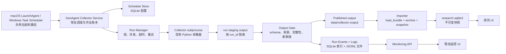

# 采集管线常驻化与监控重构方案

版本：v1.1  
日期：2026-10-02  
范围：GeoAgent 采集运行层、跨平台后台服务、采集失败处理、快照导入、管线监控 UI。

## 1. 目标和边界

目标是让 GeoAgent 的采集部分在 macOS 和 Windows 上都能作为后台服务运行，按来源/采集器计划自动更新；每一次执行都有可查询的作业状态、源级状态、日志和输出统计；失败时保留最后一次完整数据，同时明确标记本轮失败或降级；前端能够看到历史执行、当前执行、当前步骤和失败原因，并可以手动补采、重试和导入。

本方案优先改运行层和观测层，不先把所有采集器改写成浏览器爬虫。现有采集器仍作为独立子进程运行，先统一它们的生命周期、输出协议和失败语义，再针对确实需要页面渲染的来源加入 Browser transport。

## 2. 代码审计结论

### 2.1 当前运行链

`collectors/collectors.json` 注册了 19 个采集器。推荐入口 [`scripts/collect.py`](../../scripts/collect.py) 当前做四件事：

1. 读取 `enabled` 注册项并按注册顺序选择；
2. 使用 `subprocess.run` 串行启动每个入口脚本，并设置单个超时；
3. 只有子进程返回 0 时，才把 `collectors/<id>/output/` 复制到 `data/collector-output/<id>/output/`；
4. 将本轮结果写入 `data/collection-runs/<UTC>/results.json`。

它没有常驻循环、统一重试、作业锁、心跳、调度账本或自动调用 `/api/import`。`scripts/refresh_crawlers.py` 是另一套旧的有限并发流程，依赖 `collectors/tools/rerun_batch.py` 及各项目的验证脚本；两套流程的并发、验证和报告格式不一致，不能继续同时作为生产入口。

### 2.2 当前应用链

[`backend/app.py`](../../backend/app.py) 的 `/api/import` 仍是显式手动导入入口，只读取已有采集输出、调用 `load_bundle()`、保存不可变 SQLite 快照并启动翻译；它不启动采集器。常驻服务现在通过独立的 [`backend/collector_import.py`](../../backend/collector_import.py) 在“发布成功”之后自动调用同一套加载/快照逻辑，并把 `import_status`、`snapshot_id` 和导入错误写入运行报告与账本。`/api/status` 仍主要返回快照、读取根目录、模型和翻译状态，管线状态应读取 `/api/collector/*`。

前端 [`src/api.ts`](../../src/api.ts) 使用同源 `/api`；`vite.config.ts` 现在通过 `GEOAGENT_API_TARGET`/`VITE_API_TARGET` 配置开发代理。实际运行核对发现：8010 是 Vite 页面，8000 被 Colima SSH 占用，若仍把 8010 代理到 8000 就会出现页面可打开但 API 404/`Failed to fetch`。启动入口和文档因此明确区分“开发双进程端口”和“单进程兼容端口”，不再让端口错配静默发生。

### 2.3 当前测试和真实失败

初始代码审计时在当前工作树执行（历史基线，后续已增加监控与启动入口测试）：

```text
.venv/bin/pytest -q
85 passed, 1 warning
```

采集器离线自检此前已验证 19 个注册采集器均返回 0。它覆盖注册表、入口语法、规则解析、归一化和失败后的运行器行为，但不覆盖真实网络、代理、上游字段变化、输出新鲜度和导入门禁。

仓库保存的真实网络记录 [`data/collection-runs/20260930T063210Z-live-audit/results.json`](../../data/collection-runs/20260930T063210Z-live-audit/results.json) 中，17 个被实际尝试的采集器有 4 个未成功：

| 采集器 | 证据 | 初步归类 | 重构处理 |
|---|---|---|---|
| `iran-domestic-monitor` | `KeyError: 'Million'` | 单位解析对大小写不稳 | 统一单位词典、未知单位降级为源级错误并保留原文 |
| `mideast-monitor` | 报告渲染中的 `NameError: e` | 代码错误 | 修复变量名并增加报告渲染回归用例 |
| `iran-escalation-monitor` | 运行超时 | 请求/循环缺少可观测的边界 | 给每个源和阶段设置超时、心跳、取消和重试分类 |
| `taco-monitor` | `CO1` 缺少可用出口，门禁拒绝生成新指数 | 关键输入缺失 | 保留上一份完整指数，产生 `degraded` 运行并标明缺失输入；是否采用备用源必须由口径配置决定 |

另外，单个来源可能返回 403，但采集器进程仍返回 0。因此必须分开记录进程状态、来源状态、输出门禁和导入状态，不能只看进程退出码。

审计阶段已先修复两项确定性代码错误：`iran-domestic-monitor` 的金额单位查找改为大小写归一，并增加 `Million` 回归自检；`mideast-monitor` 修正报告渲染中未定义的生成器变量。两项采集器自检分别为 75/75 和 70/70，历史基线 pytest 为 85 passed。超时和 TACO 关键输入缺失仍按下文的运行层方案处理，避免把不完整数据伪装成成功；当前 2026-10-02 全量结果见第 10 节。

## 3. 目标架构



### 3.1 服务进程

新增一个明确的服务入口，例如：

```text
python -m geoagent.collector_service --config config/collector-schedules.json
```

服务进程负责读取计划、计算下一次运行时间、创建 `run_id`、获取单采集器锁、启动子进程、接收 stdout/stderr、写心跳和状态、完成输出门禁，并按策略触发导入。服务支持：

```text
collectorctl start       前台启动，便于调试
collectorctl run --id X  立即触发一次
collectorctl status      输出当前作业和来源状态
collectorctl retry RUN   只重试失败项
collectorctl stop        优雅停止当前作业
collectorctl install     输出/安装当前平台的后台启动配置
collectorctl uninstall   删除当前用户的启动配置
```

第一阶段采用 Python 标准库事件循环和持久化计划，减少新增依赖。若后续需要复杂日历、分布式调度或多主机部署，再评估 APScheduler/Celery；本地单机服务不先引入消息队列。

### 3.2 macOS 和 Windows 后台启动

统一原则是“一个 GeoAgent 服务进程，操作系统负责拉起、重启和登录后保持运行”，不再为每个采集器注册一组互相独立的系统任务。

macOS 使用用户级 `LaunchAgent`：

- `RunAtLoad=true`；
- `KeepAlive=true`；
- `ProgramArguments` 指向项目虚拟环境中的服务入口；
- stdout/stderr 指向 `data/service-logs/`；
- `ThrottleInterval` 防止崩溃重启过快。

Windows 使用用户任务计划 XML 或 PowerShell 安装器：

- 登录后启动；
- 进程退出后按递增间隔重启；
- 工作目录固定为仓库根目录；
- 环境变量、虚拟环境 Python 和日志目录写入任务配置；
- `install.ps1`、`status.ps1`、`uninstall.ps1` 三个动作必须幂等。

系统任务只负责服务生命周期；实际每个采集器的计划、重试和历史由服务自己的 SQLite 账本负责，这样 macOS 和 Windows 的行为一致。

### 3.3 计划模型

计划不再散落在各个 README 的建议文本里，统一放在 `config/collector-schedules.json` 或 SQLite 中，至少包含：

```json
{
  "collector_id": "diplomacy-monitor",
  "enabled": true,
  "cadence": "daily",
  "time_local": "08:30",
  "timezone": "Asia/Shanghai",
  "timeout_sec": 900,
  "max_attempts": 2,
  "concurrency_group": "news",
  "import_policy": "on_success_or_degraded",
  "critical_sources": []
}
```

保留采集器 `config.json` 中的业务窗口、来源和规则；调度频率、超时、重试和导入策略由运行层统一管理。旧 `schedule` 字段在迁移期只作为导入默认值，不能再被解释为“已经安装了定时任务”。

### 3.4 作业、事件和日志数据模型

新增本地 SQLite 表，建议放入独立的 `collector_runtime.sqlite3`，避免运行日志和研究快照相互锁定：

```text
collector_schedules
  id, collector_id, enabled, cadence, timezone, next_run_at, last_run_id, config_json

collector_runs
  run_id, trigger, status, queued_at, started_at, finished_at,
  requested_by, import_status, snapshot_id, summary_json

collector_run_items
  run_id, collector_id, status, attempt, started_at, finished_at,
  exit_code, timeout_sec, output_path, output_hash, record_count,
  error_type, error_message

collector_source_status
  run_id, collector_id, source_id, state, http_status, item_count,
  fetched_at, last_success_at, error_type, error_message, payload_json

collector_events
  event_id, run_id, collector_id, occurred_at, level, event_type,
  message, payload_json
```

大段 stdout/stderr 不直接塞入 SQLite：写到 `data/collector-runs/<run_id>/<collector_id>/stdout.log` 和 `stderr.log`，数据库保留路径、大小、hash、最后 2000 字符和脱敏后的摘要。日志必须禁止输出 API Key、Cookie、Authorization 和完整代理凭据。

### 3.5 执行、重试和输出门禁

运行器改为“临时目录执行，成功后原子发布”：

1. 创建 `data/collector-runs/<run_id>/<collector_id>/staging/`；
2. 通过 `COLLECTOR_OUTPUT_ROOT` 指向该目录；
3. 采集器执行期间持续写事件和心跳；
4. 结束后检查入口返回码、预期文件、JSON/CSV/schema、源级状态、条目数和时间新鲜度；
5. 门禁通过后发布到 `data/collector-output/<collector_id>/output/`，生成 output manifest；
6. 门禁失败时不覆盖最后一次完整发布，记录 `failed` 或 `degraded`，并在 UI 显示上次成功时间；
7. 只有允许导入的状态才调用导入器，并把 `snapshot_id` 记录到该 run。

重试分类：网络超时、连接重置和临时 5xx 可有限重试并指数退避；4xx、解析错误、schema 错误、配置错误和关键输入缺失不得无限重试。每个采集器只能有一个活动 run；全量任务可以并行，但必须按 host/并发组限速。

现有采集器多数没有真正消费 `COLLECTOR_OUTPUT_ROOT`，而是固定写源码目录的 `output/`。这是数据隔离和并发安全的主要技术债。迁移顺序为：先新增共享 `collector_runtime.output_dir()` 兼容函数，再逐个采集器切换；迁移完成前，运行器必须做输出前后清单和 hash 检查，防止“进程成功但写错目录”。

### 3.6 Browser transport

默认继续使用 HTTP/RSS/API/CSV。新增来源配置：

```json
{
  "source_id": "example-js-listing",
  "transport": "browser",
  "fallback_from": "http",
  "timeout_sec": 45,
  "selector_contract": "article-list-v1"
}
```

Browser worker 只负责拿到原始页面或结构化条目，不能负责调度、重试账本、发布和导入。使用边界：

- 页面必须执行 JavaScript 才能出现数据；
- HTTP 直连得到空壳页面而不是有效列表；
- 需要已批准的 cookies/登录态；
- 明确记录页面状态、最终 URL、条目数、selector 版本和截图/HTML replay 引用。

403、Cloudflare 或 Akamai 不自动等于“应该用浏览器绕过”；先记录失败并使用已批准的备用源。Browser 依赖会增加浏览器版本、页面等待、selector 漂移、资源占用和会话过期故障，应按来源逐个启用。

## 4. 管线监控 UI 方案

### 4.1 后端 API 契约

新增 `/api/collector` 命名空间，保持现有本机写入保护：

```text
GET  /api/collector/summary
GET  /api/collector/schedules
GET  /api/collector/runs?status=&collector_id=&limit=&cursor=
GET  /api/collector/runs/{run_id}
GET  /api/collector/runs/{run_id}/events?after_id=
GET  /api/collector/runs/{run_id}/logs/{collector_id}?stream=stdout|stderr&tail=
GET  /api/collector/sources?collector_id=&state=
POST /api/collector/runs                 手动触发全量/指定采集器
POST /api/collector/runs/{run_id}/retry  重试失败项
POST /api/collector/runs/{run_id}/cancel 取消运行
POST /api/collector/import               导入最近一次合格产物
```

`/api/status` 增加轻量摘要：服务状态、当前 run、最近一次成功、最近一次失败、下次计划时间、失败采集器数、陈旧来源数、最近快照 ID。完整日志不放入首页状态接口。

### 4.2 UI 页面和交互

基于现有“地缘政治智能体”深色研究工作台，新增一级入口“采集管线监控”。原型采用“运营监控工作台”而不是 KPI 卡片墙：中心区域始终展示当前采集证据，左右两侧承担筛选、定位和解释。页面必须直接回答三个问题：现在是否健康、哪一步出问题、如何补采。

#### 4.2.1 大屏信息架构

大屏保持现有顶部主题导航、深色背景、细蓝色边框和右侧研究栏的视觉语言，新增页面内部的三栏工作区：

1. 顶部命令/状态条：显示服务在线状态、当前 run、整体健康度、最近更新时间、最近快照、下次计划时间和刷新入口；状态条必须区分 `live`、`stale`、`partial`、`offline`，不能把未知状态当成成功。
2. 左侧大纲和筛选栏：按新闻、政府、媒体、市场等采集器分组，提供状态、时间范围、来源和运行类型筛选；显示启用/停用、失败数和陈旧数。左栏用于定位，不承载大段日志。
3. 中央主视图：使用采集执行泳道/时间轴展示 19 个采集器。每行显示采集器、当前阶段、开始/结束时间、耗时、尝试次数、输出文件数（若提供 `record_count` 再显示条目数）和状态；当前 run、失败项和陈旧项必须能在一眼内识别。中心区域是视觉主层级，不被右栏或卡片挤压。
4. 右侧检查器：展示当前选中采集器的详情，包括源健康、当前步骤、重试次数、输出文件/manifest、上次成功时间、最近错误日志尾部、快照关联和“重试/补采/查看历史”操作。错误详情不以悬浮 tooltip 作为唯一入口。

原型中的 19 行是注册表规模的可视化约束，不把具体数量写死到组件逻辑；新增采集器后应由接口返回并自然滚动。日志采用按需加载，默认只显示最后一段，避免把完整 stdout/stderr 挤进主视图。

#### 4.2.2 移动端竖屏方案

移动端采用独立的竖屏信息架构，不把三栏大屏压缩成窄列：

- 顶部保留品牌、页面标题、总体健康度、最后更新时间和菜单入口；
- 首屏先显示当前 run 摘要（运行中/进度/开始时间/耗时），再显示按状态排序的采集器列表；
- 采集器列表用垂直时间线表达成功、运行中、部分成功、失败、过期和离线，文字标签与图标同时出现，不能只依赖颜色；
- 点击采集器打开底部详情抽屉，抽屉包含“运行详情/历史记录/相关资源”三个页签，以及当前步骤、重试次数、输出文件数、错误摘要和主操作“补采”；
- 分组、状态、时间范围筛选进入触控抽屉；主要按钮和列表点击区域按 44～48px 触控目标设计；
- 详情抽屉打开时仍保留采集器上下文，关闭后回到原滚动位置；网络不可达时保留最后一次成功状态并明确标为陈旧。

#### 4.2.3 状态、颜色与数据语义

颜色只表达稳定语义，并始终配合文字和图标：

| 语义 | 表现 | 说明 |
|---|---|---|
| 成功 | 绿色 + 勾选 | 本次输出通过门禁并可导入 |
| 运行中 | 青色 + 进度/圆环 | 当前步骤仍在执行 |
| 当前选中 | 青色边框/高亮 | 仅表示焦点，不代表成功 |
| 部分成功/过期 | 黄色 + 警告 | 有可用产物，但不完整或超过新鲜度阈值 |
| 失败 | 红色 + 叉号 | 本次未形成可发布产物，保留上次成功数据 |
| 离线/不可达 | 灰色 + 离线图标 | 服务、来源或 API 不可访问 |
| 普通上下文 | 深蓝/中性灰 | 背景、分隔线和未选中内容 |

前端字段直接绑定运行层状态：`run_status`、`collector_status`、`source_state`、`stage`、`attempt`、`started_at`、`finished_at`、`record_count`、`output_manifest`、`last_success_at`、`error_type`、`error_message`、`snapshot_id`。不得在 UI 中用“有数据/无数据”替代“成功/部分成功/失败/陈旧”等运行语义。

#### 4.2.4 页面状态和交互契约

可分享的筛选和当前上下文放入 URL，至少包括 `mode=collector-monitor`、`run_id`、`collector_id`、`status`、`range`、`group`；刷新或复制链接后应恢复同一视图。浏览器 `localStorage` 只保存非关键偏好（如左栏折叠、日志显示行数），不保存当前 run 或运行结果。

选中、筛选、历史、补采和重试必须形成闭环：

1. 点击泳道或列表项更新 `collector_id`，右侧/底部检查器显示同一对象；
2. 触发重试/补采后立即返回新的 `run_id` 或明确错误码，并自动进入该 run 的当前执行视图；
3. 事件轮询无新事件时保持当前内容，API 断开时显示“连接中断/最后更新时间”，不能清空数据；
4. `prefers-reduced-motion` 下使用静态时间线和状态变化提示，不用持续闪烁；
5. 键盘可访问焦点、Escape 关闭检查器、触摸端可关闭抽屉，所有状态均有可读文本。

#### 4.2.5 数据流与技术落点

UI 只消费采集运行层的标准化结果，不直接请求外部网站：

```text
collector service
  -> collector_runs / run_items / events / source_status
  -> monitoring API
  -> 管线监控 UI
  -> 快照、证据台账、风险监测和研究简报
```

现有 React/TypeScript 页面继续复用 `/api` 同源客户端、主题 token、状态标签和右侧检查器样式。泳道使用 DOM/CSS 或轻量 SVG 即可，不引入地图或 WebGL；19 个采集器的首屏目标控制在约 1000 个可视标记以内。日志、源级明细和历史记录延迟加载，避免首屏等待完整日志。

新增“采集管线”页签，包含以下可落地区域：

1. 顶部健康卡：服务在线/离线、活动 run、整体状态、最近成功时间、最近快照、下次运行时间；
2. 采集器矩阵：19 个采集器的启用状态、上次运行、耗时、条目数、源失败数、输出新鲜度、导入状态；
3. 执行历史：按时间、状态、采集器筛选，点击进入 run 详情；
4. 当前 run 详情：阶段时间线、当前采集器、尝试次数、实时事件、stdout/stderr 尾部、源级状态、输出文件清单、导入快照和错误堆栈。

MVP 使用 2～5 秒轮询 `events?after_id=`，页面不可见时自动降频；服务稳定后再换 SSE。轮询实现必须区分“API 不可达”“服务空闲”“本轮没有快照”“当前采集失败”，不能统一显示为 `Failed to fetch`。

操作按钮：启动全量、启动选中项、重试失败项、取消当前 run、仅导入最近合格产物、打开原始日志。所有操作返回 `run_id` 或明确的错误码，UI 立即进入对应详情页。

原型不把示例时间、条目数、错误文本当成固定文案；实现时所有数值、时间、状态和日志必须来自接口。概念图仅作为布局和交互语义基线，不作为生产静态资源。

#### 4.2.6 三个视图的展示、核对与操作清单（本轮原型）

为了避免把“采集运行”“采集池”和“快照版本”混成一条时间线，原型将管线监控拆成三个互相切换、但共享当前 `run_id`/`snapshot_id` 上下文的视图。三者的关系是：运行视图解释本轮发生了什么，采集池视图解释产物和来源是否可用，快照视图解释哪些数据版本可以交给研究分析。

| 视图 | 需要展示的关键数据 | 需要人工核对的事项 | 需要人工操作的关键操作 |
|---|---|---|---|
| 当前运行流程 | 运行批次、触发方式、开始/结束时间、总体状态；来源抓取成功/失败/空响应；候选加工的抓取候选数、时间窗口过滤数、主题过滤数、信号桶通过数、被拒候选数、采集器内去重数；发布门禁结果与阻断原因；统一导入的原始/标准化/去重/无效记录数和指标数；快照新建/复用/跳过 | 失败来源是否影响研究口径；候选过滤是否过严；门禁是否因关键来源缺失而阻断；导入清洗数是否异常；本轮是否真的产生了新快照。接口没有提供的计数必须显示“未记录”，不能用 0 伪造 | 刷新当前批次；进入采集池看来源；在快照待确认区选择“设为工作快照”；跳转快照谱系；对失败批次进入重试/补采（沿用原检查器操作） |
| 采集池与来源 | 采集器列表、启用/排除、当前阶段、输出文件数和路径、源级状态（成功/403/空响应/过期/禁用）、条目数、最后成功时间；stdout/stderr 日志尾部；最近运行历史 | 进程成功不等于来源全部成功；403、空响应、过期数据和禁用来源要分别处理；发布目录是否被本轮覆盖；日志中是否存在超时、解析、门禁或导入错误 | 按状态/分组筛选；打开采集器详情；查看源健康和日志；立即执行、重试失败项、补采单个采集器、查看历史记录；失败时保留并对比上次成功产物 |
| 快照版本谱系 | 每个不可变 `snapshot_id`、创建时间、记录数、观察数、来源数、错误数；清洗统计（原始记录、全局重复合并、无效记录、唯一记录）；导入统计（new/revised/total）；当前页面的工作快照标记 | 快照是否来自合格的发布门禁；本次是新建、复用还是跳过；记录数变化是否由来源变化或清洗规则变化导致；是否需要人工复核后才能用于问答/简报 | 查看版本统计；选择并设为工作快照；回到当前运行流程核对来源；使用顶部“数据快照”切换研究上下文；确认后再进入问答、证据台账和简报 |

原型中“当前运行流程”按以下八个阶段显示，阶段卡片同时给出机器状态和人工核对提示：运行批次 → 来源抓取 → 候选加工 → 发布门禁 → 统一导入 → 快照 → 人工选择工作快照 → 生成问答或简报。阶段之间使用状态连接线表达顺序，但快照谱系使用独立版本列表表达“不可变版本”，不把每次运行强行画成一个快照。这样可以明确解释：一次运行可能因为门禁失败没有快照，也可能导入后复用已有快照；只有人工确认的工作快照才作为下游研究上下文。

当前真实数据可作为视图验收样例，但不是静态 fixture：最近成功批次 `20261002T054358Z` 关联快照 `0b74552eb65401083b6ae9a0`，导入投影报告 9,022 条记录、70 条观察、514 个来源，清洗统计为原始 10,319、重复合并 1,496、无效 0；这些数字由 `/api/collector/summary`、`/api/collector/sources` 和 `/api/collector/snapshots` 读取。候选加工和信号桶若运行报告没有持久化，就显示“未记录”，而不是从最终记录数倒推。

视图之间的业务流如下：

```text
运行批次
  ├─ 当前运行流程：解释本轮阶段和门禁
  ├─ 采集池与来源：核验源级健康、输出和日志
  └─ 快照版本谱系：比较不可变数据版本
                         ↓ 人工设为工作快照
                 风险监测 / 证据台账 / 智能问答 / 研究简报
```

“自动导入快照”和“自动生成简报”是两个不同动作：合格发布完成后，服务可以自动执行导入并产生/复用快照；简报、问答和分析必须读取人工选择的工作快照，不能因为采集任务结束就默默切换研究上下文。UI 因此把导入结果显示在运行流程和快照谱系中，把下游分析入口留在工作快照确认之后。

### 4.3 当前端口和启动契约

本地启动分为两个明确配置：

- 开发联调默认使用 Web `127.0.0.1:8010` + API `127.0.0.1:8011`；[`scripts/start_local.py`](../../scripts/start_local.py) 同时拉起 Vite 和 FastAPI，向 Vite 注入 `GEOAGENT_API_TARGET`，并在打开页面前检查 `/api/status` 200。
- 单进程兼容模式继续使用 API/页面 `127.0.0.1:8000`；[`scripts/serve.py`](../../scripts/serve.py) 和 Windows [`start.ps1`](../../start.ps1) 支持 `--port`/`-Port` 及 `GEOAGENT_API_PORT` 覆盖。

8000 不是“永远空闲”的假设：如果被 Colima/SSH 等本地服务占用，启动脚本必须报出占用而不停止陌生进程；开发入口应改用 8010/8011 或显式传入另一组端口。服务启动后仍需验证 `/api/status`，再进行浏览器验收。

## 5. 采集器错误修复顺序

### 第一批：已由真实运行记录定位

1. `iran-domestic-monitor`：将 `Million`、`million`、`M` 等单位归一化到统一枚举，未知单位生成可读的 source error；增加大小写、复数、缺失单位和错误单位测试。
2. `mideast-monitor`：修正报告渲染的变量名错误；增加空 `militias`、多实体和重复实体回归测试。
3. `iran-escalation-monitor`：逐个源检查是否有明确 timeout；给抓取、解析、写出三个阶段加 watchdog；记录最后心跳和最后成功源；超时只标记该 run，不让服务主循环卡住。
4. `taco-monitor`：将 `CO1` 代理不可用记录为关键输入缺失和 `degraded`，保留上一份完整标准产物；明确 `CO1_fred_crosscheck`、`CO1_sina_crosscheck` 是否允许替代，禁止静默替换口径。

### 第二批：结构性稳定性

- 所有采集器使用共享 request policy：连接超时、读取超时、总超时、重试次数、退避和 User-Agent；
- 每个来源输出 HTTP 状态、响应字节、解析条数、过滤条数和最后有效日期；
- 统一 JSONL/JSON/CSV 的 schema 检查和最小字段检查；
- 采集器返回 0 但来源失败时，运行状态必须为 `partial` 或 `failed`；
- `COLLECTOR_OUTPUT_ROOT` 迁移完成后，禁止把生产产物写进源码目录；
- 输出发布使用临时目录和原子 rename，避免半写文件被导入；
- 统一旧 `refresh_crawlers.py` 和新 runner 的退出码、报告格式和日志字段，最终只保留一个生产入口。

## 6. 测试计划

### 6.1 现有测试保留

- 注册表和入口检查；
- 每个采集器的离线 selftest；
- 统一 runner 的筛选、失败后继续和输出编码；
- 适配器归一化、去重、指标和快照不可变性；
- 前端构建和现有 API 演练。

### 6.2 新增测试分层

| 层级 | 内容 | 网络要求 |
|---|---|---|
| parser contract | 固定 RSS/XML/JSON/CSV fixture、单位、日期、去重和 schema | 不联网 |
| runner unit | timeout、退出码、重试、锁、staging、发布门禁、失败保留旧输出 | 不联网 |
| scheduler integration | 假时钟、计划计算、服务重启、幂等、并发限制、SQLite 账本 | 不联网 |
| source smoke | 每个来源状态码、最小字段、条目数和新鲜度 | 标记 `live`，按需运行 |
| importer gate | source status、manifest、partial/degraded、snapshot_id | 不联网 |
| UI acceptance | 启动 run、看当前阶段、打开日志、重试失败、导入快照 | 本地服务 |
| UI visual states | live、stale、partial、offline、无快照、API 断开、失败详情、补采中 | 本地 mock/服务 |
| responsive acceptance | 1440×900 大屏三栏、390×844 和 430×932 竖屏、抽屉和触控目标 | 本地浏览器 |
| URL state | 分享/刷新后恢复 `run_id`、采集器、筛选、时间范围和分组 | 本地浏览器 |
| accessibility | 键盘焦点、Escape 关闭、文本/图标双编码、缩小动效和对比度 | 本地浏览器 |
| platform smoke | macOS LaunchAgent 和 Windows Task Scheduler 配置的安装/状态/卸载 | 各平台 |

真实网络测试不作为普通 `pytest` 默认项，使用 `pytest -m live` 或独立 `scripts/smoke_collectors.py`，输出必须保存到 `data/collection-runs/`，避免 CI 因临时网络波动误报。

### 6.3 验收标准

- macOS 和 Windows 均能用一条安装命令注册后台服务，重启后能自动恢复；
- 服务重启不会重复执行同一个采集器，也不会丢失上一次 run 的结束状态；
- 全量运行时每个采集器和每个来源都有状态、耗时、尝试次数和日志；
- 采集失败或关键输入缺失不会覆盖上一份完整发布；
- 采集成功后可自动导入并记录 snapshot ID，导入失败不会生成假成功快照；
- UI 能看到运行历史、当前阶段、来源失败、日志尾部、上一成功时间和补采按钮；
- UI 在 1440×900 大屏和 390×844/430×932 竖屏均能完成“定位失败采集器 → 查看当前步骤和日志 → 发起补采/重试”的闭环；
- UI 断网或 API 不可达时保留最后一次可用状态，明确显示 `stale`/`offline` 和最后更新时间，不显示空白成功页；
- URL 分享后能恢复筛选、时间范围和当前采集器，键盘和触控操作不依赖 hover；
- 19 个离线 selftest、现有 85 项测试、前端 build、live smoke 和两平台启动检查全部有独立报告；
- 浏览器 transport 只出现在明确配置的来源，且有 replay/selector/schema 测试。

## 7. 实施阶段和交付物

### Phase 0：基线冻结和端口统一

- 固化当前测试基线和 2026-09-30 真实运行报告；
- 固化开发双进程端口（Web 8010、API 8011）与单进程兼容端口（8000），修正文档、代理和启动检查；
- 为现有 19 个采集器生成 output manifest 和 schedule 初始配置；
- 交付：运行状态数据字典、基线报告、端口契约。

### Phase 1：运行服务和账本

- 新增 service、run manager、锁、staging、重试、事件日志和 SQLite schema；
- 把 `scripts/collect.py` 封装为 service 的兼容执行器；
- 实现 `collectorctl run/status/retry`；
- 交付：可前台运行的常驻服务和无网络 runner integration tests。

### Phase 2：采集器修复和输出迁移

- 修复第一批四个已定位问题；
- 统一请求超时和失败分类；
- 逐个采集器迁移 `COLLECTOR_OUTPUT_ROOT`；
- 为每个输出家族增加 fixture/schema 门禁；
- 交付：19 个采集器的离线测试报告和 live smoke 报告。

### Phase 3：自动导入和快照关联

- 将“发布成功 → 导入 → snapshot_id”做成显式状态机；
- 记录 partial/degraded 的导入策略；
- 增加 stale 数据和上次成功时间；
- 交付：导入门禁、快照关联测试和失败保留验证。

### Phase 4：监控 API 和 UI

- 增加管线 API、轮询事件接口和日志尾部接口；
- 增加采集管线页签、历史页、当前执行详情和补采操作；
- 修复 `Failed to fetch` 的服务/端口诊断显示；
- 交付：本地浏览器可见的管线监控闭环。

### Phase 5：跨平台后台安装

- 生成 macOS LaunchAgent 和 Windows Task Scheduler 配置；
- 实现安装、状态、卸载和日志路径检查；
- 在两平台做服务重启、断网恢复、重复安装和升级检查；
- 交付：两平台启动说明和平台 smoke 报告。

### Phase 6：Browser fallback 和生产收口

- 只为实证需要 JS/会话的来源增加 Browser worker；
- 保存 replay、selector 版本和页面状态；
- 运行一周 canary，比较 HTTP 与 Browser 的条目数、失败率和耗时；
- 交付：来源级 transport 决策表和最终运行手册。

## 8. 主要风险和取舍

- 本地单机使用 SQLite 足够；如果未来多个主机共同调度，需要把作业账本迁移到 PostgreSQL，并增加分布式锁。
- 采集器输出字段差异很大，不能通过一个“万能 JSON schema”消除差异；应保留各输出家族协议，再在适配器层归一化。
- 进程返回 0 不代表所有来源成功；source health 必须成为一等数据。
- 旧数据保留和本轮失败必须同时展示，避免研究员把陈旧快照当成实时数据。
- Browser 会提升少数来源的可达性，但会引入新的版本和页面结构故障；先把运行账本、超时、发布门禁和监控做好，Browser 才有可控边界。

## 9. 下一步执行顺序

1. 先完成 Phase 0 的端口契约、运行状态字典和 output manifest；当前端口契约已落到 `scripts/start_local.py`、`scripts/serve.py`、Vite 代理和启动文档；
2. 修复并补测 `iran-domestic-monitor`、`mideast-monitor`、`iran-escalation-monitor`、`taco-monitor` 四个已知问题；
3. 完成取消运行和后台安装配置，跑无网络集成测试；服务级/采集器级锁、SQLite 运行账本、run/collector/import 事件、进程级重试/退避、发布 staging、只读事件 API、手动运行 POST、自动导入门禁、跨平台配置生成和失败项重试 POST 已实现；
4. 继续补齐 `/api/collector/*` 的来源和取消接口，并完善 UI 监控页的快照关联展示；日志尾部接口已完成；
5. 接入 macOS/Windows 后台安装和来源级 Browser fallback。

在 Phase 1 和 Phase 2 验收前，不把“页面能显示快照”当成后台采集已经常驻；在 Phase 4 验收前，不把 `results.json` 当成用户可见的管线监控。

## 10. 当前实现进度（2026-10-02）

本轮已完成一条不依赖真实网络的 UI/API/服务入口闭环：

- 前端新增“采集管线监控”页签和三栏工作区，包含状态筛选、采集器时间线、失败详情、补采/重试入口、历史记录和相关资源占位；移动端切换为筛选抽屉与详情底部抽屉。
- 新增 [`src/CollectorMonitor.tsx`](../../src/CollectorMonitor.tsx)，默认只显示 `/api/collector/summary` 和 `/api/collector/runs` 的真实投影；演示数据必须显式设置 `VITE_COLLECTOR_DEMO=true`，接口不可用时不会静默回退成演示运行。
- 新增只读运行报告投影 [`backend/collector_monitor.py`](../../backend/collector_monitor.py)，读取已有 `data/collection-runs/*/results.json`，区分成功、超时、进程失败和无运行报告；它不宣称服务实时心跳。
- 新增 `/api/collector/summary`、`/api/collector/runs`、`/api/collector/runs/{run_id}`，并增加 `/api/collector/ledger` 与 `/api/collector/runs/{run_id}/events` 只读账本/事件查询；补采、重试 POST 已通过后台 job bridge 复用真实执行器。
- 新增 [`scripts/collector_service.py`](../../scripts/collector_service.py)：`--once` 可执行一轮并写 `state.json`/`results.json`，默认循环模式可由 LaunchAgent/Task Scheduler 拉起；当前复用旧 `scripts/collect.py`，已增加服务级单实例锁、SQLite 调度账本、run/collector 事件记录和默认 2 次进程级重试。
- 新增 [`backend/collector_ledger.py`](../../backend/collector_ledger.py)：以 `collector_runs`/`collector_events` 记录运行生命周期和采集器级结果，账本不替换现有 JSON 报告；只读账本和事件已接入 API，监控详情会在账本存在时读取事件。
- [`scripts/collect.py`](../../scripts/collect.py) 已增加指数退避和 staging 发布：成功产物才交换进 `data/collector-output`，失败/超时/空产物不覆盖上次已发布目录；旧采集器直接写 `collectors/<id>/output` 的迁移仍未完成。
- `/api/collector/ledger` 与 `/api/collector/runs/{run_id}/events` 已将账本以只读方式暴露给监控 UI；`POST /api/collector/runs` 和 `POST /api/collector/runs/{run_id}/retry` 已接入后台 job bridge，没有账本的历史报告会返回明确的 unavailable 状态。
- 新增 [`backend/collector_import.py`](../../backend/collector_import.py)：只读取真实 `data/collector-output` 发布树，不使用 `collector_read_root()` 的演示数据回退；完整成功才自动导入，部分成功默认跳过，可显式 `--allow-partial-import`，导入失败单独写 `import_failed` 事件并保留上一份快照。
- `collector_runs` 账本增加 `import_status`、`snapshot_id` 和导入错误字段，并对已有 SQLite 账本做增量列迁移；监控 API/UI 显示导入状态和快照 ID 前缀。
- 新增 [`scripts/collector_service_config.py`](../../scripts/collector_service_config.py)：生成可审计的 macOS LaunchAgent plist 或 Windows Task Scheduler XML；默认只打印或写入明确的 `--output` 路径，不自动调用 `launchctl`/`schtasks`。
- 新增 [`scripts/collector_service_ctl.py`](../../scripts/collector_service_ctl.py)：提供显式 `install/status/uninstall`，带 `--dry-run`，只在用户明确调用安装/卸载时才执行 `launchctl` 或 `schtasks`；本机已加载项目目录内的 LaunchAgent，状态为 `running`。
- 新增 [`backend/collector_config.py`](../../backend/collector_config.py) 与监控页“调度配置”：以项目内 JSON 保存全局采集间隔、排除采集器和部分成功导入策略；`GET/PUT /api/collector/config` 展示配置来源并可显式重载本机后台任务。UI 同时说明自动导入快照已开启、简报需基于选定快照手动生成，避免把两个不同业务动作混为一谈。
- 2026-10-02 UI 入口复核：顶部快照选择器增加可见“数据快照”标签；管线监控命令栏增加“历史运行（数量）”直达入口，避免快照下拉框和右侧详情二级页签不可发现。历史列表由 `/api/collector/runs` 投影，仍与快照版本列表分开。
- 新增 [`scripts/bootstrap_env.py`](../../scripts/bootstrap_env.py)：创建和安装项目私有 `.venv`；启动脚本、采集服务和后台配置均使用项目 `.venv`，不把系统 Python 作为项目依赖环境。
- `CollectorLedger.recover_unfinished()` 会把服务被重启/杀掉后遗留的 `running` 记录标记为 `abandoned`，避免 UI 把中断运行显示成当前运行。
- 新增 `/api/collector/runs/{run_id}/logs/{collector_id}?stream=stdout|stderr&tail=`，从报告或账本事件读取受限日志尾部，并在后端脱敏 token、cookie、authorization 等字段；监控详情已接入 stdout/stderr 切换。
- 新增只读 `/api/collector/sources?collector_id=`，从发布树中的 `_source_status.json`、`_fetch_stats.json`、`_source_health.json` 投影来源状态；没有这些文件时返回 `available=false`，不触发网络探测。
- `market-context-monitor` 已补齐这三个来源状态文件；最新真实复核为 4/4 来源正常、1,830 条历史观测。`scripts/collect.py` 也会把已发布目录中的相对文件路径写入 run report 的 `runtime_files`，监控 UI 列表显示实际输出文件数，并在运行报告加载后将选中采集器同步到真实列表，避免默认演示采集器残留。
- 当前已发布来源树的实时投影仍有 `telex-en`、`lwj-feed`、`iz` 三个 HTTP 403，以及若干过期/空响应来源；这证明“进程返回 0、发布门禁通过、来源健康”必须保持三层分开。
- 安装、卸载、状态和常用采集命令已归档到 [`docs/2oA/2026-10-02-GeoAgent-本机采集服务安装与管理.md`](../2oA/2026-10-02-GeoAgent-本机采集服务安装与管理.md)。
- 2026-10-02 回归证据：`.venv/bin/pytest -q` 当前为 135 passed（1 个 Starlette/httpx 弃用警告），其中本轮新增运行中 `state.json` 投影和来源核对入口所需的监控投影测试；`npm run build` 通过。该证据不等同于所有真实网络采集成功。
- 新增 [`scripts/start_local.py`](../../scripts/start_local.py)：跨 macOS/Windows/Linux 的开发启动入口，默认同时拉起 Web `8010` 和 API `8011`，检查 `/api/status` 后再宣告就绪，Ctrl-C 会回收两个子进程；支持 `--dry-run`、`--no-frontend` 和端口覆盖。
- 2026-10-02 UI 原型补充：采集管线页拆为“当前运行流程 / 采集池与来源 / 快照版本谱系”三个视图；运行视图展示八阶段和人工核对清单，采集池视图保留原有采集器列表、源状态、日志和历史操作，快照视图读取 SQLite 的轻量统计投影并提供工作快照确认。新增只读 `GET /api/collector/snapshots`，没有持久化的候选过滤数字统一显示“未记录”。
- 2026-10-02 三视图接线修复：新增 `/api/workspace-selection`，工作快照选择写入 SQLite `workspace_state`，顶部“数据快照”和管线谱系使用同一持久化选择；没有人工确认时，页面浏览的最新快照不会被误标成“当前工作快照”。谱系“设为工作快照”会真实保存， “查看数据范围”会打开该快照的研究视图。
- 2026-10-02 运行范围修复：`/api/collector/sources?run_id=` 只投影该运行报告中的采集器，避免把当前发布树的其他采集器混入历史批次；命令栏的健康、更新时间和触发来源不再使用固定示例文案，候选分层未持久化的计数保持“未记录”。
- 2026-10-02 来源核对入口修复：当前运行流程的“来源抓取”阶段现在提供“进入来源核对”按钮；点击后切换到“采集池与来源”、优先选中本批次存在失败/过期/空响应的采集器并打开右侧详情，人工可以直接查看源级状态和日志，不再只有“需核对”文字而没有动作入口。
- 2026-10-02 运行态显示修复：监控投影同时读取没有 `results.json` 的运行目录 `state.json`，并用 `started_at` 作为运行中的更新时间；前端轮询不会再用上一批已完成报告覆盖刚点击“立即执行”的当前批次。运行完成后仍以 `results.json`、导入状态和快照 ID 为准。
- 2026-10-02 操作缺口修复计划已归档到 [`docs/plan/采集管线主要操作缺口修复计划.md`](./采集管线主要操作缺口修复计划.md)，当前列为待实施；重点是人工核对持久化、run 级来源溯源、工作快照门禁、候选/导入明细、导入重试和实时运行事件。
- 更新 [`scripts/serve.py`](../../scripts/serve.py) 与 [`start.ps1`](../../start.ps1)：保留单进程 `8000` 兼容模式，同时支持 `--port`/`-Port` 与 `GEOAGENT_API_PORT`；README、`.env.example` 和交接记录已同步新端口环境。
- 修复地图 tab 的 `.map-canvas` 容器高度塌陷：内嵌浏览器已验证国家边界、经纬网、中文标签和彩色点位恢复；采集管线页仍按设计替换地图。
- 新增启动入口、服务锁、采集器级锁、账本事件、重试/staging、事件 API、手动运行、自动导入门禁、跨平台后台配置生成、控制命令、项目虚拟环境、中断恢复、日志尾部、来源状态投影和服务级调度配置测试；前端 build 通过。测试只验证本地逻辑，没有把这组结果解释成真实网络采集成功。

因此，当前可交付物是“可见、可验证的管线监控原型 + 历史报告/账本事件读取 + 来源状态只读投影 + 手动运行/失败重试 API + 成功采集后的自动导入门禁 + 项目私有 `.venv` + 可启动的开发双进程环境 + 带锁、重试和 staging 的常驻入口 + 项目目录内的 LaunchAgent 配置与本机运行服务”；本机在排除 TACO 后已完成 18/18 的真实运行和自动导入，但仍不是已完成的生产级后台采集服务。下一步是处理 TACO 的 CO1 出口、取消运行、旧采集器输出目录迁移和 UI 来源明细；Windows 配置尚需在 Windows 目标机上做安装与 smoke 验证。
