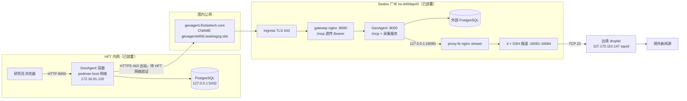
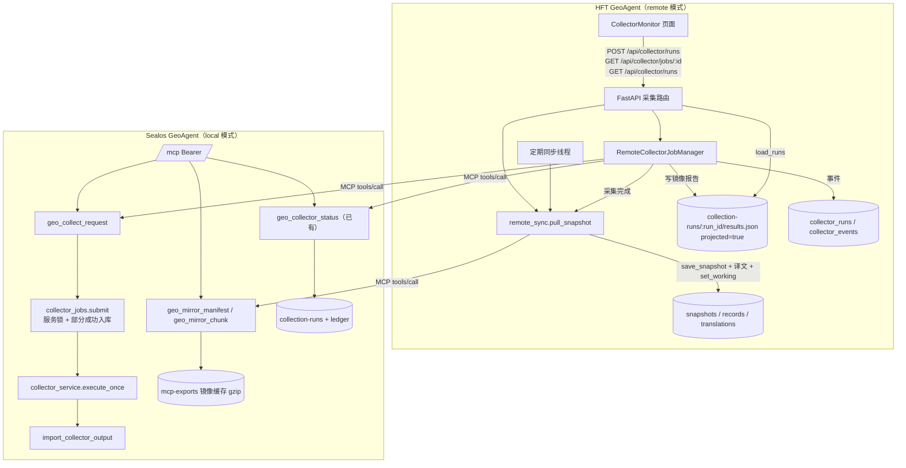

# 远端采集与快照镜像设计

功能标识：`remote-collection`。状态：设计已确认（2026-11-05），实施中。

## 一、背景与目标

HFT 内网 GeoAgent（172.16.91.120）只有国内出口，无法访问境外新闻源和出境代理；Sealos 正式环境（广州，`geoagent.lhotsetech.com`）通过 4 条 SSH 隧道出境，可以完成全量采集。

目标：HFT 页面上点击“采集”，由 Sealos 执行采集并导入快照，HFT 实时显示每个采集器的进度，结束后自动把同一份快照拉回内网、校验后设为当前快照。没有人工采集时，HFT 也能定期发现并拉取 Sealos 的新快照。

不做：

- 不让 Sealos 主动连接 HFT，不把 HFT 数据上传到 Sealos；
- 不在 HFT 运行本地采集器，不在 HFT 镜像远端原始日志、原始采集产物或附件；
- 不同步审核记录、问答、简报、模型配置、Key 等站点私有数据；
- 不改变 Sealos 现有采集、导入和页面行为（`local` 模式默认值保持不变）。

## 二、角色与配置

一套代码、一个镜像，部署时由环境变量决定角色。

| 变量 | Sealos | HFT | 说明 |
|---|---|---|---|
| `GEO_COLLECTION_MODE` | 不设（默认 `local`） | `remote` | `remote` 时采集按钮改走远端，本地采集器不运行 |
| `GEO_REMOTE_MCP_URL` | — | `https://geoagent.lhotsetech.com/mcp` | 远端 MCP 地址，必须 HTTPS |
| `GEO_REMOTE_MCP_KEY` | — | `geo_…`（secret） | Sealos 管理页创建的专用 MCP Key |
| `GEO_REMOTE_SYNC_INTERVAL_SEC` | — | 默认 `1800`，`0` 关闭 | 定期检查远端新快照 |
| `GEO_REMOTE_POLL_SEC` | — | 默认 `5` | 远端采集进度轮询间隔 |
| `GEO_REMOTE_COLLECT_PRINCIPALS` | HFT Key 的 ID | — | 允许触发采集的 MCP Key ID，逗号分隔；为空则任何 Key 都不能触发 |
| `GEO_REMOTE_COLLECT_MIN_INTERVAL_SEC` | 默认 `1800` | — | 两次远端触发的最短间隔 |

`remote` 模式缺少 URL 或 Key 时启动不失败，但采集与同步接口返回明确的“远端未配置”错误，页面照常浏览已有快照。

## 三、网络拓扑



唯一新增的网络路径是 HFT → Sealos 的 HTTPS 443 出站。上线前必须在 172.16.91.120 上验证：

```bash
curl -sS -m 10 -o /dev/null -w "%{http_code} %{time_total}s\n" https://geoagent.lhotsetech.com/mcp
```

返回 401/406 等 HTTP 状态码即可达；超时或 TLS 错误需要 HFT 网管放行，这是上线阻断项。

## 四、架构拓扑



数据归属：采集产物、运行账本原件、快照原件归 Sealos；HFT 只保存镜像来的快照、相关译文和运行进度投影。快照 ID 是内容哈希，两边同一份数据 ID 相同。

## 五、Sealos 端 MCP 契约

### 5.1 geo_collect_request（新增）

参数：`ids: list[str] = []`（空为全部启用采集器），`topic: str = ""`。

规则：

1. 调用方 principal ID 必须在 `GEO_REMOTE_COLLECT_PRINCIPALS` 中，否则 `GEO_TOOL_NOT_ALLOWED`。管理页 Key 的 principal ID 即 Key 的 ID。该变量为空时不注册此工具，研究类 Agent 看到的 MCP 工具仍全部只读。
2. 未知或已在调度配置中排除的采集器返回 `GEO_INVALID_ARGUMENT`，规则同 `POST /api/collector/runs`。
3. 服务锁被占用（已有批次在跑）时不新起批次，返回正在运行的 `run_id` 和 `reused=true`。
4. 距上次远端触发不足最短间隔时返回 `GEO_RATE_LIMITED`，附 `retry_after_sec` 与上一批 `run_id`；正在运行时按第 3 条优先复用。
5. 新批次以 `auto_import=true, allow_partial_import=true` 提交：部分源失败也入库，失败源在状态里可见。这与人工确认“失败的就失败吧”的做法一致，远端调用方无法在 HFT 完成 Sealos 的人工门禁。
6. 调用记录进入现有 MCP 审计（principal ID、工具、结果），上次触发的批次、时间和 principal 写入 `collection-runs/.remote-collect.json` 用于限流；不记录 Key。不在采集账本预建批次行，以免与采集服务的 `run_started` 冲突。

返回：`{run_id, request_id, reused, submitted_at, min_interval_sec}`。

### 5.2 geo_collector_status（已有，复用）

HFT 用 `run_id` 轮询，取得批次状态、每个采集器的 `status/stage/elapsed/records/error_reason` 和最近事件。返回已经过脱敏（本地路径、URL 中的密钥被替换），HFT 直接展示。

### 5.3 geo_mirror_manifest / geo_mirror_chunk（新增）

镜像格式 `geo-mirror/v1`，与客户同步格式 `geo-sync/v1` 并存，后者不变。

- 文件内容：gzip（mtime=0，同一快照字节稳定）压缩的 JSON：
  `{"schema_version":"geo-mirror/v1","snapshot_id","source_created_at","payload":<快照原始载荷，去掉 import_stats>,"translations":[{"hash","chinese","method"}]}`。
- `payload` 与 Sealos 入库前内容一致，因此 HFT 计算 `digest(payload)` 必须等于 `snapshot_id`，可以证明内容未被篡改。
- `translations` 只包含该快照记录 `title/text/summary/source_name/publisher` 等文本对应的已有译文；HFT 用记录原文按哈希回填 `original`，对不上的条目丢弃。
- manifest 参数 `snapshot_id`（空为最新可见已导入快照）、`known_sha256`；返回 `sha256/total_bytes/chunk_bytes/counts/source_created_at/unchanged`。
- chunk 参数 `snapshot_id`、`offset`，每次最多 256 KiB，返回 `chunk_sha256/next_offset/has_more`，与 `geo-sync/v1` 相同。
- 权限：与 `geo_sync_*` 相同，要求全部主题和维度授权；不要求采集权限。

### 5.4 兼容性约定

- 只新增工具，不修改现有工具的参数和返回；老版本 HFT 不受影响。
- HFT 首次连接时 `tools/list` 检查 `geo_collect_request`、`geo_mirror_manifest`、`geo_mirror_chunk`、`geo_collector_status` 是否存在；缺少时页面提示“远端版本过旧”，已有快照照常使用。
- 发布顺序：先 Sealos，确认新工具可用；再 HFT。两边可独立回滚。

## 六、HFT 端流程

### 6.1 点击采集

1. `POST /api/collector/runs` 在 `remote` 模式下调用 `geo_collect_request`，立即返回本地 `request_id` 和远端 `run_id`，HTTP 202，与 `local` 模式响应结构一致。
2. 后台线程每 `GEO_REMOTE_POLL_SEC` 秒调用 `geo_collector_status(run_id)`：
   - 把投影写入 `collection-runs/<run_id>/results.json`（`projected: true`、`run_kind: "remote"`），`load_runs` 原样读取，页面批次列表、采集器进度、汇总无需改动；
   - 新事件写入 HFT 账本（`ensure_run` + `event`），`/events` 接口照常可用。
3. 远端批次结束：
   - 有 `snapshot_id`：本地任务状态保持 `running`，`import_status=syncing`，执行 6.3 拉取；成功后 `import_status=succeeded`、本地 `snapshot_id` 与远端相同。
   - 无快照（失败或导入跳过）：本地状态同步为远端结果，`import_status` 记录远端原因。
4. 网络错误按 5s、10s、20s… 退避重试，连续失败 10 分钟后本地标记 `failed`，原因“远端不可达”；远端采集本身不受影响，恢复后可再次同步。
5. HFT 重启：启动时扫描 `run_kind=remote` 且仍在运行的镜像报告，重新挂起轮询。

`GET /api/collector/jobs/{request_id}` 返回与 `local` 模式相同的字段；`status` 在拉取完成前保持 `running`，前端轮询逻辑不变。

### 6.2 页面差异

- 汇总接口返回 `collection_mode`，页面在采集按钮旁显示“远端采集 · Sealos”；
- 新增“立即同步”按钮和同步状态：上次检查时间、上次成功快照、失败原因；
- 远端模式下隐藏或禁用只能在 Sealos 处理的操作：发布门禁、日志尾部、调度配置；后端相应接口返回 409 和中文说明，防止绕过页面调用。“仅重试导入”改为“重新拉取快照”。快照人工核对是本地研究判断，保留并记录在 HFT 账本；
- “重试失败采集器”改为向远端请求只采这些采集器，受同样的限流。
- 来源明细（`/api/collector/sources`、`source-records`）依赖本机采集产物，远端模式下返回空并说明“来源明细请在 Sealos 查看”。

### 6.3 拉取快照（手动、定期、采集完成共用）

1. `geo_mirror_manifest(snapshot_id)`；本地已存在该快照且已是当前工作快照则结束（`unchanged`）。
2. 顺序下载分块到 `data/remote-sync/<snapshot_id>.part`，断点续传以已写字节数为 offset；每块校验 `chunk_sha256`，校验失败的块不写入（已验证的前缀保留供续传），完成后校验整体 `sha256`，失败则删除临时文件。
3. 解压、解析，校验 `schema_version` 与 `digest(payload) == snapshot_id`；任一失败删除临时文件，保留原快照，记录原因。
4. `save_snapshot(payload)`，写入可回填原文的译文（已有同哈希译文不覆盖），`set_working_snapshot_id`。
5. 手动同步和采集完成后的拉取总是切换工作快照；定期同步只在本地没有工作快照、或工作快照就是上次同步来的快照时切换，用户手动选择了其他快照时只导入不切换。
6. 同一时间只允许一个拉取（进程内锁）；并发请求复用正在进行的结果。

## 七、权限与安全

- HFT 只出站访问 Sealos `/mcp`，Bearer 认证，校验 TLS 证书，不支持关闭校验；
- 专用 Key 只给 HFT，Sealos 端可随时撤销；触发采集另需 `GEO_REMOTE_COLLECT_PRINCIPALS` 白名单，普通只读 Key 无法触发；
- Key 只存在 `/etc/geoagent/geoagent.env`（600 权限）和 Sealos 数据库哈希中，不写入镜像、日志、页面和运行报告；
- 镜像内容只有已导入快照与相关译文，不含运行日志、本地路径、审核、问答或凭据；
- 远端返回的文本在 HFT 展示前沿用现有脱敏投影，不渲染 HTML。

## 八、异常处理

| 场景 | 处理 |
|---|---|
| 远端未配置 / Key 无效 | 采集与同步接口返回 503/401 中文说明，页面提示，已有快照可用 |
| 远端版本过旧 | 提示“远端版本过旧”，不发请求 |
| 远端正在采集 | 复用该批次进度，不新起批次 |
| 触发过于频繁 | 显示还需等待的分钟数和上一批进度 |
| 下载中断 | 下次从已写字节继续；快照 ID 变化则丢弃旧临时文件 |
| 分块或整体校验失败 | 丢弃临时文件，保持原快照，记录失败原因 |
| 内容哈希与快照 ID 不符 | 拒绝导入，记录“内容被篡改或损坏” |
| HFT 重启 | 恢复未完成的远端批次轮询 |

## 九、验收标准

1. Sealos 不设新变量时，现有测试全部通过，采集、导入、页面行为不变。
2. HFT `remote` 模式点击采集后，页面在 10 秒内显示远端批次，并逐个采集器更新状态。
3. 远端批次结束后自动拉取，HFT 当前快照 ID 与 Sealos 该批次快照 ID 相同，译文可见。
4. 篡改任一分块或载荷时导入被拒绝，原工作快照不变。
5. 未在白名单的 Key 调用 `geo_collect_request` 被拒绝；白名单 Key 在间隔内重复触发被限流或复用。
6. HFT 页面上门禁、日志、调度配置等远端不支持的操作不可用，对应接口返回 409；“仅重试导入”变为“重新拉取快照”。

## 十、测试用例

| ID | 场景 | 前置 | 步骤 | 预期 | 层级 / 位置 |
|---|---|---|---|---|---|
| RC-01 | 默认 local 模式不变 | 未设 `GEO_COLLECTION_MODE` | 运行现有采集相关测试 | 全部通过 | 回归 / `tests/` |
| RC-02 | 触发权限 | Key 不在白名单 | 调 `geo_collect_request` | `GEO_TOOL_NOT_ALLOWED`，不提交任务 | 单元 / `tests/test_remote_collect_mcp.py` |
| RC-03 | 正常触发 | Key 在白名单，无运行批次 | 调 `geo_collect_request` | 返回 `run_id`，`reused=false`，以允许部分入库提交 | 单元 / 同上 |
| RC-04 | 运行中复用 | 服务锁被占用 | 调 `geo_collect_request` | 返回运行中批次 `reused=true` | 单元 / 同上 |
| RC-05 | 限流 | 上次触发在间隔内且已结束 | 调 `geo_collect_request` | `GEO_RATE_LIMITED` 带 `retry_after_sec` | 单元 / 同上 |
| RC-06 | 非法采集器 | — | 传未知 ID | `GEO_INVALID_ARGUMENT` | 单元 / 同上 |
| RC-07 | 镜像格式可还原 | 已导入含译文的快照 | manifest + 全部 chunk，解压 | `digest(payload)==snapshot_id`，译文条目只含该快照文本 | 单元 / `tests/test_mcp_mirror.py` |
| RC-08 | 镜像字节稳定 | 同上 | 两次构建 | sha256 相同 | 单元 / 同上 |
| RC-09 | 镜像不改动 geo-sync/v1 | 已有同步测试 | 运行 `tests/test_mcp_sync.py` | 通过 | 回归 |
| RC-10 | HFT 拉取导入 | 模拟远端提供镜像 | `pull_snapshot()` | 本地出现同 ID 快照、设为工作快照、译文可查 | 集成 / `tests/test_remote_sync.py` |
| RC-11 | 断点续传 | 已有部分 `.part` | `pull_snapshot()` | 从已写字节继续，结果正确 | 集成 / 同上 |
| RC-12 | 篡改分块 | 模拟远端返回错误 chunk_sha256 | `pull_snapshot()` | 失败，原工作快照不变，未导入，错误写入同步状态 | 集成 / 同上 |
| RC-13 | 载荷哈希不符 | 模拟远端载荷被改 | `pull_snapshot()` | 拒绝导入并记录原因 | 集成 / 同上 |
| RC-14 | 已是最新 | 本地已有并为工作快照 | `pull_snapshot()` | `unchanged`，不下载分块 | 集成 / 同上 |
| RC-15 | 定期同步不覆盖人工选择 | 用户选择了非同步来的快照 | 定期同步 | 导入但不切换；工作快照为上次同步快照时切换 | 集成 / 同上 |
| RC-16 | 远端采集进度镜像 | 模拟远端状态从 running 到 partial+快照 | `POST /api/collector/runs` 后轮询 | `/api/collector/runs/{id}` 显示各采集器状态；结束后 job `import_status=succeeded` 且快照一致 | 集成 / `tests/test_remote_collection.py` |
| RC-17 | 远端失败无快照 | 模拟远端 failed | 同上 | job 结束为 failed，不导入 | 集成 / 同上 |
| RC-18 | 远端不可达 | 模拟连接错误超过上限 | 同上 | job failed，原因“远端不可达” | 集成 / 同上 |
| RC-19 | 远端模式禁止本地专属操作 | remote 模式 | 调门禁、日志、配置保存接口；保存快照核对 | 前三者 409 中文说明；核对正常保存 | 集成 / 同上 |
| RC-20 | 重启恢复 | 存在 running 的远端镜像报告 | 调用恢复函数 | 重新开始轮询 | 集成 / 同上 |
| RC-21 | 远端未配置 | remote 模式无 URL | `POST /api/collector/runs` | 503 中文说明 | 集成 / 同上 |
| RC-22 | 端到端 | 本机启动 local 实例作为远端、remote 实例作为 HFT | 页面点采集，等待结束 | HFT 快照与远端一致 | 手工 + 记录 / 发布报告 |
| RC-23 | HFT 连通性 | HFT 服务器 | 执行第三节 curl | HTTP 状态码返回 | 手工 / 发布报告 |

## 十一、对其他模块的影响

- `backend/geo_mcp/sync.py`：抽出通用的缓存构建，`geo-sync/v1` 输出字节不变；
- `backend/collector_monitor._load_report`：支持 `projected: true` 的报告，原有报告解析不变；
- `backend/app.py` 采集路由：按模式分支，`local` 路径代码不变；
- `CollectorMonitor.tsx`：增加模式标识、同步按钮和远端模式下的按钮禁用；
- `deploy/mcp-data-sync.md`：补充镜像与触发工具的接入说明；
- HFT 部署脚本：`geoagent.env` 增加远端配置项。
