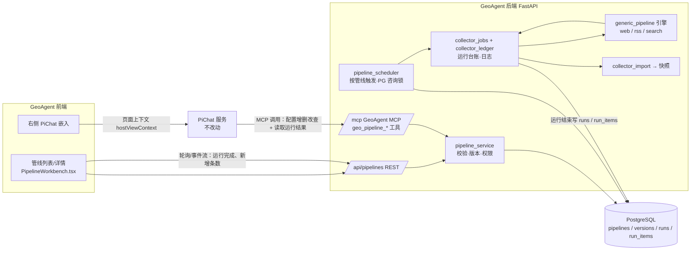
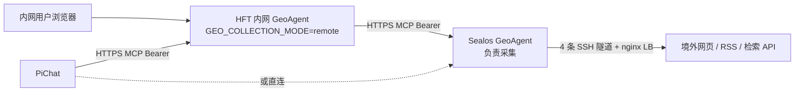

# 采集管线自定义配置设计

> 状态：设计稿（待确认），未实现。日期：2026-11-11。
> 关联：[多源地缘新闻采集器设计](2026-10-31-多源地缘新闻采集器设计.md)、[远端采集与快照镜像设计](2026-11-05-远端采集与快照镜像设计.md)、[用户管理](../../用户管理.md)

## 1. 背景与现状

地缘议题变化快，现在每加一个来源或关键词都要改代码、改 `config.json`、发版。现状盘点：

| 现有能力 | 位置 | 对本需求的意义 |
| --- | --- | --- |
| 25 个代码型采集器注册表 | `collectors/collectors.json` | **已有列表**，但只有 id/名称/主题/入口/启用，无来源、关键词、调度；增删要改代码 |
| 采集调度 | `backend/collector_config.py` | 全局一个间隔 + 排除列表，由 launchd / Windows 计划任务整批执行，**不能按管线单独调度** |
| 通用网页采集引擎 | `collectors/geopolitical-source-monitor/` | 已具备“入口页 → 发现候选 → 允许域名 → 主题锚词/分类词/排除词过滤 → geo-v6 输出”，是配置化的最佳起点；**不支持 RSS、不支持关键词检索源**，主题写死 `usiran`/`ukraine` |
| 采集监控页 | `src/CollectorMonitor.tsx` + `/api/collector/*` | 运行状态、日志、补采已具备，可复用 |
| GeoAgent MCP | `backend/geo_mcp/server.py`（`/mcp`，Bearer Key） | PiChat 已在用；有 `geo_collector_status`、`geo_collect_request`，**没有管线增删改查** |
| PiChat 右侧嵌入 | `research-dock` + `hostViewContext` + `/api/v1/embed/identity` | 左内容右 PiChat 的布局和“页面上下文传给 PiChat”已存在 |
| PiChat 推送 | pi-chat-server | **没有服务端推送消息的接口**：`/api/notifications` 只有用户自己读/标已读，`/api/v1/embed/*` 只有 identity 和 mcp-session |
| 远端采集 | `backend/remote_collection.py` | 内网无出境，由 Sealos 经 MCP 代采；配置放哪一侧必须设计清楚 |

结论：现有“列表”只是代码采集器注册表，不满足“页面配置网页/RSS/关键词”。需要新增一层 **可配置管线（Pipeline）**，与代码采集器并存。

## 2. 目标与不做事项

目标：

1. 页面上可新增、编辑、停用、删除采集管线，每条管线可配置：网页入口、RSS/Atom、关键词检索、过滤词、主题、调度。
2. 左侧管线列表 + 详情，右侧 PiChat；PiChat 通过 MCP 能完成同样的增删改查、试跑和立即执行。
3. 每条管线有自己的定时；一次运行完成后，左侧列表立即标出新增结果，PiChat 可经 MCP 读取并解读本次结果。
4. 配置有版本，可追溯谁改了什么，可回滚。

不做（本期）：

- 不改写 25 个代码型采集器的内部逻辑；它们进入统一列表，但只开放启停、调度设置，不开放来源编辑（它们的解析规则是代码）。
- 不做需要登录、付费墙、验证码的站点；遵守现有 `content_policy`（`public_fulltext` / `metadata_only`）。
- 不做任意 JS 渲染爬虫（Playwright）；后续按需单独立项。
- 不新增看板主题。新主题如何进入风险面板、情景研判属于另一个需求（见 §14 决策 D3）。
- 不向 PiChat 主动推送消息，不改 pi-chat-server。结果采用“左侧展示 + PiChat 经 MCP 拉取”，理由与后续扩展见 §10。

## 3. 核心概念

```
采集管线 Pipeline
├── 基本信息：名称、说明、所属主题、负责人、启用状态
├── 来源 sources[]（三种类型，可混合）
│   ├── web     网页列表页：entry_urls、allowed_hosts、链接选择规则（可选）
│   ├── rss     RSS/Atom：feed_url
│   └── search  关键词检索：provider + query（如 Google News RSS、GDELT DOC API）
├── 过滤规则 filters
│   ├── include_any   命中任一即候选（锚词）
│   ├── include_strong 强锚词（单独命中即入选）
│   ├── exclude       排除词
│   ├── languages / lookback_days / 每源上限
└── 调度 schedule：间隔或每日固定时刻、时区、超时
```

关键词有两种用途，在页面上分开表达，避免混淆：

- **过滤关键词**：作用于 web/rss 抓回来的内容，决定是否入选（沿用 `filtering.py` 的 `_phrase_hit` 规则：英文按词边界、中文子串、NFKC 归一）。
- **检索关键词**：作为 `search` 源的查询语句，主动去检索平台找新内容。

代码型采集器在列表中显示为 `kind=builtin`，配置化管线为 `kind=configurable`，同一列表、同一状态模型。

## 4. 架构

### 4.1 架构拓扑（逻辑）



要点：

- REST 和 MCP 共用同一个 `pipeline_service`，保证页面和 PiChat 的校验、权限、版本行为完全一致。
- 配置化管线不再“每条一个 Python 目录”，而是统一由 `generic_pipeline` 引擎按数据库配置执行；引擎从 `geopolitical-source-monitor` 抽出（`web.py` 的发现/抓取、`filtering.py` 的过滤），新增 RSS 与 search 适配器。原采集器改为“引擎 + 一份内置配置”，行为不变。
- 运行仍走 `collector_jobs` + `collector_ledger`，采集监控页、日志脱敏、错误分类（`ERROR_GUIDANCE`）全部复用。

### 4.2 网络拓扑（含远端采集）



**配置归属规则**：管线配置只存在于实际执行采集的实例上。

- `local` 模式：配置存本地 PostgreSQL。
- `remote` 模式（HFT 内网）：内网页面的 `/api/pipelines` 不读本地表，而是经已有的远端 MCP 通道调用 Sealos 的 `geo_pipeline_*` 工具（与 PiChat 用的是同一组工具），结果镜像回来照常进入内网快照。这样不会出现两边配置漂移。
- 运行结果（`runs` 与 `run_items`）同样以 Sealos 为准，内网页面和内网 PiChat 经同一 MCP 通道读取，不需要额外推送链路。

## 5. 数据设计（PostgreSQL）

按 `database-schema-standard` 实施：所有表含六个公共字段（`created_by`、`created_at`、`updated_by`、`updated_at`、`data_timestamp`、`is_deleted`），全部表与字段写中文 `COMMENT`，并同步 `docs/database/data-dictionary.md`。下表只列业务字段。

### 5.1 `collection_pipelines` 管线当前态

| 字段 | 类型 | 说明 |
| --- | --- | --- |
| id | text PK | 管线标识，`[a-z0-9-]{3,64}`；`builtin` 管线沿用注册表 id |
| kind | text | `configurable` / `builtin` |
| name | text | 中文名称 |
| description | text | 用途说明 |
| topic | text | 所属主题，必须是已注册主题（当前 `usiran`/`ukraine`，见 D3） |
| enabled | boolean | 是否参与调度 |
| current_version | int | 指向 `collection_pipeline_versions.version` |
| daily_times | text[] | 每日固定运行时刻 `HH:MM`（与 `interval_sec` 二选一；一期不引入 cron 依赖） |
| interval_sec | int | 间隔秒数，60 ~ 604800，沿用 `collector_config` 边界 |
| timezone | text | 默认 `Asia/Shanghai` |
| next_run_at | timestamptz | 调度器计算的下一次运行时间 |
| last_run_id / last_status / last_finished_at | text / text / timestamptz | 列表展示用的最近运行投影 |
| owner | text | 负责人账号 |

索引：`(enabled, next_run_at) WHERE NOT is_deleted`（调度扫描）；活动记录 `name` 唯一：`UNIQUE (name) WHERE NOT is_deleted`。
删除策略：逻辑删除，`enabled` 置 false；历史运行、新增条目与去重台账保留（防重证据）。

### 5.2 `collection_pipeline_versions` 配置版本（只追加）

| 字段 | 类型 | 说明 |
| --- | --- | --- |
| pipeline_id + version | PK | 版本号单调递增 |
| config | jsonb | 完整配置快照（sources / filters / request），带 `schema_version: "pipeline/1"` |
| change_note | text | 变更说明；PiChat 修改时写入“经 PiChat：<用户原话摘要>” |
| source_channel | text | `web` / `mcp` / `migration` |

编辑永远产生新版本；回滚 = 用旧版本内容创建新版本。

### 5.3 `collection_pipeline_runs` 运行记录

| 字段 | 类型 | 说明 |
| --- | --- | --- |
| run_id | text PK | 与 `collector_ledger` 的 run id 一致 |
| pipeline_id / version | | 本次运行使用的配置版本 |
| trigger | text | `schedule` / `manual` / `mcp`（试跑不产生运行记录） |
| status | text | `queued` / `running` / `success` / `partial` / `failed` / `cancelled` |
| started_at / finished_at | timestamptz | |
| stats | jsonb | 每源请求数、候选数、入选数、新增数（相对历史去重）、错误码 |
| snapshot_id | text | 导入后产生的快照（若开启自动导入） |

`data_timestamp` 取运行开始时间。索引：`(pipeline_id, started_at DESC)`。

### 5.4 `pipeline_seen_items` 去重台账

`(pipeline_id, url_hash)` 唯一，记录首次看到时间。用于“本次新增”判断；不随软删除清理。

### 5.5 `collection_pipeline_run_items` 运行新增条目

| 字段 | 类型 | 说明 |
| --- | --- | --- |
| run_id + seq | PK | 本次运行内的序号 |
| pipeline_id | text | 冗余便于按管线查最近新增 |
| source_id / source_type | text | 来自哪个来源，`web` / `rss` / `search` |
| title / published_at / language | | 标题、源站发布时间、语种 |
| matched_terms | jsonb | 命中的锚词 / 强锚词 / 检索词 |
| dimension | text | 维度映射结果 |
| evidence_id | text | 导入快照后的证据 id，用于跳转证据详情与 `geo_evidence_get` |

只记录本次相对去重台账的新增条目，供左侧“本次新增”和 MCP 读取。`data_timestamp` 取源站发布时间，缺失时回退到采集时间并在数据字典注明。索引：`(pipeline_id, run_id)`。

## 6. 运行引擎

### 6.1 来源适配器

| 类型 | 实现 | 说明 |
| --- | --- | --- |
| web | 复用 `geopolitical-source-monitor/web.py` 的 `discover_candidates` + `fetch` | 新增可选 `link_include_pattern`（正则）帮助在列表页挑文章链接；强制 `allowed_hosts` |
| rss | 新增，`feedparser` 或标准库 XML 解析 | 取 title / link / published / summary；`content_policy=public_fulltext` 时再抓正文 |
| search | 新增 provider 插件 | 首批建议 `google_news_rss`（无需 Key）与 `gdelt_doc`（无需 Key）；需要 Key 的检索服务走环境变量，配置里只存变量名，与现有 `licensed_api_env` 一致 |

所有请求走现有出境代理与限速（`request.rate_limit_seconds` 等），单源失败只影响该源，整条管线标 `partial`。

### 6.2 处理流程

抓取 → 规范化（NFKC、去追踪参数、URL 规范化）→ 过滤（排除词优先，其次强锚词 / 锚词）→ 去重（`pipeline_seen_items`）→ 维度映射（沿用 `filtering.py` 的主题维度规则）→ 输出 geo-v6 → `collector_import` 进入快照。

### 6.3 校验（保存前）

- URL 必须 http(s)，host 必须落在该源 `allowed_hosts`；拒绝内网地址、回环、链路本地（防 SSRF，PiChat 可写配置后这是必须项）。
- 每条管线来源数、关键词数、每源页数有上限（建议 30 源 / 200 词 / 5 页）。
- 正则做编译与长度检查，禁止灾难性回溯写法（限制长度 + 超时执行）。
- 间隔不低于 600 秒；每日时刻最多 24 个。

### 6.4 试跑 preview

不落快照、不写去重台账和新增条目；只抓每源前 N 条，返回“命中哪些词、为什么被排除”。页面“试跑”按钮和 MCP `geo_pipeline_preview` 共用，用于新建管线时调关键词。

## 7. 调度

- 新增进程内调度器 `pipeline_scheduler`，随 FastAPI 启动（与 `start_remote_collection()` 同处）。每 30 秒扫描 `enabled AND next_run_at <= now()`。
- 多副本安全：每条管线运行前取 `pg_try_advisory_xact_lock(hash(pipeline_id))`，并用“同一管线已有 running 则跳过”保证不重入。
- 与现有整批调度的关系：现有 launchd / 计划任务批量执行保持不变（作为 builtin 采集器的兜底）；当某个 builtin 管线在新列表里设置了单独调度，就自动加入 `exclude_ids`，避免一天跑两遍。过渡期结束后整批调度可退役（见 D4）。
- 并发：全局同时运行管线数上限（默认 3），超过排队。
- 服务重启：沿用 `recover_interrupted_runs` 把中断的运行标为 `SERVICE_INTERRUPTED`，并重算 `next_run_at`。

## 8. MCP 工具（给 PiChat）

在 `backend/geo_mcp/server.py` 新增，走现有 Bearer 鉴权与审计（`geo_mcp/audit.py`）：

| 工具 | 只读 | 说明 |
| --- | --- | --- |
| `geo_pipeline_list` | 是 | 分页列出管线，可按主题、状态、类型、关键词筛选；返回最近运行状态 |
| `geo_pipeline_get` | 是 | 读取当前配置、版本号、调度设置 |
| `geo_pipeline_versions` | 是 | 版本历史与差异 |
| `geo_pipeline_runs` | 是 | 最近运行与每源统计、错误码说明；可按 `since` 只取某时间后完成的运行 |
| `geo_pipeline_run_items` | 是 | 读取某次运行（缺省为最近一次）的新增条目，分页；正文再用 `geo_evidence_get` |
| `geo_pipeline_recent_results` | 是 | 跨管线汇总“最近 N 小时哪些管线有新增、各多少条”，回答“最近采到了什么” |
| `geo_pipeline_preview` | 是 | 试跑，不落库 |
| `geo_pipeline_create` | 否 | 新建（默认 `enabled=false`，需显式启用） |
| `geo_pipeline_update` | 否 | 局部修改（JSON Merge Patch），必须带 `expected_version` 做乐观锁 |
| `geo_pipeline_set_enabled` | 否 | 启用 / 停用 |
| `geo_pipeline_delete` | 否 | 逻辑删除 |
| `geo_pipeline_rollback` | 否 | 回滚到指定版本（生成新版本） |
| `geo_pipeline_run` | 否 | 立即执行一次 |

设计约束：

- **权限**：写工具需要新的 Key 范围 `pipeline:write`。现有 MCP Key 默认只读，管理员在集成设置里给 PiChat 的 Key 勾选；嵌入用户的 PiChat 身份映射回 GeoAgent 账号，普通用户只能改自己 owner 的管线，管理员可改全部（D2）。
- **防误操作**：写工具使用 `destructiveHint=true`；`create`/`update` 支持 `dry_run=true` 返回校验结果和差异，PiChat 侧提示词要求“先 dry_run 展示差异，用户确认后再提交”。
- **可追溯**：每次写入记录 `source_channel=mcp`、调用的 Key、PiChat 用户，进版本表。
- 第三方接入文档：新增 `docs/agent/geo-pipeline-mcp.md`，写入口、鉴权、每个工具的输入输出、错误码、限制与最小示例（按交付规范要求，对外服务必须有接入文档）。

## 9. 页面

新增 `src/PipelineWorkbench.tsx`，导航入口“采集管线”，沿用现有左内容 + 右 PiChat dock 布局，样式遵循 StockLink v4.5 设计系统。

- **左上**：筛选（主题、状态、类型、搜索）、“新建管线”。
- **左中 列表**：名称、类型标签（配置 / 内置）、主题、来源数、调度、最近运行状态与时间、新增条数、启用开关。运行完成后该行显示“新增 N 条”标记，用户查看后消除（已读状态按用户存浏览器本地，不进库）；页面顶部汇总“最近 24 小时有新增的管线”。
- **左下 / 抽屉 详情**：分页签
  - 基本信息与调度
  - 来源（web / rss / search 三类卡片，可增删）
  - 关键词（过滤：锚词 / 强锚词 / 排除词标签输入；检索：查询语句）
  - 本次新增（最近一次运行的新增条目：标题、来源、发布时间、命中词、维度，点击进证据详情）
  - 版本历史（差异、回滚）
  - 运行记录（复用 `CollectorMonitor` 的日志与错误说明组件）
  - 底部按钮：试跑、保存、立即运行
- **右侧 PiChat**：通过 `hostViewContext` 把“当前页面=采集管线、选中管线 id、当前版本”传给 PiChat，用户可以直接说“给这条加上 Reuters 的 RSS”“把排除词加上体育”。PiChat 修改后，页面根据版本号变化自动刷新；运行完成同样靠这条通道更新列表（轮询 `GET /api/pipelines?changed_since=` 或现有事件流 `backend/events.py`）。

REST 接口（页面使用，与 MCP 同一 service）：

```
GET    /api/pipelines?topic=&status=&kind=&q=
POST   /api/pipelines
GET    /api/pipelines/{id}
PATCH  /api/pipelines/{id}          (If-Match: version)
DELETE /api/pipelines/{id}
POST   /api/pipelines/{id}/enable | /disable | /run | /preview | /rollback
GET    /api/pipelines/{id}/versions | /runs
GET    /api/pipelines/{id}/runs/{run_id}/items
```

## 10. 结果交付：左侧展示 + PiChat 拉取

### 10.1 决策

不做服务端主动推送，不改 pi-chat-server。采集结果的交付方式：

1. **左侧展示**：运行完成后列表标出“新增 N 条”，详情“本次新增”页签列出条目（§9）。
2. **PiChat 按需拉取**：用户在右侧问“霍尔木兹那条刚才采到了什么”“最近一天哪些管线有新东西”，PiChat 调 `geo_pipeline_recent_results` → `geo_pipeline_run_items` → `geo_evidence_get` 读取并解读（§8）。
3. **一键解读**（可选，见 D5）：详情页“让 PiChat 解读”按钮，把当前管线和运行标识随页面上下文交给 PiChat，用户只需发一句“解读一下”。

原因：pi-chat-server 没有服务端写入会话的接口（通知接口仅供用户读取 / 标已读，嵌入接口只有 identity 与 mcp-session）；现有 `hostViewContext` 通道只在用户下一句话时生效，页面不能让 PiChat 主动发言。用户在页面上时，拉取方式已能满足查看与解读，且不需要跨仓库改动、发件箱与重试机制。

### 10.2 MCP 读取结果的约束

- 返回内容只含标题、来源名称、发布时间、命中词、维度和 `evidence_id`；不在结果里拼接源站链接，正文通过已有证据工具读取，沿用其脱敏与核验状态说明。
- `geo_pipeline_recent_results` 默认窗口 24 小时，上限 7 天；每次最多返回 50 条管线汇总，避免撑爆 PiChat 上下文。
- 只读工具对所有持有 MCP Key 的调用方开放，与现有证据工具权限一致。

### 10.3 失去的能力与后续扩展

本方案下，用户不打开 GeoAgent 页面就不会收到新结果提醒，PiChat 里也不会自动形成采集播报时间线。若后续需要离线提醒，再单独立项：在 pi-chat-server 新增应用 Key 鉴权的推送接口（按 `productUserId` 写入固定会话 + 通知 + WebSocket），GeoAgent 侧加推送发件箱（幂等键 `pipeline:{run_id}:{recipient}`，指数退避重试）。`run_items` 已具备推送所需内容，届时无需改动采集与存储。

## 11. 迁移

1. 建表（迁移脚本 + 注释 + 数据字典）。
2. 把 `collectors.json` 25 个采集器导入为 `kind=builtin` 记录，调度沿用当前全局设置，`source_channel=migration`。
3. 把 `geopolitical-source-monitor/config.json` 的 20 个来源转换为第一条 `configurable` 管线“多源地缘新闻（配置版）”，与原采集器并跑一周比对输出（条数、去重后 URL 集合差异），一致后停用原采集器。
4. 回滚：功能开关 `GEO_PIPELINES_ENABLED=false` 时调度器不启动、页面隐藏，原整批调度不受影响。

## 12. 测试与验收用例（摘要）

| 编号 | 场景 | 预期 |
| --- | --- | --- |
| P-01 | 页面新建含 web+rss+search 的管线并试跑 | 每源返回候选与命中原因，不写快照、不写新增条目 |
| P-02 | 保存非法 URL（内网 IP、host 不在白名单） | 拒绝并给出中文原因 |
| P-03 | 两人同时编辑同一管线 | 后提交者收到版本冲突 409 |
| P-04 | PiChat 经 MCP dry_run 修改关键词 | 返回差异，不产生新版本 |
| P-05 | 只读 Key 调用写工具 | `GEO_SCOPE_DENIED` |
| P-06 | 普通用户改他人管线 | 拒绝；管理员允许 |
| P-07 | 定时到点，多副本同时扫描 | 只运行一次 |
| P-08 | 单源超时 | 管线 `partial`，其余来源结果正常导入 |
| P-09 | 运行完成有新增 | 不刷新页面，列表该行出现“新增 N 条”，详情“本次新增”与 `run_items` 一致 |
| P-10 | 在 PiChat 问“最近一天哪些管线有新东西” | PiChat 调 `geo_pipeline_recent_results`，回答的管线与条数与左侧一致 |
| P-11 | 再次运行无新内容 | 新增 0 条，不出现新增标记，`run_items` 为空 |
| P-12 | 回滚到旧版本 | 生成新版本，下次运行使用旧配置 |
| P-13 | remote 模式内网页面编辑 | 实际修改 Sealos 配置，内网不留本地副本 |
| P-14 | builtin 管线单独设置调度 | 自动排除出整批调度，不重复运行 |
| P-15 | 迁移后的多源管线与原采集器并跑 | URL 集合差异在可解释范围内 |

完整用例在实施计划阶段补齐前置条件、步骤与证据位置。

## 13. 分期

| 期 | 内容 | 产出 |
| --- | --- | --- |
| 一期 | 表结构、service、REST、列表与编辑页、web/rss 引擎、试跑、按管线调度、本次新增展示 | 页面可配置可运行，结果在左侧可见 |
| 二期 | MCP 配置与结果读取工具 + 权限范围 + 接入文档；PiChat 右侧联动 | PiChat 可增删改查并解读结果 |
| 三期 | search 源（Google News RSS / GDELT）、多源采集器迁移与退役整批调度 | |
| 后续（未排期） | PiChat 主动推送（§10.3） | 仅在需要离线提醒时立项 |

## 14. 待确认决策

| 编号 | 问题 | 建议默认 |
| --- | --- | --- |
| D1 | “关键词”是只做过滤，还是也要主动检索（Google News / GDELT 等） | 两者都做，检索放三期 |
| D2 | 谁能增删改：所有登录用户，还是仅管理员 | 普通用户只能改自己创建的，管理员全部 |
| D3 | 新管线能否引入新主题（如“台海”“印巴”），新主题是否要进风险面板 | 本期只能选现有主题或“未归类”（只进证据库与本次新增，不进面板） |
| D4 | 是否最终退役 launchd / 计划任务整批调度 | 过渡期并存，稳定后退役 |
| D5 | 是否做“让 PiChat 解读”一键按钮：需在页面上下文里加入管线与运行标识，现有 `geoagent-view/v1` 只有快照、主题、维度、日期，PiChat 侧会校验字段，可能需要 PiChat 小改 | 一二期不做，用户直接提问即可；先确认 PiChat 能否接受扩展字段再定 |

已取消：原 D5（推送发往哪个 PiChat）、D6（pi-chat-server 推送接口排期），因 §10 改为拉取方案。
