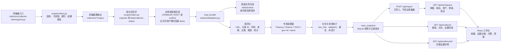

# 抓取后加工管线逻辑分析

更新时间：2026-10-01（Asia/Shanghai）  
仓库：`/Users/yujunjun/opensource/GeoAgent`

审计结论：本文描述的“抓取输出 → 导入快照”主链路与代码大体匹配，但它只覆盖数据基础层，不等于完整的数据业务分析。实际代码与 UI 的差异、业务分析链路和当前实查证据见[加工管线与业务分析审计](./加工管线与业务分析审计.md)。

本文说明采集器完成网络抓取后，数据如何进入应用、在哪些位置被转换或合并、失败如何传播，以及前端看到的“记录数量”与原始抓取数量之间的关系。

## 1. 一张图看完整链路



### 图中各层的含义

1. **采集器层**：只负责访问上游网站/API、解析来源并写出本采集器约定的文件。它不会直接把数据推送给浏览器。
2. **运行器层**：`scripts/collect.py` 从注册表选择启用的采集器，逐个启动独立子进程。生产入口默认串行；每个子进程有超时。成功时才把采集器源目录同步到统一运行目录，但成功、非零退出和超时都会写运行报告。当前多数采集器仍把输出固定写到 `collectors/*/output`，运行器注入的 `COLLECTOR_OUTPUT_ROOT` 尚未被它们普遍消费。
3. **运行输出层**：采集器实际先写 `collectors/<id>/output/`，成功后由运行器复制到 `data/collector-output/<id>/output/`。常见文件包括 `ALL-records.jsonl`、`LATEST-records.jsonl`、`geo-v6.json`、`_source_status.json` 和 `_fetch_stats.json`。
4. **读取与归档层**：`backend.paths` 决定应用读取哪个根目录；`load_bundle()` 读取文件前先按内容哈希归档到 `data/archive`，因此导入后的原始输入仍可回溯。
5. **规范化层**：`normalize()` 清理 URL、生成记录 ID、映射来源和时间字段并补默认值（时间字符串主要沿用上游值，未在此处统一时区或完成日期校验），按关键词产生主题与维度候选，并给地点标记“不等于实时部署”的不确定性角色。
6. **专用适配器层**：金融序列、TACO、`geo.v6/1` 扩展和研究报告有独立解析规则。扩展指标必须引用同一扩展文件中的记录，日期不能重复，数值必须是有限数或 `null`。
7. **合并层**：标准 JSONL 记录按清洗后的记录 ID 合并。合并时保留多个 `raw_refs`、`adapters`、主题和维度候选，并抑制重复的 `upstream_extractions`；正文使用较长版本。Treasury、finance、TACO 等专用适配器有直接写入路径，不应一概套用标准记录的重复计数。它是证据合并，不是把不同来源强行合成一个事实。
8. **快照层**：`save_snapshot()` 根据完整 payload 生成内容哈希，写入 `data/research.sqlite3` 的快照和记录版本。相同内容复用旧快照，内容变化生成新快照，旧快照不被覆盖。
9. **服务与展示层**：工作区接口同时计算主题覆盖、指标、资产和情景规则结果，并返回地图所需的轻量记录；证据接口负责搜索和分页；完整正文通过 `/api/evidence/{id}?snapshot_id=...` 按需读取。前端没有把全部原文一次性塞进地图列表。

## 2. 当前真实运行证据

本轮实际网络审计不是离线 `selftest`。审计结果保存于：

[真实采集审计报告](../../data/collection-runs/20260930T063210Z-live-audit/results.json)

19 个注册采集器的进程级结果为：

- 15 个退出码为 0 并产生可同步输出；
- `iran-domestic-monitor` 因 `KeyError: Million` 失败；
- `iran-escalation-monitor` 在 180 秒内超时；
- `mideast-monitor` 因报告渲染 `NameError: e` 失败；
- `taco-monitor` 因 `CO1` 数据源不可用、无代理而拒绝生成新 TACO 产物。

此外，退出码为 0 也不代表所有子来源都成功：

- `eu-domestic-monitor` 的 `telex-en` 返回 HTTP 403；
- `russia-domestic-monitor` 的 `iz` 返回 HTTP 403。

审计后的输出导入快照 `0b18ddf4468552d911eba06e`，实际统计为：

```text
records:          4384
sources:           338
observations:       70
projects:           15
raw_records:      4420
duplicates_merged: 204
invalid_records:     0
errors:              0
```

这里的 `projects: 15` 与本轮审计中 15 个成功产出、4 个失败结果相符；但 `projects` 是当前读取根目录的目录统计，失败采集器若已有旧输出仍可能计入，不能单凭数量证明失败采集器没有历史数据。

## 3. 失败如何影响后续层

### 3.1 采集器进程失败或超时

`scripts/collect.py` 对非零退出码和超时返回结果并继续处理后续选择项。成功时调用 `_sync_output()`；失败或超时时不调用，因此本轮失败输出不会被当作成功运行结果同步。

已有的旧运行输出不会自动删除。这会带来一个必须明确的边界：采集器失败后，应用仍可能读取旧输出，页面看起来有数据，但不代表本轮抓取成功。运行报告、`_source_status.json` 和快照时间必须一起检查。

### 3.2 单个来源失败

有些采集器会在部分来源失败后仍以退出码 0 结束。运行输出可能包含 `_source_health.json` 或 `_fetch_stats.json`，但 `backend/adapters.py` 统一解析的是 `_source_status.json`，没有该文件时才读取 `_fetch_stats.json`；`_source_health.json` 需要直接查原始输出，不能假定已进入 UI。因此需要同时看：

```text
采集器进程退出码
来源级 state / error / http_status
最终输出文件是否更新时间
导入快照的 sources / projects.failed_sources
```

本轮欧盟和俄罗斯采集器就是这种情况：进程成功，但各自仍有一个 HTTP 403 来源；该细节由 `_fetch_stats.json` 提供。

### 3.3 导入错误

`load_bundle()` 对逐行 JSON 解析和规范化中的 `ValueError`、`TypeError`、`AttributeError` 会增加 `invalid_records` 与 `errors`，继续处理其他记录；`KeyError`、`IndexError` 或状态文件解析异常不在这个逐行捕获范围内。当前这批导入的 `invalid_records=0`、`errors=0`。如果扩展协议、指标引用、坐标或字段校验触发不可恢复异常，`POST /api/import` 通常返回 422，`save_snapshot()` 不会保存这次失败导入；未被 `app.py` 捕获的异常仍可能表现为 500。

## 4. 是否会发生数据丢失

需要区分“没有进入当前展示列表”和“原始数据真的丢失”：

- **原始文件**：导入前按内容哈希写入 `data/archive`，正常导入时可以回源检查。
- **格式非法行**：不会进入记录集合，会计入 `invalid_records/errors`；原始文件仍在归档中。
- **重复记录**：对标准 JSONL 记录不会简单丢弃，`raw_refs`、采集器来源、主题候选和抽取信息会合并保留；专用指标/市场适配器走各自写入逻辑。本轮标准归并统计为 204。
- **采集失败**：本轮新输出不会同步，页面可能继续使用旧输出；这是新鲜度问题，也是最容易被误认为“采集成功”的地方。
- **来源级失败**：进程可能成功但部分来源没有数据，必须查看来源状态；退出码 0 不能作为完整覆盖证明。
- **只有 LATEST 文件**：当没有 `ALL-records.jsonl` 时，适配器会回退到 `LATEST-records.jsonl`，更早历史不会凭空补回。
- **前端工作区**：`/api/workspace` 使用轻量地图投影；正文和证据详情由 `/api/evidence` 分页、`/api/evidence/{id}` 按需读取。这是接口分层，不是删除原文。

因此，本轮快照可以确认“导入阶段没有发现非法记录”，但不能推出“19 个采集器、所有上游来源和所有历史记录都完整”。

## 5. 维护时的核对顺序

```bash
# 1. 查看采集器运行结果
.venv/bin/python scripts/collect.py --all --timeout 900

# 2. 查看应用实际读取根目录和快照
curl -s http://127.0.0.1:8000/api/status

# 3. 把已有运行输出导入不可变快照（此请求不会启动采集器）
curl -X POST http://127.0.0.1:8000/api/import

# 4. 检查清洗和导入统计
curl -s 'http://127.0.0.1:8000/api/workspace?snapshot_id=<快照ID>&topic=all'
```

`--verify-only` 只执行注册表提供的离线自检，不产生真实 Web 抓取结果，不能替代上面的实际运行链路。

## 6. 后续优化优先级

1. 修复 `iran-domestic-monitor` 的 `Million` 单位解析异常。
2. 修复 `mideast-monitor` 报告渲染中的变量名错误。
3. 为 `iran-escalation-monitor` 找出超时来源，并把来源级超时写入运行报告。
4. 为 `taco-monitor` 明确 CO1 的代理/数据源策略，区分“源不可用”和“整个 TACO 不应覆盖”。
5. 让统一运行报告汇总来源级失败，而不是只依赖采集器进程退出码。
6. 为采集输出增加 freshness 检查，避免旧输出在页面上看起来像本轮成功。
7. 当数据量继续增大时，再把当前内存线性搜索升级为 SQLite FTS5 或等价索引。
