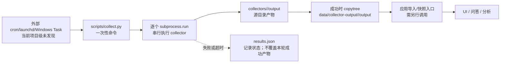

# 采集调度与技术审计

审计日期：2026-10-01  
审计范围：`collectors/`、`scripts/collect.py`、采集测试、仓库内调度说明，以及当前 macOS 主机上的 cron/launchd 注册状态。

## 2026-10-02 实现复审

本文件前面的结论是 2026-10-01 的历史基线。之后项目新增了统一采集服务，当前实际调度链已经变为：

```text
macOS LaunchAgent / Windows Task Scheduler
  -> scripts.collector_service
  -> 启动一轮 enabled 采集器
  -> 采集完成后等待 interval_sec
  -> 下一轮全量采集
```

当前 macOS 实例已安装并运行项目目录内的 LaunchAgent，实际参数为：

```text
.venv/bin/python -m scripts.collector_service \
  --interval-sec 86400 \
  --exclude-id taco-monitor \
  --auto-import
```

这意味着：

- `RunAtLoad`/`KeepAlive` 负责登录后启动、进程退出后拉起；真正的采集间隔由服务内部 `--interval-sec 86400` 控制。
- 服务启动后先执行一轮，完成后休眠 24 小时；它不是固定在每天某个墙上时刻执行。若本轮耗时 18 分钟，下一轮从本轮完成后再等待 24 小时。
- 当前一轮选择 `collectors/collectors.json` 中所有 `enabled=true` 的采集器，并临时排除 `taco-monitor`；没有按采集器分别计算 `08:30`、`19:30` 等计划。
- `--once` 只执行一轮，适合调试；`--id`、`--topic` 和 `--exclude-id` 用于限制一轮的范围。
- `--auto-import` 在完整采集和输出门禁通过后自动生成不可变快照；部分成功、空产物或导入失败会单独记录，不会伪装成成功快照。

仓库里个别 `config.json` 的 `schedule`、`cadence`、`time_local` 仍是采集器业务元数据或历史运行提示，当前统一服务不会读取它们来形成独立计划。macOS 当前安装、服务参数、日志和运行报告见 [`docs/2oA/2026-10-02-GeoAgent-本机采集服务安装与管理.md`](../2oA/2026-10-02-GeoAgent-本机采集服务安装与管理.md)；统一重构目标见 [`docs/plan/采集管线常驻化与监控重构方案.md`](../plan/采集管线常驻化与监控重构方案.md)。

### UI 配置和采集后续动作（2026-10-02）

管线监控页的 **调度配置** 已接入项目级配置 API。它调整的是服务的全局 `interval_sec`、排除列表和部分成功导入策略；保存后会更新 `data/service-config/collector-settings.json`，并在用户选择“保存并应用”时重载本机后台任务。它不会把各采集器 `config.json` 中的历史 `schedule` 字段解释成已生效的独立计划。

采集完成后的动作必须分层看：

1. 采集器返回成功并不等于可见数据；产物先写入 staging，通过输出门禁后才交换到 `data/collector-output`。
2. 常驻服务带 `--auto-import` 时，完整成功且门禁通过才自动导入不可变快照；部分成功、无产物、门禁失败和导入异常分别记录 `import_status`，不会覆盖上一份完整快照。
3. 顶部 **更新快照** 是人工调用 `/api/import`，只读取已经发布的采集产物，不会启动采集器。
4. 顶部 **生成简报** 是对当前选定快照调用 `/api/briefs` 的分析动作，生成两个主题的研究简报；它不是调度器的隐式后置步骤，默认需要用户单独触发。

因此，当前“采集 → 快照”已由常驻服务闭环；“快照 → 简报”仍是有意保留的人工分析步骤，便于先确认快照、筛选主题并留审计记录。

## 结论先行

1. 当前仓库没有发现一个“持续运行、按计划调度全部采集器、失败重试、成功后导入快照”的项目级调度器。
2. 现在存在的是三类分散的调度线索：采集器配置里的 `schedule` 元数据、README 中给人的 cron/WorkBuddy/任务计划说明，以及 TACO 的 Windows `schtasks` 安装脚本。它们不是一个统一运行中的服务。
3. `scripts/collect.py` 是一次性批处理入口：读取 19 个已启用采集器，按注册表顺序串行启动子进程；它不会自己循环，也不会把成功结果自动导入 SQLite/快照 API。
4. 当前采集技术以 Python 标准库直连 HTTP/RSS/XML/JSON/CSV 为主，`market-context-monitor` 使用 `httpx`。没有发现 Playwright、Selenium、Scrapy 或 BeautifulSoup 被用于正式采集。
5. 不建议把全部采集器改成 Agent Browser。对公开 RSS/API/CSV，直连更快、更可重放；浏览器应作为少数 JS 渲染、登录态或被直连拦截的来源的定向 fallback，并且必须保留源状态、原始响应和失败记录。

## 1. 现有实际执行链



图的含义是：目前“采集”和“业务可见”之间不是一个自动闭环。`scripts/collect.py` 成功时只负责把采集器自己的 `output/` 同步到统一数据目录；应用快照导入是后续独立动作。若没有外部调度器或人工命令，采集不会自行更新。

统一入口的关键行为：

- `select_collectors()` 只选择注册表中 `enabled` 的项目；当前注册表有 19 个。
- `run_collectors()` 对选中的采集器做串行列表执行，不是常驻 worker，也没有 interval/cron loop。
- `run_one()` 使用 `subprocess.run(..., timeout=...)`；返回码为 0 且不是自检模式时，才同步 `collectors/<id>/output`。
- 单个采集器失败不会阻止后续采集器继续执行；最终统一写入 `data/collection-runs/<UTC>/results.json`，并以是否所有返回码成功决定命令退出码。
- 超时或非 0 返回码不会触发统一重试，也不会清理旧的统一输出。因此“保留上次可用数据”与“本轮没有新数据”在业务层仍需要依赖运行报告和产物时间判断，不能只看目录是否存在。

## 2. 是否有定时任务

### 仓库内的调度线索

| 位置 | 看到的内容 | 是否等于项目级调度 |
|---|---|---|
| `collectors/*/config.json` | 个别采集器记录 `daily`、本地时间、时区或 `cron_hint` | 否；只是配置/建议 |
| `collectors/naval-monitor/README.md` | WorkBuddy 自动化或系统 cron 示例 | 否；要求运维者另行配置 |
| `collectors/defense-spend-monitor/README.md` | 说明由外部 scheduler 触发，Windows `run.bat` 可作为任务入口 | 否；程序本身不常驻 |
| `collectors/taco-monitor/install_task.bat` | 注册 Windows `taco-monitor-daily`，默认每日 09:10 | 仅 TACO、仅 Windows，且需手动执行安装 |
| `src/App.tsx` | `setInterval` 每 60 秒刷新翻译任务状态 | 否；这是 UI 状态轮询，不是抓取调度 |

例如：

- TACO 的 `install_task.bat` 确实调用 `schtasks /Create ... /SC DAILY`，但它只覆盖 `taco-monitor`，不是 19 个采集器的统一任务。
- `defense-spend-monitor/config.json` 明确写着“本程序自身不常驻，由外部调度器触发”。
- `iran-escalation-monitor` 的 `cron_hint` 是“每日 07:30 与 19:30”，属于建议文本。
- `naval-monitor` README 给出 cron 命令示例，说明的是如何由系统调度器启动脚本，而不是仓库已经安装了 cron。

### 当前机器的实证

本次审计在当前 macOS 主机做了只读检查：

- `crontab -l` 没有 GeoAgent/collector/crawler 任务；
- `~/Library/LaunchAgents` 和 `/Library/LaunchDaemons` 没有匹配 GeoAgent/collector/crawler/TACO/defense 的任务文件；
- `launchctl list` 没有匹配项目的服务。

所以截至本次审计，不能说“项目正在定时不断更新”。更准确的说法是：项目准备了若干外部调度接入说明，但当前没有被证明已经部署并运行的统一调度链。

## 3. 抓取技术盘点

正式采集器主要采用以下方式：

- RSS/XML：`urllib.request` 请求源站，`xml.etree.ElementTree` 解析 feed，再做时间窗、来源等级、关键词和主题桶过滤；
- HTML listing：标准库 HTTP 拉取列表页，使用 HTML/正则相关的轻量解析逻辑提取标题、链接和日期；
- JSON/API：标准库 HTTP 请求后解析 JSON，例如部分政府、市场和新闻接口；
- CSV：标准库或 `httpx` 拉取时间序列 CSV，再做数值校验、派生指标和历史累积；
- TACO：自带 `tacolib` 网络封装，带按 host 限速、重试、源状态和降级写入；
- UI 验收脚本里的 Playwright 只用于检查前端，不是正式采集链路。

依赖文件目前只有 `fastapi`、`uvicorn`、`httpx`、`pytest`，没有浏览器自动化或 Scrapy 依赖。由此可以确认：当前项目的采集基线是“直接取源 + 本地规则加工”，不是浏览器 Agent。

## 4. Agent Browser 是否更稳

不能笼统地认为更稳。稳定性取决于来源类型和可观测性：

| 来源类型 | 建议技术 | 原因 |
|---|---|---|
| RSS、公开 JSON API、CSV | 继续直连 HTTP | 请求快、成本低、结果容易保存和重放，字段契约更明确 |
| 静态 HTML 列表 | 直连 HTTP + 轻量解析 | 不依赖浏览器生命周期，部署简单 |
| JS 渲染后才出现的列表 | 定向 Browser fallback | 只有这类来源需要执行页面脚本 |
| 必须 cookies/登录态/交互才能读取 | 受控 Browser worker | 需要会话、等待和页面状态，但应隔离账号与权限 |
| 403/Cloudflare/Akamai 等拦截 | 先记录失败并切换已批准替代源；必要时再走 Browser | 浏览器不是绕过风控的保证，也不能替代合规的来源治理 |

浏览器全量化会新增 Chromium 依赖、页面等待、selector 漂移、弹窗、会话过期、资源消耗和 headless 检测等故障面。更重要的是，浏览器成功打开页面不等于抓到了完整数据；仍然要记录 HTTP/页面状态、源条目数、过滤数、输出文件、内容 hash 和导入结果。

推荐采用混合策略：在每个来源配置中显式标注 `transport: http|browser`；默认 HTTP；仅对已确认需要 JS/会话的来源启用 Browser；HTTP 返回 403、空壳页面或结构缺失时，进入有界超时的 Browser fallback；两条路径都写同一套 source health 和 raw/replay 证据。

## 5. 你之前建立的采集器测试覆盖到哪里

现有测试不是无效，反而已经覆盖了很重要的离线契约：

- `tests/collectors/test_registry.py` 检查 19 个注册项、入口文件、README、路径边界和 Python 语法；
- `tests/collectors/test_selftests.py` 按注册表逐个启动每个采集器的 `--selftest`，使用临时输出目录，不联网；
- `tests/test_collect_runner.py` 检查失败后继续执行、主题筛选和 Windows 安全输出；
- `tests/test_integrate_collectors.py` 检查源目录产物与统一运行输出的边界。

本次实际执行结果：

```text
.venv/bin/pytest -q tests/collectors tests/test_collect_runner.py tests/test_integrate_collectors.py
27 passed in 7.52s

.venv/bin/python scripts/collect.py --all --verify-only --timeout 240
19 个注册采集器 returncode=0
```

这能证明规则、解析器、自检样例和统一入口基本可运行；不能证明真实网页可达、代理可用、源站没有变更、抓到的数据足够新，也不能证明快照已经导入 UI。

仓库中保存的真实网络审计记录 `data/collection-runs/20260930T063210Z-live-audit/results.json` 也说明了这个边界：该次记录实际尝试 17 个采集器，17 个完成，其中 `iran-domestic-monitor`、`mideast-monitor` 返回 1，`iran-escalation-monitor` 超时，`taco-monitor` 返回 2；同时某些源在采集器进程仍返回 0 的情况下出现 HTTP 403。测试全绿与真实网络全绿不是同一个结论。

## 6. 项目真正缺的不是“再写一个爬虫”

要实现可持续更新，缺口主要在调度和运行账本：

1. 一个唯一的调度入口：按来源/采集器配置运行 `scripts/collect.py` 或单个采集器，避免每个 README 各写一套任务。
2. 作业账本：保存 job id、collector id、计划时间、开始/结束时间、退出码、超时、重试次数、源级状态、输出文件 hash/mtime、导入快照 id。
3. 重试和退避：网络超时、临时 5xx、代理失败可以有限重试；解析错误、配置错误、403 不应盲目重试成死循环。
4. 快照导入门禁：只有产物完整、schema 正确且源状态可解释时才导入；失败时保留上一快照，但 UI 必须显示“上次成功时间”和“本轮失败”，不能把旧数据伪装成实时数据。
5. 测试分层：
   - 离线 parser/selftest（现有）；
   - HTTP fixture/replay（固定响应，验证字段和去重）；
   - 每个来源的 live smoke probe（只确认可达、状态码、条目数和最小字段）；
   - 调度器集成测试（失败、超时、重试、锁、导入）；
   - UI freshness/数据来源验收。
6. Browser fallback 只作为 transport 层能力接入，不能把调度、失败记录和数据完整性责任交给 Agent Browser。

## 7. 可复核命令

```bash
cd /Users/yujunjun/opensource/GeoAgent

# 查看 19 个注册采集器
.venv/bin/python scripts/collect.py --list

# 离线测试与自检
.venv/bin/pytest -q tests/collectors tests/test_collect_runner.py tests/test_integrate_collectors.py
.venv/bin/python scripts/collect.py --all --verify-only --timeout 240

# 只读检查当前 macOS 是否有外部调度
crontab -l
launchctl list | rg -i 'geoagent|collector|crawler|taco|defense'

# 真实网络运行（会访问上游并写 output；建议先单个采集器）
.venv/bin/python scripts/collect.py --id xinhua-monitor --timeout 180
```

本次审计没有注册或修改任何系统定时任务，也没有把 Browser 自动化加入正式采集链；下一步应先确定统一调度器和作业/导入状态契约，再选择需要 Browser fallback 的具体来源。
